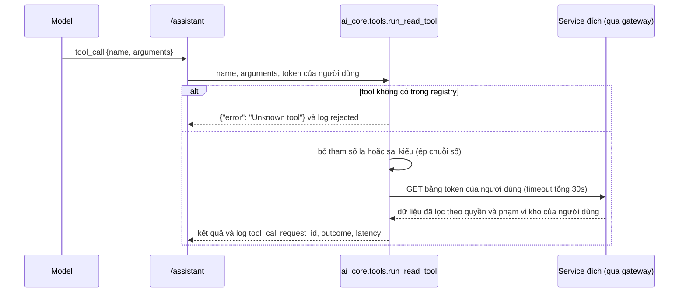
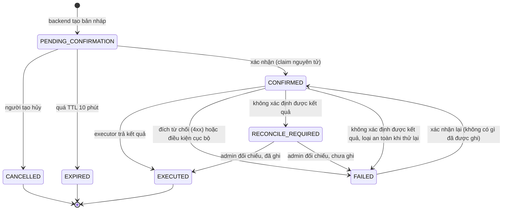

# Vòng đời action AI và luồng thực thi tool

> Cập nhật 2026-11-12. Code: `agent_actions.py`, `agent_store.py`, `agent_executor.py`, `action_guard.py`, `agent_permissions.py`, `main.py` (`confirm_action`, `_execute_claimed_action`, `reconcile_action`), `ai_core/tools.py`. Test: `test_action_lifecycle.py`, `test_reservation_actions.py`, `test_agent_store.py`, `test_copilot_security.py`.

## Hai loại thao tác

| Loại | Ai quyết định chạy | Ví dụ |
|---|---|---|
| **READ** — tool đọc | Model được gọi trực tiếp | `get_dashboard_kpis`, `compare_warehouses`, `search_books` |
| **DRAFT_THEN_CONFIRM** — hành động ghi | Backend tạo bản nháp; **người** có quyền xác nhận; chỉ khi đó executor mới gọi service đích | `CREATE_REORDER_DRAFT`, `CREATE_STOCK_ALERT`, `CREATE_STAFF_TASK_DRAFT`, `CREATE_RESERVATION_DRAFT`, `CREATE_REPORT_DRAFT` |
| **FORBIDDEN** | Không bao giờ | `DANGEROUS_ACTION_DENYLIST`: xóa sách/người dùng, đổi role, chỉnh tồn kho trực tiếp, thu phạt, duyệt PO, post phiếu nhập, SQL thô |

Model không bao giờ thấy hay gọi được một hành động ghi: danh sách tool gửi cho model chỉ gồm tool đọc (test `test_no_write_or_forbidden_action_is_exposed_to_the_model`).

## Luồng thực thi tool đọc

Quyền của tool đọc do **service đích** quyết định: tool gửi token của người dùng, nên analytics/inventory áp đúng quyền và phạm vi kho của người đó. Model không thể đọc rộng hơn người đang hỏi.

## Máy trạng thái của action

Mọi chuyển trạng thái là UPDATE có điều kiện trên trạng thái hiện tại (`agent_store._finish_execution`, `mark_action_confirmed`, `cancel_pending_action`), nên một trạng thái kết thúc không bị ghi đè và hai request không cùng thực thi một action. Mỗi chuyển đều ghi `ai_action_audit_logs` (người thực hiện, trạng thái cũ/mới, lỗi hoặc tóm tắt kết quả).

### Phân loại kết quả thực thi

| Tình huống | Ví dụ | Trạng thái | Phản hồi | Lý do |
|---|---|---|---|---|
| Executor trả kết quả | Tạo reservation 201 | `EXECUTED` | 200 | |
| Đích từ chối | 400/403/409/422 (hết hàng, thiếu quyền) | `FAILED` | lỗi gốc | Đích từ chối nghĩa là chưa ghi gì, xác nhận lại là an toàn |
| Điều kiện cục bộ | Denylist, loại không biết | `FAILED` | 403/400 | Chưa gọi đích |
| Không xác định, loại không an toàn khi thử lại | Timeout, mất kết nối, 5xx khi tạo staff task; lỗi bất ngờ giữa chừng | `RECONCILE_REQUIRED` | 502 | Có thể đã ghi; không bao giờ tự thực thi lại |
| Không xác định, loại an toàn khi thử lại | Timeout khi tạo reservation | `FAILED` | 502 | Gửi lại cùng `Idempotency-Key: ai-reservation-<id>`, borrow-service trả bản ghi cũ |
| Kết quả nhiều dòng có dòng không xác định | Một số phiếu đề xuất nhập timeout | `RECONCILE_REQUIRED` | 200, `success: false` | Lưu kết quả từng dòng để đối chiếu |

Loại an toàn khi thử lại (`RETRY_SAFE_ACTIONS`): `CREATE_REPORT_DRAFT` (không ghi gì) và `CREATE_RESERVATION_DRAFT` (idempotent nhờ khóa). Đã xác minh trong code borrow-service: id reservation được dựng từ `Idempotency-Key`.

### Khi service khởi động lại giữa lúc thực thi

Action còn `CONFIRMED` lâu hơn `ACTION_STALE_CONFIRMED_SECONDS` (mặc định 900 giây) là của một lần chạy đã mất. `release_stale_confirmed_actions` chạy lúc khởi động và trước mỗi lần xác nhận: loại an toàn khi thử lại → `FAILED`, loại khác → `RECONCILE_REQUIRED`. Action vừa xác nhận chưa đủ thời gian không bị động tới.

### Đối chiếu thủ công

`POST /actions/reconcile` (chỉ ADMIN): sau khi kiểm tra service đích, admin đánh dấu `EXECUTED` (đã có bản ghi) hoặc `FAILED` (chưa có; người dùng có thể xác nhận lại), kèm ghi chú bắt buộc. Audit ghi sự kiện `RECONCILED`. `GET /actions/stats` trả số action đang chờ đối chiếu.

### Idempotency theo loại

| Loại | Service đích | Idempotency |
|---|---|---|
| `CREATE_RESERVATION_DRAFT` | borrow `/my/reservations`, `/borrow/reservations` | Có (`Idempotency-Key`) |
| `CREATE_REPORT_DRAFT` | không gọi đích | Không cần |
| `CREATE_REORDER_DRAFT` | inventory `/api/purchase-requests` | Không (đích không đọc khóa) → dòng không xác định sẽ cần đối chiếu |
| `CREATE_STOCK_ALERT` | inventory `/api/stock-alerts` | Đích tự bỏ qua cảnh báo trùng (HTTP 200) |
| `CREATE_STAFF_TASK_DRAFT` | inventory `/api/staff-tasks` | Không → cần đối chiếu khi không xác định |

Trong ai-service, claim nguyên tử `mark_action_confirmed` bảo đảm một action chỉ được thực thi một lần dù bấm hai lần hay hai tab (test `test_two_concurrent_confirms_execute_once`).

## Kiểm tra lúc xác nhận

Theo thứ tự trong `confirm_action`:

1. Có header Authorization; action tồn tại; chưa hủy; đã thực thi thì trả kết quả cũ; quá hạn thì 410.
2. Danh tính từ auth-service (fail-closed).
3. Chỉ người tạo (hoặc superuser) được xác nhận/hủy.
4. Chính sách xác nhận **hiện hành** của loại action (role **và** permission) — không dùng danh sách lưu trên action lúc tạo.
5. Phiên đăng nhập chưa xác minh được thu hồi (Redis lỗi) → 503, action giữ nguyên.
6. `override_payload` chỉ được sửa các trường hộp thoại cho phép (`action_guard.ALLOWED_OVERRIDES`); số lượng 1–1000; dòng phải là dòng đã đề xuất.
7. Phạm vi **ghi** kho hiện hành cho mọi kho mà action sẽ ghi vào (đề xuất nhập, cảnh báo tồn kho, staff task). Đặt chỗ không cần phạm vi kho (xem PERMISSION_MATRIX.md).
8. Claim nguyên tử rồi mới thực thi.

## Sự kiện realtime

Executor phát `ai_action:created|confirmed|executed|failed|cancelled` tới phòng `admin` và phòng của người tạo (`user:<id>`), qua `/internal/push-events` của gateway (khóa nội bộ, danh sách sự kiện cho phép). Trường hợp chờ đối chiếu phát `ai_action:failed` kèm `reconcile_required: true`.
