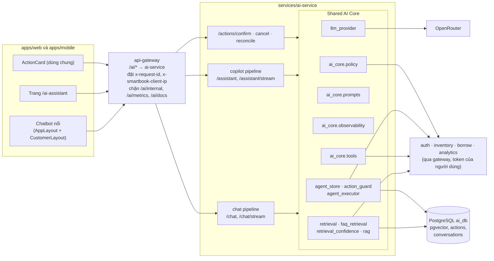
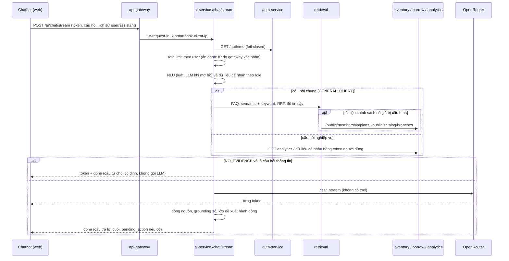
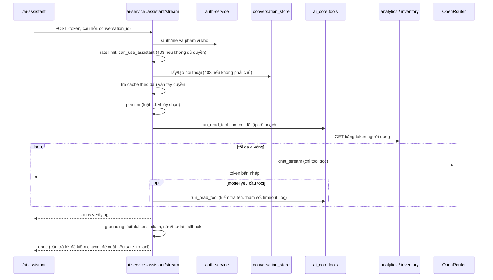

# Kiến trúc AI của SmartBook

> Cập nhật 2026-11-12, branch `hungg`. Mô tả đúng code đang có trong `services/ai-service`, `apps/api-gateway` và `apps/web`. Những gì chưa triển khai được ghi rõ ở mục cuối.

SmartBook có **hai trải nghiệm AI** chạy trong **một service** (`ai-service`, FastAPI, một process uvicorn). Hai trải nghiệm dùng chung một tầng lõi (Shared AI Core) nhưng giữ riêng cách điều phối, prompt, hội thoại, cache và cổng truy cập.

| | General AI Chatbot | AI Decision Assistant |
|---|---|---|
| Người dùng | Bạn đọc (cổng `/customer`), thủ thư, nhân viên kho (chatbot nổi) | ADMIN, WAREHOUSE_MANAGER có quyền analytics (trang `/ai-assistant`) |
| Endpoint | `POST /chat`, `POST /chat/stream` | `POST /assistant`, `POST /assistant/stream` |
| Cổng truy cập | Mọi người dùng đã đăng nhập (và khách ẩn danh: chỉ FAQ/danh mục) | `can_use_assistant`: role quản lý **và** quyền analytics (giống `canAccess` của web) |
| Điều phối | NLU → dữ liệu cá nhân → truy xuất (RAG FAQ hoặc API nghiệp vụ) → **một** lần gọi LLM (stream token) → grounding số → lớp đề xuất hành động | Planner → tool đọc song song (vòng lặp tool tối đa 4 vòng) → giải thích/biểu đồ → kiểm chứng (grounding, faithfulness, claim) → sửa/thử lại một lần → đề xuất hành động nếu `safe_to_act` |
| Bộ nhớ hội thoại | Lịch sử do client gửi (localStorage, chỉ role user/assistant) | `conversation_store` trong PostgreSQL, kiểm tra chủ sở hữu |
| Cache | `response_cache` 5 phút, khóa theo token + câu hỏi | `assistant_response_cache` 60 giây, khóa theo hội thoại + dấu vân tay quyền/phạm vi kho |
| Hành động | 5 loại (đặt chỗ, cảnh báo tồn kho, staff task, đề xuất nhập, báo cáo) | Đề xuất nhập (reorder) |

## Sơ đồ thành phần

## Luồng General AI Chatbot (`/chat/stream`)

## Luồng AI Decision Assistant (`/assistant/stream`)

## Shared AI Core

| Module | Trách nhiệm | Được dùng bởi |
|---|---|---|
| `llm_provider.py` | Provider OpenRouter: model theo use case (`TEXT_MODEL`, `ASSISTANT_MODEL`, vision), retry một lần, model dự phòng, stream, đếm token, metric Prometheus, log có `request_id` | chatbot, assistant, NLU, planner, OCR |
| `ai_core/prompts.py` | Prompt có tên và phiên bản (sha256 8 ký tự): `chat.system`, `chat.role_rules`, `chat.rag_rules`, `chat.abstention_reply`, `assistant.system`, `nlu.classifier`. Hai trải nghiệm không dùng chung system prompt. `/health` trả `prompt_versions` | chatbot (định nghĩa tại đây), assistant/NLU/RAG (đăng ký) |
| `retrieval.py`, `faq_retrieval.py`, `retrieval_confidence.py`, `rag.py` | Truy xuất lai, độ tin cậy, dữ liệu hiện hành cho tài liệu chính sách, quy tắc grounding/từ chối | chatbot (RAG), assistant (grounding số qua `rag.verify_numeric_grounding`) |
| `ai_core/policy.py` | Một bề mặt import cho mọi quyết định quyền: danh tính, khóa rate limit, cổng assistant, chính sách xác nhận action, phạm vi kho, kiểm tra override | chatbot, assistant, `/actions/*` |
| `ai_core/tools.py` | Registry tool: READ (model được gọi), DRAFT_THEN_CONFIRM (hành động), FORBIDDEN (denylist). `run_read_tool` là đường thực thi duy nhất cho tool model yêu cầu: kiểm tra tên, lọc/ép kiểu tham số theo schema, timeout tổng 30s, một dòng log audit | assistant (vòng lặp tool + fast path) |
| `ai_core/observability.py` | Middleware ASGI giữ `x-request-id` của gateway trong context; log LLM và tool có cùng id | toàn service |
| `agent_store.py`, `action_guard.py`, `agent_executor.py`, `agent_permissions.py` | Vòng đời action, kiểm tra override và phạm vi ghi kho, thực thi qua gateway với token người dùng | chatbot, assistant |

**Giữ riêng có chủ đích:** bộ điều phối của mỗi trải nghiệm, system prompt, nơi lưu hội thoại, cache, cổng truy cập, chuỗi kiểm chứng của assistant (`copilot_*`). Chatbot không có tool nào để model gọi (test `test_chat_llm_call_never_offers_tools`).

### Trước và sau đợt chỉnh sửa này

| Hạng mục | Trước | Sau |
|---|---|---|
| Rate limit | Chia sẻ một bucket theo IP của gateway | Theo user; ẩn danh theo IP do gateway xác nhận |
| `/chat` và `/chat/stream` | Hai bản sao ~180 dòng, lệch nhau | Một `_prepare_chat_turn` + `_finish_chat_reply` |
| Thực thi tool | Ba chỗ gọi trực tiếp `TOOL_FUNCTIONS` | `ai_core.tools.run_read_tool` |
| Prompt chatbot | Hằng số trong `main.py` | `ai_core/prompts.py`, có phiên bản |
| Quyền xác nhận action | Role **hoặc** permission, đọc danh sách lưu trên action | Chính sách theo loại (role **và** permission), đọc cấu hình hiện hành lúc xác nhận |
| Cổng assistant | Role hoặc permission (khác web) | Role và permission (giống web) |
| Log | Không có id liên kết | `request_id` từ gateway trên log LLM và tool |

## Thay đổi API (bổ sung, không phá hợp đồng cũ)

| Thay đổi | Ghi chú |
|---|---|
| `POST /actions/reconcile` (mới, admin) | `{action_id, outcome: EXECUTED\|FAILED, note}` |
| `POST /internal/corpus-sync` (mới, khóa nội bộ) | Gateway không mở `/ai/internal/*` |
| `POST /actions/confirm` | Có thể trả `status: RECONCILE_REQUIRED` (`success: false`) hoặc HTTP 502 khi không xác định được kết quả |
| `GET /actions/stats` | Thêm `reconcile_required` |
| `GET /health` | Thêm `prompt_versions` |
| Header phản hồi | `x-request-id` |
| `ChatMessage.role` | Chỉ `user` hoặc `assistant` (422 nếu khác) |

## Chưa triển khai

- Lịch sử chatbot vẫn do client giữ (localStorage); chưa lưu phía server.
- Rate limit và các cache nằm trong bộ nhớ một process; đủ cho cấu hình một instance hiện tại, chưa chia sẻ qua Redis.
- Chưa có reranking; chưa có trace phân tán ngoài `x-request-id`.
- Tách `main.py` (~6.000 dòng) thành nhiều router chưa làm.
