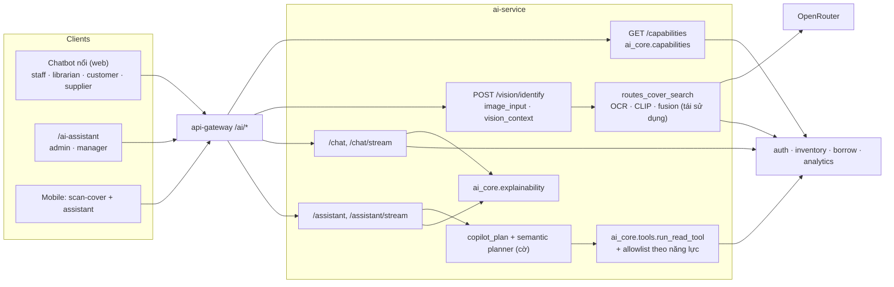

# Phase F — Kiến trúc SmartBook AI Copilot (role-aware, multimodal, explainable)

> Mô tả code sau Phase F trên `hungg` (chưa commit). Vẫn **một** `ai-service`, **một** database `ai_db`, **không** migration.
> Nguồn đối chiếu: `services/ai-service/{main.py, routes_ai_experience.py, ai_core/capabilities.py, ai_core/explainability.py,
> ai_core/tools.py, vision_context.py, image_input.py, user_personal_context.py, copilot_plan.py, copilot_semantic_planner.py,
> copilot_response.py}`, `apps/web/src/components/{ai-chatbot.tsx, ai-experience/*, pages/ai-assistant.tsx}`,
> `apps/mobile/app/customer/{scan-cover.tsx, assistant.tsx}`.

## 1. Trước và sau

| | Trước (HEAD 63c2fa8) | Sau Phase F |
|---|---|---|
| Quyền dữ liệu cá nhân của chatbot | theo **primary role** (`_ROLE_ENDPOINTS[role]`) | capability registry: hợp mọi role AND permission |
| Supplier | không có AI | chatbot trên `/supplier`, đọc đơn của chính mình |
| Gợi ý câu hỏi | hard-code theo primary role ở web | `GET /capabilities` sinh từ năng lực thực có |
| Tool assistant | cổng `can_use_assistant` | cổng giữ nguyên + allowlist tool theo năng lực (`ai_tools.CALLER`) |
| Ảnh trong hội thoại | không (chỉ trang quét bìa riêng) | `/vision/identify` + `attachment_id` trên chat/assistant |
| Nhận diện ảnh | luôn trả top-1 nếu có candidate; "khớp 82%" | IDENTIFIED / AMBIGUOUS / NO_MATCH, bằng chứng từng tín hiệu, không phần trăm |
| Bằng chứng chatbot | `context_sources` + một cảnh báo số | `explainability` claim-level, chung hợp đồng với assistant |
| Planner | "trong số đó" chỉ là nhãn; "chi nhánh Hà Nội" đoán kho; semantic planner OFF | danh sách lượt trước được mang theo; chi nhánh trùng tên → hỏi lại; semantic planner ON |
| Gọi OpenRouter khi bị 429 | retry ngay → thường lại 429; đường stream không retry | chờ theo `Retry-After` (≤ 2 s) rồi retry, cả đường stream |

## 2. Thành phần

## 3. Ranh giới bảo mật (giữ nguyên + bổ sung)

| Ranh giới | Cơ chế |
|---|---|
| Danh tính | `/auth/me` fail-closed cho mọi endpoint mới (401/503) |
| Quyền | registry chỉ thu hẹp; service đích kiểm tra lại bằng token người dùng; `can_use_assistant` không đổi |
| Ghi | không thêm đường ghi nào; action vẫn qua `ACTION_CONFIG` + xác nhận |
| Ảnh | chữ ký file thật, 8 MB, 40 MP, giải mã đầy đủ, re-encode bỏ EXIF, rate limit riêng, cần xác nhận thông báo, không lưu/không log |
| Ngữ cảnh ảnh | server-side, theo chủ sở hữu, TTL 30 phút; `book_id` phải là candidate đã xác minh |
| LLM | không chọn tool/endpoint/SQL; semantic planner vẫn không nhận câu ghi/cá nhân; cờ mặc định **ON** từ vòng 2 (tắt: `COPILOT_SEMANTIC_PLANNER=off`) |
| Cache | chat có ảnh không cache; assistant có ảnh không cache; khóa cũ giữ nguyên |

## 4. Luồng hội thoại nhiều lượt có ảnh (ví dụ yêu cầu)

1. Độc giả gửi ảnh + "Đây là sách gì? Thư viện còn không?" → `/vision/identify` (SSE trạng thái thật) → IDENTIFIED.
2. Client gửi câu hỏi tới `/chat/stream` với `attachment_id`, `book_id`, `image_turn=true` → server nạp lại tồn công khai theo chi nhánh, thêm khối ngữ cảnh ảnh vào prompt, bỏ qua abstention FAQ, trả `explainability` có bằng chứng IMAGE_RECOGNITION + public catalog.
3. "Sách này có được mượn nhiều không?" → cùng `attachment_id` → câu có tham chiếu → dùng lượt mượn công khai (độc giả) hoặc analytics (vai trò có quyền).
4. "Thư viện mở cửa mấy giờ?" → không tham chiếu → không dùng sách cũ.

## 5. Contextual reasoning

Planner luật: `entities.subset_items` (danh sách lượt trước) cho "trong số đó/những cuốn đó/các sách này", có loại trừ trường hợp danh sách
được hỏi ngay trong câu; "Những cuốn đó còn đủ tồn kho" sau một danh sách top → `analyze_demand_vs_stock`; top mượn trên danh sách lấy 50 dòng;
"kho kia" sau khi so sánh 2 kho và đã có kho được đánh giá → kho còn lại; "kho nào … hơn" vẫn giữ 2 kho khi kèm điều kiện top mượn;
"chi nhánh <thành phố>" khớp ≥ 2 chi nhánh → hỏi lại. Semantic planner: được đọc nghĩa các câu luật hỏi lại vì thiếu **chỉ số**
(không phải thiếu đối tượng) khi câu có ≥ 3 từ nội dung; động từ phân tích + kho/kỳ không còn bị coi là vế chưa hiểu.
Kết quả và quyết định cờ: `PHASE_F_BENCHMARK_REPORT.md` §2.

## 6. Không thay đổi

Endpoint cũ, schema DB, hợp đồng request/response cũ (chỉ thêm trường tùy chọn), sidebar/dashboard/design system, các trang ngoài AI
(ngoài một dòng gắn chatbot vào trang Supplier và một nút máy ảnh trong trợ lý mobile).
