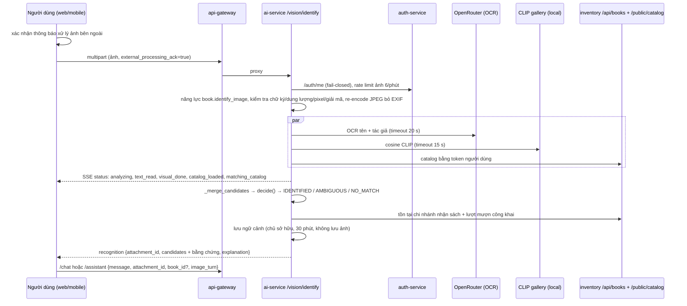

# Phase F — Multimodal: nhận diện sách từ ảnh bìa trong hội thoại

> Code: `routes_ai_experience.py` (`POST /vision/identify`, ngữ cảnh ảnh cho lượt sau), `image_input.py` (kiểm tra ảnh),
> `vision_context.py` (quyết định, giải thích, ngữ cảnh theo chủ sở hữu). Tái sử dụng nguyên `routes_cover_search`
> (`_run_cover_ocr`, `_match_visual`, `_fetch_catalog`, `_merge_candidates`) và `assistant_tools._score_and_rank_books`.
> Không có hệ thống CLIP/gallery/OCR thứ hai. Không ghi gì vào catalog.

## 1. Luồng

## 2. API

| Endpoint | Ghi chú |
|---|---|
| `POST /ai/vision/identify` (mới) | multipart `file`, `external_processing_ack` (thiếu → 428). `?stream=true` (mặc định, SSE) hoặc `?stream=false` (JSON — dùng cho mobile vì fetch của React Native không đọc stream). 401 ẩn danh/token thu hồi, 403 không có quyền đọc catalog (SUPPLIER), 413 quá 8 MB hoặc quá 40 MP, 415 không phải JPEG/PNG/WebP thật (gồm SVG), 400 ảnh hỏng/quá nhỏ, 429 vượt 6/phút–40/giờ |
| `POST /ai/chat`, `/chat/stream`, `/assistant`, `/assistant/stream` (mở rộng) | trường tùy chọn `attachment_id`, `book_id`, `image_turn`. Client cũ không đổi. Ảnh hết hạn/của người khác → 410; `book_id` không thuộc candidate đã xác minh → 400 |
| `POST /ai/find-book-by-cover` (giữ hợp đồng) | bổ sung chặn file không phải ảnh raster thật (SVG/HTML → 415) và > 8 MB (413); GIF vẫn nhận cho client cũ |

## 3. Bằng chứng của từng candidate

`rank`, `book_id`, `variant_id`, `title`, `authors`, `isbn`, `publisher`, `cover_image_url`, `match_basis` (BOTH_SIGNALS / TEXT_ONLY / VISUAL_ONLY),
`visual_similarity` (cosine CLIP), `text_match_score` (điểm khớp chữ của `_score_and_rank_books`), `ranking_score`, `ocr_title`, `ocr_author`,
`availability` (bản sẵn sàng theo chi nhánh nhận sách + lượt mượn công khai, kèm thời điểm truy xuất).
**Không** có trường xác suất. UI ghi "độ tương đồng ảnh 0,91" và ghi rõ không phải xác suất.

## 4. Luật quyết định (đặt trên split **dev** của bộ dữ liệu nghiên cứu)

| Kết quả | Điều kiện |
|---|---|
| IDENTIFIED | khớp chữ mạnh (≥ 0,9) và không đầu sách khác khớp chữ mạnh; hoặc chữ + hình cùng chỉ một sách; hoặc chỉ hình nhưng hơn sách thứ hai ≥ 0,10 |
| AMBIGUOUS | còn lại có candidate (khớp chữ yếu một mình, nhiều bìa giống nhau, nhiều tên khớp) → người dùng chọn |
| NO_MATCH | không candidate |

Trên dev: cả 9/9 ảnh sách **ngoài** thư viện chỉ có khớp chữ yếu 0,5 không có hình xác nhận; mọi ca sai chỉ-hình hơn sách thứ hai < 0,06.

## 5. Ngữ cảnh hội thoại

- Lưu phía server theo `user_id`, TTL 30 phút, tối đa 2.000 mục, **không lưu ảnh** (chỉ id/tên/tác giả/ISBN/NXB/cơ sở khớp). `shortcut:` dict trong một process (giống rate limiter); chuyển Redis khi chạy nhiều replica.
- Lượt sau chỉ dùng sách trong ảnh khi lượt đó tham chiếu tới nó: gửi kèm ảnh, đã chọn candidate, hoặc câu có "sách này / cuốn trong ảnh / đây là / nó…". Đổi chủ đề ("Thư viện mở cửa mấy giờ?") không kế thừa sách cũ (test + E2E).
- Assistant: tên sách đã xác minh được đưa cho planner dưới dạng tên trích dẫn, nên "sách này" dẫn tới cùng tool như khi gõ tên sách; câu trả lời không vào cache.
- Client chỉ giữ ảnh trong bộ nhớ (object URL); lịch sử chatbot trong localStorage chỉ có kết quả nhận diện, không có dữ liệu ảnh (kiểm bằng Playwright).

## 5b. Mobile

`app/customer/scan-cover.tsx`: chụp bằng camera (`PhotoCaptureModal`) hoặc chọn ảnh có sẵn (`expo-image-picker`, `launchImageLibraryAsync({ mediaTypes: ['images'] })`), gửi `/ai/vision/identify?stream=false`; hiển thị trạng thái bằng lời, cơ sở khớp, độ tương đồng (ghi rõ không phải xác suất), tồn theo chi nhánh, "Vì sao có kết quả này?". Trợ lý độc giả có nút máy ảnh mở màn này. Đã kiểm trên bản web của app (Playwright, 390 px); chưa thử trên thiết bị thật.

## 6. Fallback

OCR lỗi → chỉ dùng CLIP (`signals.ocr_status=error`); CLIP lỗi/timeout → chỉ dùng chữ (`visual_status=error|timeout`); catalog lỗi → NO_MATCH với
`catalog_status=unavailable`; tồn công khai lỗi → bỏ trường availability, câu trả lời nói "chưa có dữ liệu". Có test cho từng nhánh.

## 7. Quyền riêng tư

Thông báo trước lần chọn ảnh đầu tiên (web: hộp thoại; mobile: dòng chú thích dưới nút chụp); backend từ chối nếu thiếu xác nhận.
Ảnh được re-encode trước khi gửi OCR: bỏ EXIF (vị trí GPS, thiết bị), giữ đúng chiều. Không gửi JWT/hồ sơ người dùng kèm ảnh. Log chỉ có
trạng thái, số candidate, trạng thái tín hiệu — không có ảnh, không có văn bản OCR.

## 8. Kết quả đo

Xem `PHASE_F_BENCHMARK_REPORT.md` §3.
