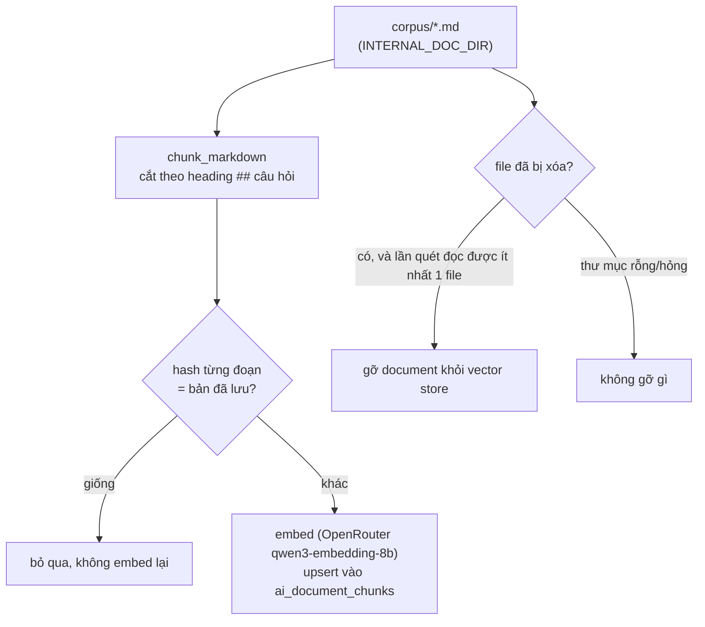

# RAG pipeline và nguồn tri thức

> Cập nhật 2026-11-12. Code: `ingestion.py`, `faq_retrieval.py`, `retrieval.py`, `retrieval_confidence.py`, `rag.py`, `corpus/*.md`. Eval: `eval/eval_rag.py`, `eval/calibrate_rag.py`, `eval/eval_chat_answers.py`.

## Ba loại tri thức

| Loại | Ví dụ | Nguồn sự thật | Cách chatbot lấy |
|---|---|---|---|
| **Tĩnh** | Quy trình mượn/trả, cách tính phạt, OTP, vai trò, quy trình kho, Luật Thư viện | `corpus/*.md` (22 tài liệu, 64 đoạn), review qua git | RAG: tìm lai semantic + keyword |
| **Động** | Tồn kho, phiếu mượn, đặt chỗ, khoản phạt hiện tại, số dư ví, nhiệm vụ | API nghiệp vụ (inventory, borrow, analytics) | Gọi API bằng token của người dùng mỗi lần hỏi; **không bao giờ** lấy từ tài liệu |
| **Lai** | Hạn mức từng hạng thẻ, mức phạt/ngày, địa chỉ và giờ mở cửa chi nhánh | Giá trị: API công khai (`/public/membership/plans`, `/public/catalog/branches`); giải thích: tài liệu | Khi tài liệu chính sách được tìm thấy, `retrieval._live_policy_data` đọc giá trị hiện hành và thêm khối `[DỮ LIỆU HIỆN HÀNH …]` kèm thời điểm đọc; quy tắc prompt: giá trị hiện hành thắng tài liệu, và phải nói khi hai nguồn khác nhau |

Ví dụ thực tế: tài liệu ghi địa chỉ chi nhánh Đà Nẵng "155 Nguyễn Văn Linh, Hải Châu"; dữ liệu hiện hành ghi thêm phường "Nam Dương". Câu trả lời dùng dữ liệu hiện hành.

Nếu đọc dữ liệu hiện hành thất bại, câu trả lời vẫn dùng tài liệu nhưng kèm cảnh báo "số liệu trong tài liệu có thể đã cũ" (trong `retrieval_warnings`).

## Nạp và đồng bộ tài liệu

- Kích hoạt: lúc khởi động (nền, không chặn startup) và **chủ động** qua `POST /internal/corpus-sync` (khóa nội bộ; chạy một lần tại một thời điểm). Mount thư mục tài liệu vào `INTERNAL_DOC_DIR` để sửa tài liệu không cần build lại image.
- Phiên bản/hash: hash = nội dung đoạn + model embedding + số chiều; đổi model thì mọi đoạn được embed lại, đoạn của model cũ bị xóa trước khi nạp.
- Log: `ingestion: docs N doc, X chunk embed, Y bo qua, Z go bo`; lỗi embed một tài liệu không làm hỏng phần đã nạp.
- Danh mục sách (BOOK_METADATA) đồng bộ riêng, định kỳ, từ feed nội bộ của inventory-service (`catalog_sync.py`).

## Truy xuất và độ tin cậy

1. Hai nhánh: semantic (cosine trên pgvector, ngưỡng 0,3) và keyword (full-text bỏ dấu), hợp nhất bằng Reciprocal Rank Fusion, lấy 3 kết quả.
2. `retrieval_confidence.evaluate` tính độ tin cậy 0..1 = 0,5 × semantic chuẩn hóa + 0,4 × hạng keyword + 0,1 nếu hai nhánh cùng xếp đầu:
   - `CONFIDENT_MATCH` ≥ 0,66; `UNCERTAIN` ≥ `tau_evidence`; còn lại `NO_EVIDENCE`.
   - INTERNAL_DOC `tau_evidence = 0,40`, BOOK_METADATA `0,25`.
   - **0,40 là trần cho INTERNAL_DOC**: một kết quả chỉ khớp keyword (khi embedding lỗi) đạt tối đa 0,40; ngưỡng cao hơn sẽ tắt hẳn nhánh dự phòng này (test `test_internal_doc_keyword_only_hit_can_still_pass_the_evidence_threshold`).
3. Quyết định:
   - `NO_EVIDENCE` + câu hỏi thông tin → trả câu từ chối cố định, không gọi LLM.
   - `UNCERTAIN` → tài liệu được gắn nhãn "gần giống, độ tin cậy chưa cao"; prompt yêu cầu chỉ dùng mục trả lời trực tiếp, nói "tài liệu chưa có thông tin về X" thay vì khẳng định "không hỗ trợ X", không tự đặt quy định; không tự gắn dòng nguồn; câu trả lời dự phòng chỉ nêu tên mục liên quan, không in nội dung.
   - `CONFIDENT_MATCH` → trả lời theo tài liệu, kèm dòng nguồn.

### Hiệu chỉnh ngưỡng

`calibrate_rag.py` chọn ngưỡng trên nửa `val` và báo kết quả trên nửa `test` riêng (chia bằng hash ổn định của id, không rò rỉ). Ứng viên hợp lệ phải giữ answerable Recall@5 trong khoảng 0,06 so với baseline **và** giữ nhánh dự phòng keyword. Không có ứng viên hợp lệ → `NO_VALID_CANDIDATE`, giữ nguyên production. Script chỉ ghi báo cáo, không bao giờ sửa `retrieval_confidence.py`. Báo cáo có Recall@5, answerable Recall@5, No-answer Accuracy, FPR, FNR, Coverage, Abstention Precision/Recall/F1.

## Grounding và tự từ chối

Quy tắc trong `rag.RAG_SYSTEM_RULES` (phiên bản ở `/health` → `prompt_versions["chat.rag_rules"]`):

- Không bịa số liệu; số liệu động chỉ từ dữ liệu hệ thống trong context.
- Giá trị hiện hành thắng tài liệu; khi hai nguồn khác nhau phải nói.
- Trả lời được một phần thì nói rõ phần nào chưa xác minh.
- Câu hỏi chứa thông tin sai so với context thì chỉ ra và nêu giá trị đúng.
- Không suy ra "thư viện không hỗ trợ X" từ việc thiếu thông tin.

Sau khi trả lời: `verify_numeric_grounding` cảnh báo mọi con số không khớp dữ liệu đã truy xuất.

Bạn đọc (CUSTOMER) không được xem analytics toàn hệ thống. Khi NLU xếp câu hỏi chính sách của họ vào một intent analytics (ví dụ "Phí phạt tính thế nào?" → `FINE_SUMMARY_QUERY`), chatbot vẫn tra **tài liệu** (không gửi token của họ tới analytics), còn dữ liệu cá nhân của họ đến từ ngữ cảnh cá nhân.

## Đánh giá

- Truy xuất: `eval/eval_rag.py` trên `eval/rag_dataset.json` (226 câu: 107 sách, 119 tài liệu nội bộ, 92 câu không có đáp án).
- Câu trả lời cuối: `eval/eval_chat_answers.py` trên `eval/chat_answer_dataset.json` (32 câu, 8 nhóm: đủ bằng chứng, một phần, không bằng chứng, thông tin sai, mâu thuẫn tài liệu, dữ liệu động, suy luận nhiều nguồn, tài liệu gần nghĩa). Chấm điểm xác định: sự kiện bắt buộc, cụm từ cấm, từ chối đúng/sai, trích dẫn đúng/đủ, cảnh báo grounding. Có trích dẫn không được coi là bằng chứng câu trả lời đúng.

Kết quả từng lần chạy: `services/ai-service/eval/reports/` và báo cáo tổng hợp `docs/AI/SMARTBOOK_AI_REMEDIATION_REPORT.md`.

### Kết quả gần nhất (2026-11-12)

| Chỉ số | Kho 10 tài liệu (trước) | Kho 22 tài liệu (sau) |
|---|---|---|
| INTERNAL_DOC — số câu | 77 | 119 |
| INTERNAL_DOC — Recall@1 / Recall@5 / MRR | 0,4416 / 0,4545 / 0,4481 | 0,605 / 0,6387 / 0,6218 |
| INTERNAL_DOC — No-answer Accuracy | 0,9762 (42 câu) | 0,70 (40 câu) |
| BOOK_METADATA — Recall@5 | 0,2175 | 0,2082 |

Báo cáo: `rag_20261112_102120.md` (trước, trong container), `rag_20261112_151714.md` (sau). Hiệu chỉnh `calibration_20261112_151704.md`: BOOK_METADATA → `NO_VALID_CANDIDATE` (giữ 0,25); INTERNAL_DOC: 0,35 và 0,40 bằng nhau trên tập calib, production giữ 0,40.

Kho tài liệu lớn hơn làm câu ngoài phạm vi dễ "gần giống" một tài liệu hơn (No-answer Accuracy giảm). Phần này được xử lý sau truy xuất (nhãn "độ tin cậy chưa cao" + quy tắc prompt), đo bằng eval câu trả lời:

| Chỉ số câu trả lời (32 câu, `chat_answers_20261112_155422`) | Kết quả |
|---|---|
| Câu trả lời đúng | 28/32 (0,875) |
| Từ chối đúng câu ngoài phạm vi | 0,875 |
| Từ chối nhầm câu có đáp án | 0,062 |
| Câu chứa khẳng định bị cấm (quy định bịa, "không hỗ trợ" sai) | 0 |
| Trích dẫn: precision / đủ | 0,639 / 0,9 |
| Có cảnh báo grounding số | 0,125 |
