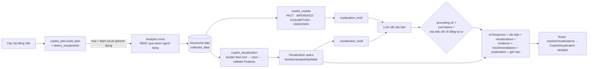
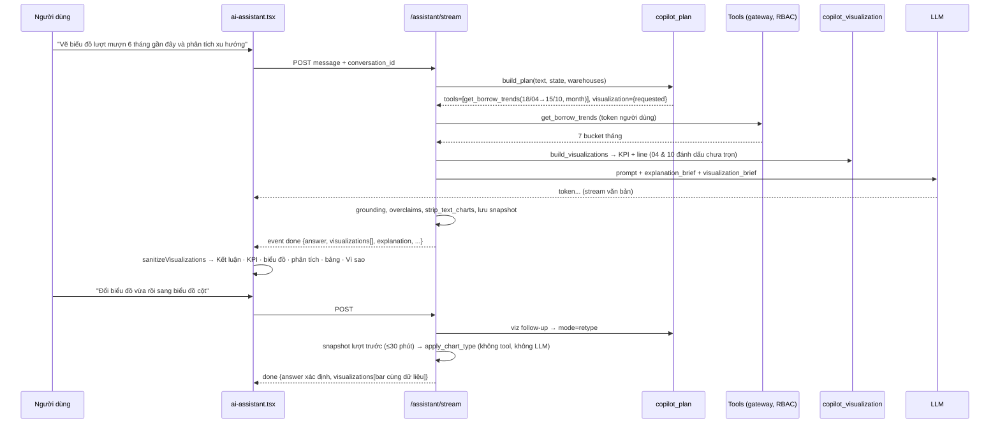
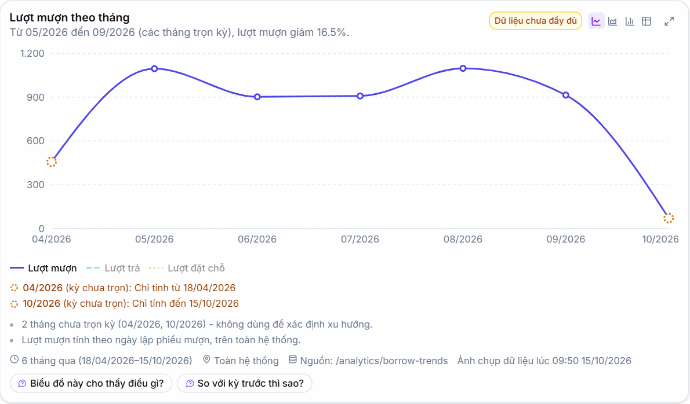
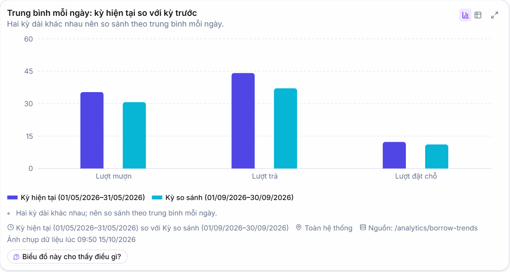
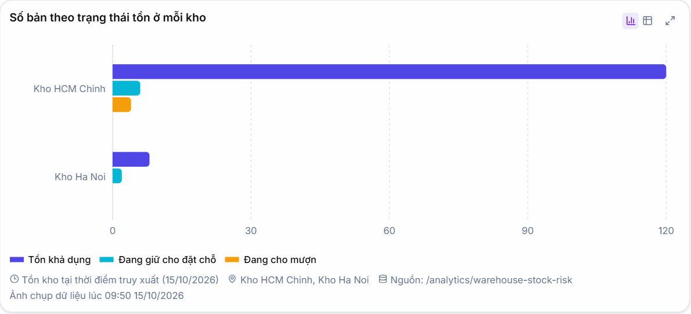
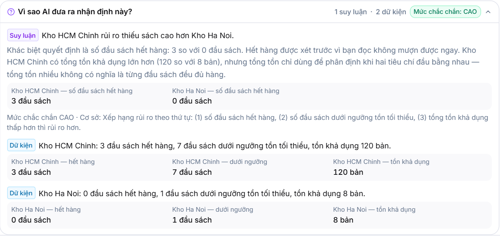
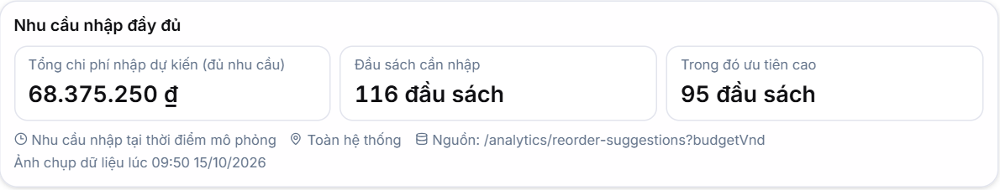
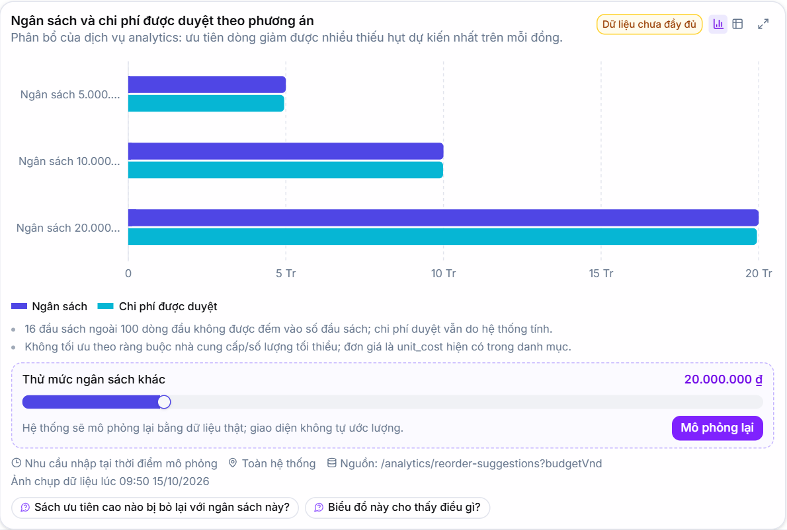
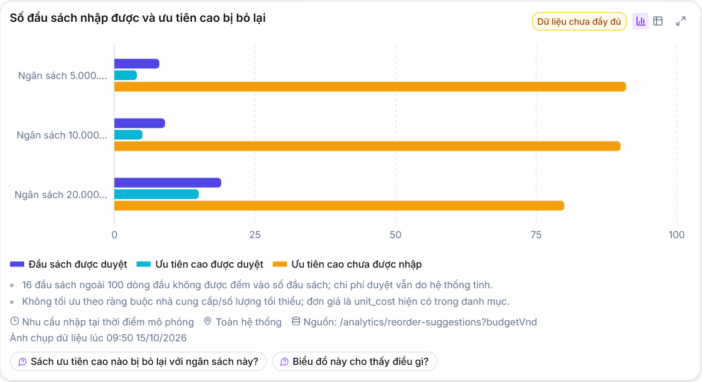
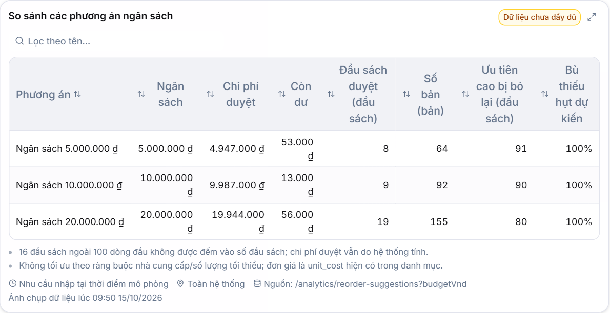

# SmartBook AI Copilot 3.0 — Interactive Data Visualization & Generative UI (2026-10-15)

Phạm vi: `/assistant` và `/assistant/stream` (trang **Trợ lý AI**, ADMIN/WAREHOUSE_MANAGER), nhánh `hungg` (nền: commit `9c31fde`, Explainable AI 2.0).
Không đổi model/nhà cung cấp LLM (`OPENROUTER_ASSISTANT_MODEL` = `qwen/qwen3.7-flash`), không đổi RBAC, không đổi luồng xác nhận thao tác ghi. API chỉ **thêm** hai trường tùy chọn `visualizations`, `visualization_notes` (và `plan.visualization`) — hội thoại cũ và client cũ không bị ảnh hưởng.

Mục lục: 1. Hiện trạng · 2. Kiến trúc Generative UI · 3. Luồng câu hỏi → biểu đồ · 4. Visualization schema · 5. Lựa chọn biểu đồ · 6. Tích hợp Explainable AI · 7. Bảo đảm nguồn gốc dữ liệu · 8. Kết quả kiểm thử · 9. Đánh giá thực nghiệm · 10. Hạn chế và hướng phát triển · Phụ lục.

---

## 1. Phân tích hiện trạng trước khi nâng cấp

Nguồn: đọc mã tại `9c31fde` (`copilot_plan.py`, `copilot_tools.py`, `copilot_response.py`, `copilot_explain.py`, `assistant_loop.py`, `main.py`, `routes_conversations.py`, `ai-assistant.tsx`, `ai-copilot-insights.tsx`, `services/ai.ts`, các trang `reports.tsx`, `dashboard/trend-funnel-section.tsx`).

| Khía cạnh | Hiện trạng (Copilot 2.0 + XAI 2.0) | Hệ quả |
|---|---|---|
| Hình thức trả lời | Chỉ văn bản Markdown nhẹ + thẻ đề xuất nhập hàng + panel "Vì sao AI đưa ra nhận định này?" + danh sách rủi ro/giới hạn. Prompt cấm bảng. | Câu hỏi xu hướng 6 tháng phải đọc 7 con số trong câu chữ; so sánh kho/ngân sách khó nhìn ra chênh lệch. |
| Biểu đồ | Recharts 2.15 đã có nhưng chỉ dùng ở Dashboard/Báo cáo, dữ liệu cố định theo trang. Trợ lý không có đường nào để trả dữ liệu dạng biểu đồ. | Người dùng hỏi "vẽ biểu đồ" → LLM trả lời "tôi không thể vẽ" hoặc tự vẽ bằng ký tự (đã quan sát thấy: khối `█████ 4.947.000 ₫`). |
| Planner | `"bieu do"` là từ khóa của năng lực **xu hướng mượn** → "biểu đồ tồn kho" bị hiểu thành câu hỏi lượt mượn. Không có khái niệm "đổi sang biểu đồ cột", "biểu đồ vừa rồi". | Câu tiếp nối về hình thức trình bày bị hiểu thành câu hỏi dữ liệu mới hoặc rơi về LLM tự chọn tool. |
| Dữ liệu nhiều công cụ | `seed_fast_path` gom kết quả bằng dict theo tên tool: hai lần gọi `explain_warehouse_shortage` (kho HCM, kho HN) → **lần sau ghi đè lần trước**. | Câu "Vì sao kho HCM rủi ro hơn kho Hà Nội?" chỉ còn dữ liệu của một kho trong `data`. (Đã sửa - mục 7.) |
| Bucket thời gian | `borrow-trends` theo tháng với khoảng "6 tháng gần đây" (18/04 → 15/10) cho tháng đầu và tháng cuối **chưa trọn**; không đâu đánh dấu. | Tháng 10/2026 (72 lượt sau 15 ngày) trông như "sụp đổ" nếu vẽ thẳng. |
| Lưu hội thoại | `metadata.extras` được lưu và trả lại khi mở hội thoại; dữ liệu tool lưu trong `ai_messages.data`. | Có sẵn chỗ để lưu snapshot biểu đồ — không cần đổi schema DB. |
| Điểm mạnh giữ nguyên | Planner xác định, tool tổng hợp tính trong code, grounding số + kiểm tra diễn đạt quá mức (XAI 2.0), RBAC qua token người dùng, `_finalize_assistant_turn` dùng chung cho hai endpoint. | Biểu đồ được gắn vào đúng các điểm dùng chung này. |

## 2. Kiến trúc Generative UI

Nguyên tắc: **LLM không bao giờ chọn số, chọn biểu đồ hay sinh mã giao diện.** Backend dựng một *đặc tả dữ liệu* (spec) đã kiểm tra từ kết quả tool; frontend chỉ có một danh sách component được phép (whitelist) để vẽ spec đó.



Thành phần mới / sửa:

| Tầng | File | Vai trò |
|---|---|---|
| Backend | `services/ai-service/copilot_visualization.py` (mới) | Schema Pydantic, 18 builder theo tool, quy tắc chọn biểu đồ, đổi kiểu biểu đồ, `visualization_brief`, `strip_text_charts`, `consistency_issues`. |
| Backend | `copilot_plan.py` | `detect_visualization`, follow-up biểu đồ (`retype`/`render`/`explain`), câu hỏi làm rõ, "lập bảng ≠ thao tác ghi", granularity tháng cho kỳ > 62 ngày, ngân sách nhiều mức = what-if, nhận kho "Hà Nội và HCM". |
| Backend | `copilot_explain.py` | `_x_borrow_trends` — giải thích xu hướng dùng **cùng hàm** với biểu đồ. |
| Backend | `copilot_response.py` | `build_extras` trả `visualizations`, `visualization_notes`, `explanation.chart_mismatches`; prompt cấm vẽ biểu đồ bằng ký tự. |
| Backend | `main.py` | Trường response mới, SSE `done` đi qua cùng response model, snapshot reuse (`_visualization_turn`, `_load_viz_snapshot`), `_viz_data`, không cache lượt follow-up biểu đồ. |
| Backend | `assistant_loop.py` | Sửa ghi đè kết quả khi hai lần gọi cùng một tool. |
| Frontend | `apps/web/src/lib/copilot-visualization.ts` (mới) | Kiểu TypeScript, `sanitizeVisualizations` (whitelist, số hữu hạn, giới hạn kích thước), định dạng `vi-VN`, sắp xếp/lọc bảng. |
| Frontend | `apps/web/src/components/ai-copilot-visualization.tsx` (mới) | `CopilotVisualization`, `CopilotLineChart`, `CopilotBarChart`, `CopilotAreaChart`, `CopilotPieChart`, `CopilotKpiCards`, `CopilotDataTable`, mô phỏng ngân sách. |
| Frontend | `ai-assistant.tsx`, `ai-copilot-insights.tsx`, `services/ai.ts`, `ui/slider.tsx` | Xen kẽ văn bản/biểu đồ, khôi phục từ lịch sử, nhãn truy cập cho thanh trượt. |

## 3. Sơ đồ xử lý câu hỏi đến biểu đồ



Trường hợp tiếp nối:

| Câu hỏi | `plan.visualization.mode` | Xử lý |
|---|---|---|
| "Đổi sang biểu đồ cột", "Vẽ lại bằng biểu đồ đường", "Hiển thị số liệu dưới dạng bảng" | `retype` | Dùng lại **snapshot** lượt trước (cùng dòng dữ liệu), chỉ đổi kiểu nếu dữ liệu cho phép; trả lời xác định, không gọi tool, không gọi LLM. Snapshot cũ hơn `VIZ_SNAPSHOT_MAX_AGE_SECONDS` (mặc định 1800 s) → chạy lại đúng các lời gọi tool do planner dựng ở lượt trước, và câu trả lời nói rõ đã truy vấn lại. |
| "Vẽ biểu đồ" sau một câu hỏi số liệu | `render` | Vẽ từ snapshot lượt trước. |
| "Giải thích biểu đồ vừa rồi", "Biểu đồ này cho thấy điều gì?" | `explain` | LLM giải thích trên **đúng dữ liệu đã vẽ** (snapshot nạp làm kết quả tool), prompt ghi rõ mốc thời gian dữ liệu; biểu đồ hiển thị lại. |
| "Chỉ lấy dữ liệu tháng này" | (không mode) | Câu hỏi dữ liệu mới, kế thừa năng lực + kiểu biểu đồ lượt trước. |
| Không có ngữ cảnh / dữ liệu không tồn tại ("doanh thu bán sách online") | — | Câu hỏi làm rõ xác định, liệt kê các loại biểu đồ vẽ được; không tool, không LLM, không biểu đồ. |

## 4. Visualization schema

Backend: `copilot_visualization.Visualization` (Pydantic v2); frontend: `CopilotVisualizationSpec` (TypeScript) + `sanitizeVisualization` kiểm tra lại mọi spec (cả spec từ lịch sử).

| Trường | Kiểu | Ý nghĩa / ràng buộc |
|---|---|---|
| `id` | `viz-[0-9a-f]{12}` | Băm của kiểu + tiêu đề + dữ liệu + nguồn (ổn định giữa hai endpoint). |
| `type` | `line \| bar \| area \| pie \| kpi \| table` | Whitelist; phải thuộc `interactions.allowed_types`. |
| `title`, `description` | chuỗi ≤ 200 / 400 | Văn bản thuần, không HTML. |
| `x_key`, `x_label`, `x_kind` | `time \| category` | Line/area chỉ cho `time`; pie chỉ cho `category`. |
| `series` | `VizField[]` (`key`, `label`, `unit`, `kind`, `scope_note`, `hidden`) | Biểu đồ: 1–4 chuỗi, **cùng đơn vị, cùng loại giá trị, cùng phạm vi**. Bảng: cột, được trộn đơn vị (mỗi cột ghi đơn vị). `kind`: `count`, `currency`, `percent`, `days`, `rate`, `rank`, `text`, `date`. |
| `data` | `{key: string \| number \| null}[]` | ≤ 60 điểm (biểu đồ), ≤ 50 dòng (bảng). Không NaN/Infinity, không boolean, chuỗi ≤ 200. Ô thiếu = `null`, **không bao giờ 0**. Biểu đồ có > 50% ô thiếu bị loại. |
| `kpis` | `KpiItem[]` (≤ 6) | Chỉ cho `type=kpi`; giá trị hữu hạn hoặc `null`. |
| `source` | `{tools[], endpoints[]}` | Tool và endpoint analytics tạo ra dữ liệu. |
| `scope` | `{level: system \| warehouse \| warehouses \| item, label}` | Phân biệt toàn hệ thống / một kho / nhiều kho. Cột khác phạm vi ghi `scope_note` (vd. "Lượt mượn — Toàn hệ thống" trong bảng của một kho). |
| `time_range` | `{label, start, end}` | Kỳ thống kê. |
| `data_as_of` | ISO 8601 | Thời điểm truy xuất — UI ghi "Ảnh chụp dữ liệu lúc …". |
| `is_partial`, `limitations[]`, `annotations[]` | | Dữ liệu bị cắt (12 dòng đầu, 100 dòng đề xuất), kỳ chưa trọn, kịch bản lỗi, giá trị không hợp lệ. `annotations` gắn ghi chú vào từng điểm (tháng chưa trọn). |
| `summary` | `{key: scalar}` | Kết luận xác định của biểu đồ (hướng xu hướng, kho rủi ro nhất, `parts_of_whole`) — dùng để đối chiếu với phần giải thích. |
| `interactions` | `allowed_types[]`, `can_toggle_series`, `sortable`, `filterable`, `followups[] (≤3)`, `budget` | Chỉ các kiểu mà dữ liệu cho phép; thanh trượt ngân sách gửi câu hỏi mới để backend tính lại. |
| `snapshot` | `true` | Luôn là ảnh chụp; không tự làm mới khi mở lại hội thoại. |

Giới hạn toàn câu trả lời: tối đa 4 visualization, tối đa 1 khối KPI (gộp, giữ đủ nguồn). Ví dụ spec thật (rút gọn) — phụ lục A.

## 5. Cách lựa chọn biểu đồ

Mỗi builder biến một kết quả tool thành các ứng viên có vai trò `kpi` / `chart` / `table` và cờ `auto` (hiện mà không cần người dùng yêu cầu). Quy tắc:

| Dữ liệu (tool) | Ứng viên | Hiện tự động khi |
|---|---|---|
| `get_borrow_trends` | line (lượt mượn; lượt trả, đặt chỗ ẩn sẵn) + KPI (tổng, cao nhất, TB tháng trọn, % thay đổi) | yêu cầu vẽ, từ xu hướng ("xu hướng", "thống kê", "theo tháng"), hoặc câu phân tích. Câu "bao nhiêu" → không biểu đồ. Cần ≥ 2 bucket. |
| `compare_borrow_periods` | bar nhóm (kỳ này / kỳ trước; **trung bình/ngày** khi hai kỳ dài khác nhau) + KPI | luôn (câu so sánh) |
| `get_top_books`, `compare_top_books` | bar ngang (tên sách dài) + bảng xếp hạng | ≥ 3 sách hoặc câu phân tích; sách không có trong top kỳ trước = `null` |
| `get_warehouse_stock_risk`, `compare_warehouses` | bar "hết hàng / dưới ngưỡng" (đầu sách) + bar số bản (chỉ khi yêu cầu) + bảng đối chiếu | so sánh/xếp hạng/nguyên nhân với ≥ 2 kho |
| `explain_warehouse_shortage` ×2 | bar "các yếu tố thiếu hàng theo kho" | câu nguyên nhân hai kho |
| `simulate_reorder_budget` | KPI nhu cầu đầy đủ + bar chi phí (₫) + bar số đầu sách (đầu sách) + bảng kịch bản + thanh trượt | luôn |
| `get_dashboard_kpis`, `get_overdue_summary`, `get_fine_summary`, `get_reservation_funnel` | KPI; phân bố số ngày trễ (chỉ khi danh sách phủ ≥ 80% phiếu); tiền phạt/đặt chỗ theo loại (bar, hoặc **pie** khi hỏi tỷ trọng) | câu phân tích hoặc yêu cầu vẽ |
| `get_reorder_suggestions`, `analyze_demand_vs_stock`, `get_warehouse_low_stock_items`, aging/weeding, `rank_priority_tasks` | KPI, bảng (biểu đồ chỉ khi có cặp số cùng đơn vị) | yêu cầu "bảng"/"vẽ" hoặc câu phân tích |

Sau đó: yêu cầu kiểu cụ thể ("biểu đồ cột") áp lên biểu đồ chính nếu tương thích, nếu không thì giữ kiểu hợp lệ và nói lý do ("biểu đồ tròn chỉ dùng cho các phần cộng lại thành một tổng thể"); thứ tự KPI → biểu đồ → bảng; tối đa 4.

Ma trận tương thích kiểu: `time` → line/area/bar/table; `category` → bar/table (+pie khi `parts_of_whole`, đủ dữ liệu, ≤ 8 lát, không âm); `kpi` → kpi; bảng dựng sẵn (trộn đơn vị) → chỉ bảng.

Màu: bộ 4 màu phân loại của app (indigo/cyan/amber/hồng) đã kiểm bằng validator (light + dark: đạt độ tách CVD và normal-vision); cyan/amber dưới 3:1 trên nền sáng nên luôn có chú giải + chế độ bảng. Chuỗi thứ hai của line/area là nét đứt (không phân biệt chỉ bằng màu). Điểm/cột của kỳ chưa trọn vẽ rỗng/mờ, viền hổ phách.

## 6. Tích hợp Explainable AI

- **Cùng một nguồn**: biểu đồ và phần giải thích đọc cùng `collected_data`. Với xu hướng mượn, cả hai gọi chung `borrow_trend_points` + `trend_summary` → tổng, đỉnh, đáy (chỉ tháng trọn), % thay đổi giữa tháng trọn đầu/cuối là **cùng một con số**. Ví dụ thật: biểu đồ `summary.direction = "giảm"`, `change_pct = -16.5`; XAI: *"Lượt mượn có xu hướng giảm: từ 1.095 lượt (05/2026) đến 914 lượt (09/2026), -16,5%."* (INFERENCE, mức chắc chắn TRUNG BÌNH vì 5 tháng trọn; cơ sở: "chưa xét mùa vụ, chưa kiểm định thống kê").
- **So sánh kho** dùng đúng `_risk_key` (hết hàng → dưới ngưỡng → tồn khả dụng) cho cả xếp hạng biểu đồ (`summary.riskiest`) và INFERENCE của XAI; tiêu chí in ngay trong mô tả biểu đồ.
- **Kiểm tra nhất quán**: `consistency_issues(visualizations, explanation)` → `explanation.chart_mismatches` (rỗng = nhất quán): hướng xu hướng ngược nhau hoặc kho rủi ro khác nhau giữa biểu đồ và giải thích.
- **Prompt**: `visualization_brief` cho LLM biết giao diện sẽ vẽ gì (tiêu đề, kỳ, phạm vi, KPI, hướng xu hướng, dữ liệu chưa đầy đủ) và yêu cầu nhận định khớp biểu đồ, không đọc lại toàn bộ số liệu, không vẽ bằng ký tự. KPI/summary được thêm vào tập giá trị "có căn cứ" của grounding check.
- **Giữ nguyên** XAI 2.0: kiểm tra số không có căn cứ, `overclaims` (chắc chắn / nhân quả / tối ưu / đáp ứng toàn bộ). So sánh nhiều mức ngân sách giờ được xếp `what_if` → từ "tối ưu" bị kiểm tra (trước đây câu "So sánh các phương án 5/10/20 triệu" là `comparison`, không bị kiểm tra).
- **Hậu kiểm** `strip_text_charts`: xóa biểu đồ/bảng LLM tự vẽ bằng ký tự (khối code, `█`, bảng `|...|`) khi đã có biểu đồ thật — văn bản stream được thay bằng bản cuối trong `done`, không nhân đôi.

## 7. Cách bảo đảm nguồn gốc dữ liệu

| Rủi ro | Biện pháp |
|---|---|
| LLM bịa số cho biểu đồ | Spec chỉ dựng từ `collected_data`; khi có plan, **chỉ từ tool do planner chọn** (`_viz_data`) — tool LLM tự gọi thêm chỉ phục vụ văn bản. |
| LLM sinh mã giao diện | Không có đường nào: spec là dữ liệu; React chỉ render 6 component whitelist; `sanitizeVisualizations` loại mọi kiểu khác (kiểm thử E2E: spec `type: "html"` không xuất hiện). |
| Giá trị không hợp lệ | NaN/Infinity/văn bản trong cột số → `null` + `is_partial` + ghi chú "không phải số hợp lệ… không thay bằng 0". Pydantic và TS sanitizer đều từ chối NaN/Infinity. |
| Thiếu = 0 | Không có `fillna(0)`; kịch bản mô phỏng lỗi, sách không có trong top kỳ trước, kho thiếu số liệu → `null`, hiển thị "—"/"Không có dữ liệu", ghi chú "không tính là 0". Sắp xếp bảng luôn đẩy ô thiếu xuống cuối. |
| Trộn phạm vi / đơn vị | Validator: mọi chuỗi của một biểu đồ cùng `unit`, `kind`, `scope_note`. Bảng của một kho ghi rõ cột "Lượt mượn — Toàn hệ thống". |
| Dữ liệu bị cắt/phân trang | `_truncated` (12 dòng), `truncated` (stock items), `items_not_listed` (ngoài 100 dòng đề xuất), danh sách quá hạn < 80% → không vẽ phân bố. |
| Kỳ chưa trọn | Bucket tháng đầu/cuối được đánh dấu; không dùng để xác định xu hướng/đáy. |
| Quyền truy cập | Tool gọi gateway bằng token người dùng như trước; tool lỗi 403 → không có biểu đồ + `visualization_notes` "tài khoản không có quyền xem dữ liệu này". Snapshot chỉ đọc từ hội thoại đã qua kiểm tra chủ sở hữu (`_resolve_owned_conversation`). Cache câu trả lời vẫn theo `conversation_id`; lượt follow-up biểu đồ không được cache. |
| Hội thoại cũ | Spec lưu trong `metadata.extras.visualizations` cùng `data_as_of`; mở lại hiển thị nguyên ảnh chụp + dòng "Biểu đồ hiển thị dữ liệu tại thời điểm trả lời… không tự cập nhật". |
| Thao tác ghi | Tương tác với biểu đồ (đổi kiểu, ẩn chuỗi, sắp xếp, mở rộng) là thuần client; thanh trượt chỉ gửi **câu hỏi** mới. "Lập bảng / tạo biểu đồ" không còn bị hiểu là thao tác ghi; "lập phiếu" vẫn đi luồng xác nhận. |
| Dữ liệu nhiều công cụ | Sửa `seed_fast_path`: lần gọi thứ hai cùng tool lưu dưới `name#2` (như `execute_tool_round`). |

## 8. Kết quả kiểm thử

Chạy trên máy phát triển (Windows 11, Python 3.14, Node 24.16), 2026-10-15.

| Bộ kiểm thử | Lệnh | Kết quả |
|---|---|---|
| Backend — visualization (mới) | `python -m pytest services/ai-service/test_copilot_visualization.py` | **64 passed** (schema 10, xu hướng 7, chọn biểu đồ 10, brief cho LLM 1, kho 4, mô phỏng 3, null≠0 1, giá trị không hợp lệ 1, planner tiếng Việt 15, biểu đồ vẽ bằng ký tự 3, endpoint/integration 11) |
| Backend — toàn bộ ai-service | `pnpm test:ai` | **900 passed, 8 skipped** (8 test Postgres cần `TEST_PG_DSN`, bỏ qua như trước). Trước nâng cấp: 836 passed. |
| Frontend — unit (mới) | `pnpm test:web` | **12/12 passed** (sanitize, NaN/Infinity, whitelist, giới hạn, pie, KPI, định dạng vi-VN, bảng, sắp xếp, lọc không dấu, slider) |
| Frontend — E2E (mới) | `apps/web/e2e/ai-copilot-visualization.spec.ts` | **4/4 passed** trên stack Docker (đăng nhập thật, endpoint AI giả lập dữ liệu cố định): KPI + line + tooltip + bật/tắt chuỗi + đổi bảng/cột + mở rộng + spec không hợp lệ bị loại; follow-up & thanh trượt gửi câu hỏi mới; khôi phục snapshot từ lịch sử; dark mode + 375 px không tràn ngang. |
| Kiểm tra trực tiếp API | `/assistant` và `/assistant/stream` trên stack Docker | Kịch bản A–F chạy với dữ liệu thật (mục 9.3); SSE `done` qua cùng response model với `/assistant`. |
| Quality gate | `pnpm verify` | xem mục 8.1 |

### 8.1 `pnpm verify`

`pnpm verify` (đã thêm bước mới `test:web`) — **exit code 0**:

| Bước | Kết quả |
|---|---|
| `lint:ci` (eslint `apps/*`) | sạch |
| `typecheck` (`tsc --noEmit`, web) | sạch |
| `build` (`apps/*`, Vite) | thành công (web build 43,8 s) |
| `test:workspace-config` | 62/62 |
| `test:web` (mới) | 12/12 |
| `test:node` (shared 9, gateway 13, auth 2, inventory 169, borrow 143, analytics 119) | 455/455 |
| `test:ai` | 899 passed, 8 skipped |

Không xóa test, không tắt lint, không nới typecheck. CI chạy Node 20 (không có type-stripping) nên test web tự biên dịch module bằng `transformWithEsbuild` của Vite — chạy được cả Node 20 và 24.

### 8.2 Lỗi phát hiện và đã sửa trong quá trình làm

| Lỗi | Phát hiện bởi | Sửa |
|---|---|---|
| `seed_fast_path` ghi đè kết quả khi hai lần gọi cùng tool (2 kho) | Audit mã | Khóa `name#2` |
| "biểu đồ" là từ khóa xu hướng mượn → "biểu đồ tồn kho" sai năng lực | Audit | Tách thành yêu cầu trình bày |
| LLM tự vẽ biểu đồ bằng ký tự `█` dù đã có biểu đồ thật | Chạy live kịch bản C | Prompt + `strip_text_charts` |
| "Vẽ biểu đồ doanh thu bán sách online" bị hiểu là vẽ lại dữ liệu lượt trước | Chạy live kịch bản E | Nhận diện từ nội dung còn lại; câu hỏi làm rõ "chưa có dữ liệu" |
| "Lập bảng số liệu" bị coi là thao tác ghi (không gọi tool) | Bộ đánh giá offline | Bỏ cụm trình bày khỏi nhận diện thao tác ghi |
| Biểu đồ vẽ cả tool LLM tự gọi thêm (tháng 5 vs tháng 9) | Ảnh chụp giao diện live | `_viz_data`: chỉ tool của planner |
| Nhãn "Ngân sách 5.000...." bị cắt | Ảnh chụp | Nhãn trục rút gọn "5 triệu ₫" |
| Header thẻ biểu đồ tràn ngang 42 px ở 375 px | E2E | Toolbar xuống dòng, lưới KPI auto-fit |
| Thanh trượt không có tên truy cập (role slider) | E2E | `thumbLabel` cho `ui/slider` |
| Tháng chưa trọn trông như "sụt giảm" | Ảnh chụp | Điểm rỗng viền hổ phách + chú thích |
| Văn bản LLM nói "chưa có dữ liệu theo tháng để vẽ" ngay cạnh biểu đồ đường (khi dạng tròn bị từ chối) | Eval live (iv-06) | `visualization_brief` nhận cả ghi chú: LLM biết biểu đồ nào không vẽ và vì sao |
| Bộ chấm không nhận `Kho **HCM Chinh**` là tên kho | Eval live | Bộ chấm bỏ định dạng Markdown trước khi so khớp |
| NaN bị để trống âm thầm | Rà soát yêu cầu | `is_partial` + ghi chú số giá trị không hợp lệ |
| Giới hạn 15 req/phút của ai-service làm hỏng lượt eval live đầu | Eval live | Eval giãn cách + chờ khi 429 (không tính là lỗi hệ thống) |

## 9. Kết quả đánh giá thực nghiệm

Bộ dữ liệu: `services/ai-service/eval/visualization_dataset.json` (tạo bởi `build_visualization_dataset.py`) — **64 trường hợp / 75 lượt hỏi**, 10 nhóm: xu hướng 8, so sánh 8, xếp hạng 6, KPI 6, mô phỏng ngân sách 6, tiếp nối 10 (21 lượt), thiếu dữ liệu 5, phân quyền 4, mơ hồ 5, dữ liệu sai/thiếu 6. Mỗi lượt có kỳ vọng vàng (tool, kiểu biểu đồ chính hoặc "không biểu đồ", hỏi lại, chế độ follow-up, dữ liệu thiếu phải là null, ghi chú phải xuất hiện…). Script: `eval/eval_visualization.py` (định nghĩa chỉ số trong docstring).

### 9.1 Offline (xác định: planner + engine thật trên fixture)

| Chỉ số | Kết quả |
|---|---|
| Visualization selection accuracy | 75/75 |
| Clarification đúng | 75/75 |
| Tool accuracy | 48/48 |
| Schema validity | 60/60 lượt có spec |
| Data fidelity (ô số + KPI có trong dữ liệu tool hoặc tính lại độc lập) | 1184/1184 ô |
| Null fidelity | 4/4 |
| Tool-source consistency | 60/60 |
| Follow-up consistency | 11/11 |
| Faithfulness biểu đồ ↔ giải thích | 60/60 |
| Usefulness (không biểu đồ cho câu một số, ≤ 4 spec, ghi chú bắt buộc…) | 75/75 |
| Latency overhead `build_visualizations` | p50 0,67 ms · p95 1,27 ms · max 1,51 ms |

**Cách đọc đúng con số này**: đây là *tập phát triển* do chính người làm viết song song với code; trong lần chạy đầu có 3 lượt lỗi (1 lỗi thật của planner "lập bảng" — đã sửa; 1 kỳ vọng vàng viết sai; 1 tiêu chí quá chặt với biểu đồ nhóm 1 kịch bản — đã nới và ghi rõ). Vì vậy 100% ở đây chỉ chứng minh **engine xác định làm đúng những gì bộ test mô tả**, không phải độ chính xác trên câu hỏi chưa thấy. Bằng chứng ngoài mẫu là lượt live (9.2) và kiểm tra thủ công (9.3).

### 9.2 Live (stack Docker, dữ liệu thật, LLM thật)

Lượt chạy `visualization_live_run2.json` (15/10/2026 ~09:55–10:00): 50 trường hợp / 61 lượt (14 trường hợp chỉ có nghĩa với fixture — NaN, timeout, danh sách bị cắt — được bỏ qua ở chế độ live), một nửa số trường hợp đi qua `/assistant/stream`. Tài khoản `hung` (ADMIN) và `manager01` (không có `analytics.borrow.read`). Kỳ vọng vàng phụ thuộc dữ liệu (hướng xu hướng, tên kho) chỉ chấm offline; ở live thay bằng **đối chiếu biểu đồ ↔ câu trả lời** (hướng xu hướng của biểu đồ không bị câu mở đầu nói ngược; kho rủi ro nhất của biểu đồ được nêu trong câu trả lời).

| Chỉ số | Kết quả live |
|---|---|
| Visualization selection accuracy | 60/61 (98,4%) |
| Clarification đúng | 60/61 |
| Tool accuracy | 33/34 |
| Schema validity | 47/47 lượt có spec |
| Data fidelity (ô số + KPI có trong `data` trả về hoặc tính lại độc lập) | 1002/1002 ô |
| Tool-source consistency | 47/47 |
| Follow-up consistency (mode + giữ nguyên dòng dữ liệu khi đổi kiểu) | 11/11 |
| Faithfulness biểu đồ ↔ câu trả lời (heuristic) | 42/42 |
| Usefulness | 61/61 |
| Độ trễ lượt có LLM | p50 3,65 s · p95 7,48 s · max 8,08 s (n = 45) |
| Độ trễ lượt không LLM (đổi kiểu biểu đồ, hỏi lại) | p50 0,32 s · p95 0,47 s (n = 16) |

Lượt sai duy nhất (cp-02, "So sánh hai kho Hà Nội và Đà Nẵng bằng biểu đồ cột"): dữ liệu thật **không có kho Đà Nẵng** (chỉ Kho Ha Noi, Kho HCM Chinh, Chi Nhanh District 1, Chi Nhanh District 3), trợ lý hỏi lại "Bạn muốn so sánh Kho Ha Noi với kho nào?" — hành vi đúng (không bịa kho), nhưng kỳ vọng vàng viết theo fixture nên vẫn tính là sai.

Chi phí thêm của biểu đồ trên độ trễ: dựng spec mất < 2 ms (offline, p95 1,27 ms); phần còn lại của lượt là gọi tool + LLM như trước. Chưa đo lặp lại độ trễ của nhánh trước nâng cấp trên cùng câu hỏi nên **không** đưa ra con số "chậm hơn/nhanh hơn" so với 2.0 (ở XAI 2.0 hai lượt baseline giống hệt nhau đã lệch p50 5,6 s ↔ 10,2 s — một lượt đo không đủ để kết luận).

Kiểm tra lại sau khi sửa lỗi "văn bản nói ngược biểu đồ" (mục 8.2, iv-06): lượt `visualization_live_run3-subset.json` (6 trường hợp / 7 lượt): selection 7/7, data fidelity 169/169 ô, iv-06 giờ trả lời đúng lý do giữ biểu đồ đường. Một lượt faithfulness 6/7 do **bộ chấm** không bỏ định dạng in đậm (`Kho **HCM Chinh**`) — đã sửa bộ chấm; chạy lại riêng ca đó: 1/1.

Những gì eval live **không** chứng minh: một lượt chạy duy nhất cho phần lớn câu hỏi (LLM biến động giữa các lượt), heuristic faithfulness không bắt được mọi mâu thuẫn ngữ nghĩa, và văn bản vẫn có lỗi diễn đạt (mục 10).

### 9.3 Kịch bản nghiệm thu A–F (chạy thật)

Chạy trên stack Docker với dữ liệu demo thật (ảnh ở phụ lục B; câu trả lời trích từ eval live và log kiểm tra).

| Kịch bản | Câu hỏi | Kết quả quan sát | Đạt |
|---|---|---|---|
| **A** Trend | "Vẽ biểu đồ lượt mượn sách trong 6 tháng gần đây và phân tích xu hướng." | Tool `get_borrow_trends` 18/04→15/10/2026, `granularity=month`. KPI: tổng 5.445 lượt, cao nhất 08/2026 1.097, TB tháng trọn 983,2, thay đổi 05→09/2026 −16,5%. Biểu đồ đường 7 tháng, 04 và 10/2026 đánh dấu chưa trọn; nguồn `/analytics/borrow-trends`, phạm vi toàn hệ thống, ảnh chụp dữ liệu 09:31. Văn bản: *"…xu hướng giảm, từ 1.095 lượt (tháng 05/2026) xuống còn 914 lượt (tháng 09/2026), tương ứng mức giảm 16,5%."* — khớp biểu đồ và XAI; grounding không cảnh báo. | ✔ |
| **B** So sánh kho | "So sánh tình hình tồn kho Hà Nội và HCM bằng biểu đồ." | Nhận đúng 2 kho (kể cả "HCM" không có chữ "kho"), tool `compare_warehouses`. Bar "Hết hàng / Dưới ngưỡng" (đơn vị đầu sách) + bar số bản (đơn vị bản) — không trộn đơn vị; tiêu chí xếp hạng in trong mô tả. Văn bản: *"Kho HCM Chinh có rủi ro thiếu sách cao hơn Kho Ha Noi"* (3 vs 0 hết hàng, 7 vs 1 dưới ngưỡng) và giải thích vì sao tồn khả dụng 120 > 8 vẫn rủi ro hơn. XAI: INFERENCE theo đúng `_risk_key`, `chart_mismatches = []`. Câu "Vì sao kho HCM rủi ro thiếu hàng hơn kho Hà Nội?" thêm biểu đồ yếu tố thiếu hàng của **cả hai** kho (sau khi sửa lỗi ghi đè), giới hạn "nhu cầu tính trên toàn hệ thống" được nêu. | ✔ |
| **C** Ngân sách | "So sánh các phương án nhập sách 5 triệu, 10 triệu và 20 triệu bằng biểu đồ." | `simulate_reorder_budget` thật, `requested_analysis = what_if`. KPI nhu cầu đầy đủ 68.375.250 ₫ / 116 đầu sách / 95 ưu tiên cao; bar ngân sách vs chi phí duyệt (4.947.000 / 9.987.000 / 19.944.000 ₫); bar đầu sách duyệt 8/9/19, ưu tiên cao bỏ lại 91/90/80; bảng kịch bản; thanh trượt. Cảnh báo "16 đầu sách ngoài 100 dòng đầu không được đếm…", badge "Dữ liệu chưa đầy đủ". XAI: *"Không có kịch bản nào tối ưu tuyệt đối…"*; không có cờ "tối ưu/đáp ứng toàn bộ". Lỗi tìm thấy: lần đầu LLM vẽ thêm biểu đồ bằng ký tự `█` → đã chặn. | ✔ |
| **D** Follow-up | "Đổi biểu đồ vừa rồi sang biểu đồ cột." | `mode = retype`, 0,3–0,5 s, không gọi tool, không gọi LLM; *"Đã chuyển "Lượt mượn theo tháng" sang biểu đồ cột. Dùng đúng dữ liệu của lượt trước (truy xuất lúc 09:59 15/10/2026); số liệu không thay đổi."* — 7 dòng dữ liệu giống hệt lượt trước. "Đổi sang biểu đồ tròn" với top sách: từ chối có lý do, giữ cột. | ✔ |
| **E** Toàn vẹn dữ liệu | "Vẽ biểu đồ doanh thu bán sách online theo quý." / `manager01`: "Vẽ biểu đồ lượt mượn 6 tháng gần đây." | Câu 1: không tool, không LLM, không biểu đồ: *"Tôi chưa có dữ liệu cho số liệu bạn muốn vẽ, nên không tạo biểu đồ để tránh hiển thị số liệu không có căn cứ. Hiện tôi vẽ được: …"* (trước khi sửa: bị hiểu là vẽ lại dữ liệu lượt trước). Câu 2: analytics trả 403 → không biểu đồ, `visualization_notes`: *"Không tạo biểu đồ xu hướng mượn: tài khoản không có quyền xem dữ liệu này."*; cùng tài khoản vẫn xem được biểu đồ tồn kho (quyền kho). | ✔ |
| **F** Persistence | Đóng/mở lại hội thoại | Tải lại trang `/ai-assistant` (hội thoại khôi phục từ `GET /assistant/conversations/{id}`): KPI + biểu đồ hiện lại đúng dữ liệu, cùng "Ảnh chụp dữ liệu lúc 09:31 15/10/2026" và dòng "…không tự cập nhật"; theo mã, khôi phục chỉ gọi API hội thoại (và trạng thái thao tác chờ xác nhận), không gọi lại analytics. Đổi kiểu biểu đồ trên lịch sử vẫn hoạt động (state client). Có E2E tự động cho luồng này. | ✔ |

## 10. Hạn chế và hướng phát triển

- **Chất lượng văn bản vẫn phụ thuộc LLM** (`qwen3.7-flash`): đã thấy câu trả lời chép gần nguyên văn khung giải thích (có cả nhãn "Ý nghĩa:" — kịch bản C), đếm "ba yếu tố" khi XAI nói "2 yếu tố", và vẫn viết "biểu đồ… đã được hiển thị ở trên" dù prompt cấm. Biểu đồ và số liệu không bị ảnh hưởng (xác định), nhưng câu chữ thì có. Hướng: kiểm tra sau sinh cho nhãn kỹ thuật bị chép, few-shot theo biểu đồ.
- **Faithfulness văn bản ↔ biểu đồ** ở chế độ live chỉ đo bằng heuristic (hướng xu hướng/tên kho có trong câu trả lời); chưa có kiểm tra ngữ nghĩa đầy đủ. Chưa chặn câu trả lời khi lệch — chỉ ghi `chart_mismatches` cho phần giải thích có cấu trúc.
- **Bucket tháng theo UTC** của analytics (`date_trunc` theo múi giờ DB); ranh giới tháng có thể lệch 7 giờ so với giờ Việt Nam. Chưa sửa vì nằm ở analytics-service (ngoài phạm vi).
- **"6 tháng gần đây" = 180 ngày** (định nghĩa có sẵn của planner) nên luôn có 2 tháng chưa trọn; đã đánh dấu thay vì đổi định nghĩa (đổi sẽ ảnh hưởng các câu hỏi khác).
- **Thanh trượt ngân sách** gửi một câu hỏi mới cho mỗi mức (mất 5–10 s do LLM); chưa có chế độ mô phỏng nhanh không cần LLM.
- **Không có biểu đồ cho mọi tool**: aging/weeding/đề xuất nhập/ưu tiên chỉ có bảng hoặc KPI (dữ liệu trộn đơn vị). Chưa có biểu đồ phân tán, heatmap, biểu đồ kết hợp.
- **Layout staff chưa có chế độ di động**: ở 375 px sidebar 232 px chiếm gần hết màn hình (lỗi có sẵn, ghi nhận từ audit UX 12/10); component biểu đồ đã co giãn đúng khi thu gọn sidebar.
- **E2E giả lập endpoint AI** (để ổn định, không phụ thuộc LLM); luồng end-to-end với LLM thật được kiểm bằng eval live và kịch bản A–F, không nằm trong CI.
- **Eval live bị giới hạn 15 req/phút, 100 req/giờ** của ai-service → mỗi lượt chạy mất ~8 phút; kết quả LLM biến động giữa các lượt (đã thấy ở XAI 2.0), nên các chỉ số phụ thuộc LLM cần chạy lặp lại trước khi kết luận.

Hướng phát triển: drill-down (bấm cột → câu hỏi chi tiết kho/sách), xuất PNG/CSV, so sánh nhiều chuỗi thời gian theo kho khi analytics có nhu cầu theo kho, kiểm định xu hướng (Mann–Kendall) thay cho so sánh đầu/cuối, đồng bộ múi giờ bucket.

---

## Phụ lục A. Ví dụ spec thật (rút gọn) — kịch bản A

```json
{
  "id": "viz-…", "type": "line", "title": "Lượt mượn theo tháng",
  "description": "Từ 05/2026 đến 09/2026 (các tháng trọn kỳ), lượt mượn giảm 16.5%.",
  "x_key": "period", "x_kind": "time",
  "series": [{"key": "loans", "label": "Lượt mượn", "unit": "lượt", "kind": "count"},
             {"key": "returns", "label": "Lượt trả", "unit": "lượt", "kind": "count", "hidden": true},
             {"key": "reservations", "label": "Lượt đặt chỗ", "unit": "lượt", "kind": "count", "hidden": true}],
  "data": [{"period": "04/2026", "loans": 457, "returns": 550, "reservations": 165},
           {"period": "05/2026", "loans": 1095, "…": "…"}, "…",
           {"period": "10/2026", "loans": 72, "returns": 73, "reservations": 90}],
  "source": {"tools": ["get_borrow_trends"], "endpoints": ["/analytics/borrow-trends"]},
  "scope": {"level": "system", "label": "Toàn hệ thống"},
  "time_range": {"label": "6 tháng qua (18/04/2026–15/10/2026)", "start": "2026-04-18", "end": "2026-10-15"},
  "data_as_of": "2026-10-15T09:31:50+07:00", "is_partial": true,
  "limitations": ["2 tháng chưa trọn kỳ (04/2026, 10/2026) - không dùng để xác định xu hướng.",
                  "Lượt mượn tính theo ngày lập phiếu mượn, trên toàn hệ thống."],
  "annotations": [{"x": "04/2026", "note": "Chỉ tính từ 18/04/2026"}, {"x": "10/2026", "note": "Chỉ tính đến 15/10/2026"}],
  "summary": {"metric": "loans", "direction": "giảm", "change_pct": -16.5, "peak_label": "08/2026", "peak_value": 1097, "total": 5445},
  "interactions": {"allowed_types": ["line", "area", "bar", "table"], "can_toggle_series": true,
                   "followups": ["Biểu đồ này cho thấy điều gì?", "So với kỳ trước thì sao?"], "budget": null},
  "snapshot": true
}
```

## Phụ lục B. Hình minh họa (ảnh chụp giao diện thật, 15/10/2026)

| Hình | Nội dung |
|---|---|
|  | Kịch bản A — khối KPI (tổng, đỉnh, TB tháng trọn, % thay đổi). |
|  | Kịch bản A — biểu đồ đường, tháng chưa trọn đánh dấu, nguồn, kỳ, ảnh chụp dữ liệu. |
|  | Kịch bản D — "Đổi biểu đồ vừa rồi sang biểu đồ cột": cùng dữ liệu. |
|  | Kịch bản B — so sánh hai kho, tiêu chí rủi ro trong mô tả. |
|  | Kịch bản B — "Vì sao AI đưa ra nhận định này?". |
|   | Kịch bản C — nhu cầu đầy đủ; ngân sách và chi phí được duyệt. |
|   | Kịch bản C — đầu sách nhập được / ưu tiên cao bị bỏ lại; bảng so sánh kịch bản + thanh trượt. |

## Phụ lục C. Cách chạy lại

```bash
python -m pytest services/ai-service/test_copilot_visualization.py -q
pnpm test:web
python services/ai-service/eval/build_visualization_dataset.py
python services/ai-service/eval/eval_visualization.py                 # offline
EVAL_PASSWORD=<mật khẩu demo> python services/ai-service/eval/eval_visualization.py --mode live --label runN
cd apps/web && pnpm exec playwright test e2e/ai-copilot-visualization.spec.ts   # cần stack đang chạy
```
