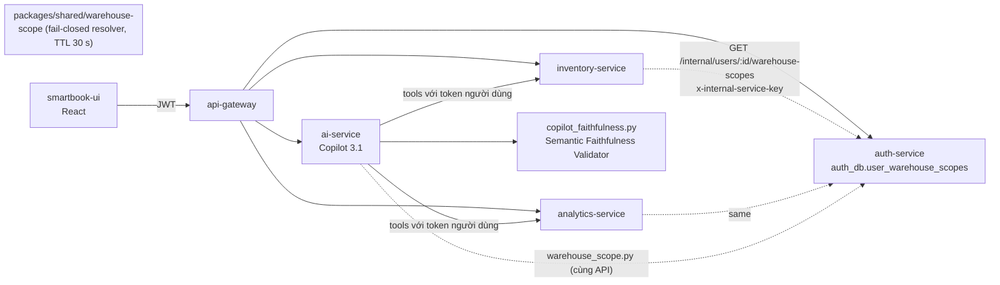
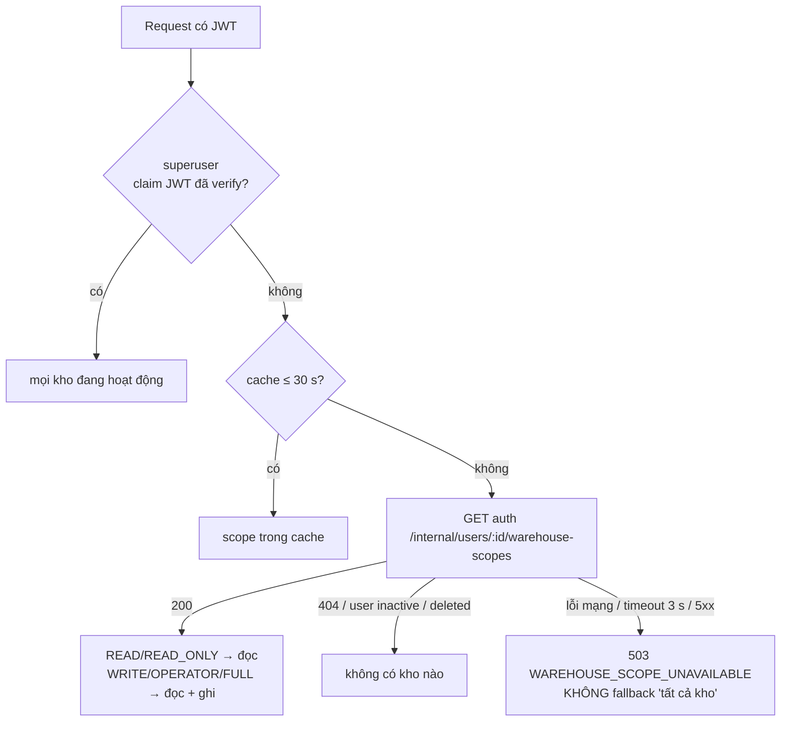

# SmartBook — Ổn định hệ thống & AI Copilot 3.1 (Semantic Faithfulness) (2026-10-15)

Phạm vi: các thay đổi sau commit `4550121` (Copilot 3.0) trên nhánh `hungg`. Tài liệu chỉ mô tả những gì đã
được triển khai trong mã nguồn; mỗi mục ghi rõ trạng thái:

- **[ĐÃ KIỂM THỬ]** — đã triển khai và có test/lần chạy thật chứng minh.
- **[CHƯA KIỂM THỬ]** — đã triển khai nhưng chưa có bằng chứng chạy.
- **[CHƯA TRIỂN KHAI]** / **[ĐỀ XUẤT]** — chưa có trong mã nguồn.

---

## 1. Hiện trạng và các vấn đề trước khi sửa

| # | Vấn đề | Cách xác nhận | Root cause |
|---|---|---|---|
| 1 | CI đỏ ở bước Playwright E2E (run `38674520301`): snapshot “Dữ liệu tính đến …” lệch 7 giờ | Log CI: runner hiển thị `02:31` thay vì `09:31`; tái hiện cục bộ bằng `test.use({ timezoneId: 'UTC' })` | `toLocaleString('vi-VN')` không truyền `timeZone` → dùng múi giờ của máy chạy (CI = UTC) |
| 2 | **Warehouse Scope fail-open**: người dùng thấy dữ liệu mọi kho | Đọc code + truy vấn DB: inventory-service không có bảng `user_warehouse_scopes`; khi không đọc được quyền thì trả về *tất cả kho*; 12/12 dòng scope trong `auth_db` trỏ tới ID kho “placeholder” không tồn tại; mức `OPERATOR` không được coi là quyền đọc | Quyền kho nằm ở `auth_db` nhưng inventory/analytics không đọc được nên “tự cấp tất cả”; seed hai DB sinh ID kho độc lập |
| 3 | Copilot chỉ kiểm tra **số** (numeric grounding) và vài từ “quá mức” (Explainable AI 2.0); câu trả lời vẫn có thể nói ngược xu hướng, đảo thứ hạng kho, gán lượt mượn toàn hệ thống cho một kho, khẳng định nguyên nhân, gọi một phương án là “tối ưu”, hoặc chép nhãn nội bộ “Ý nghĩa:” | Thu thập 63 câu trả lời thật (mục 10): 22/63 bản nháp đầu tiên có ít nhất một lỗi | Không có tầng kiểm tra ngữ nghĩa giữa văn bản ↔ explanation ↔ biểu đồ |
| 4 | Lịch sử hội thoại/biểu đồ cũ vẫn hiển thị dữ liệu kho sau khi người dùng **bị thu hồi quyền** kho đó | Đọc `routes_conversations.py`, `main.py`: snapshot biểu đồ và câu trả lời cache được trả lại nguyên vẹn | Không lưu kho nào mà một lượt trả lời đã dùng; không kiểm tra lại quyền khi đọc lịch sử |
| 5 | Thống kê lượt mượn theo ngày/tháng gom theo **UTC**: lượt mượn 00:00–06:59 giờ Việt Nam ngày 01/10 rơi vào tháng 9 | Test với Postgres thật (mục 8) | `date_trunc` trên `timestamptz` theo múi giờ phiên DB (UTC) |
| 6 | “6 tháng” mơ hồ: 180 ngày gần nhất / 6 tháng dương lịch / 6 tháng đã kết thúc | Đọc `copilot_plan.py` | Chỉ có một nghĩa (cuộn 180 ngày) |

## 2. Kiến trúc sau khi nâng cấp



- **Một nguồn sự thật** cho quyền kho: `auth_db.user_warehouse_scopes`, đọc qua endpoint nội bộ
  `GET /internal/users/:id/warehouse-scopes` của auth-service (không đi qua gateway, cổng không publish,
  khóa `x-internal-service-key` so sánh constant-time). **[ĐÃ KIỂM THỬ]**
- `packages/shared/runtime/warehouse-scope.cjs`: resolver dùng chung cho inventory và analytics; ai-service có bản
  Python tương đương (`warehouse_scope.py`). **[ĐÃ KIỂM THỬ]**
- `copilot_faithfulness.py`: tầng kiểm tra ngữ nghĩa, chạy **sau** LLM, **không gọi thêm LLM** khi câu trả lời đạt. **[ĐÃ KIỂM THỬ]**

## 3. Sơ đồ xử lý AI mới

```mermaid
sequenceDiagram
  participant U as Người dùng
  participant A as ai-service
  participant T as Tools (inventory/analytics, token người dùng)
  participant L as LLM
  participant V as Kiểm tra (grounding + 2.0 overclaims + 3.1 faithfulness)
  U->>A: câu hỏi (/assistant hoặc /assistant/stream)
  A->>A: copilot_plan (ý định, kỳ thời gian, kho)
  A->>T: gọi tool
  T-->>A: dữ liệu (đã lọc theo quyền kho)
  A->>A: copilot_explain (FACT/INFERENCE/ASSUMPTION/UNKNOWN) + copilot_visualization (spec biểu đồ)
  A->>L: prompt + dữ liệu + explanation
  L-->>A: bản nháp (draft)
  A->>V: strip nhãn nội bộ → validate(draft, context)
  alt không có lỗi
    V-->>A: passed / repaired (chỉ bỏ nhãn) — 1 lần gọi LLM
  else có lỗi
    A->>L: retry 1 lần, kèm danh sách lỗi cụ thể
    L-->>A: bản viết lại
    A->>V: validate lại
    alt hết lỗi
      V-->>A: retried_passed
    else còn lỗi chặn (mâu thuẫn/xếp hạng/phạm vi/biểu đồ)
      V-->>A: fallback = kết luận dựng từ explanation (không gọi LLM)
    else còn lỗi không chặn
      V-->>A: warning (giữ câu trả lời, UI hiện ghi chú)
    end
  end
  A->>A: lưu message + metadata.warehouse_ids + extras.faithfulness
  A-->>U: JSON (non-stream) / SSE "done" mang câu trả lời CUỐI đã kiểm tra (stream)
```



Ở chế độ stream, văn bản được stream từ bản nháp; sự kiện `done` mang câu trả lời cuối cùng đã qua kiểm tra và
UI thay thế toàn bộ nội dung đã stream bằng nội dung này. Test `test_copilot_faithfulness.py` khẳng định câu trả lời
cuối của stream **bằng** câu trả lời non-stream cho cùng một tình huống. **[ĐÃ KIỂM THỬ]**

## 4. Luồng Semantic Faithfulness Validator

```mermaid
flowchart TD
  D[draft] --> S[strip_internal_labels<br/>bỏ 'Ý nghĩa:', 'Cơ sở:', '[DỮ KIỆN]'…<br/>viết hoa lại đầu câu]
  S --> C[build_context: xu hướng, % thay đổi, kho rủi ro nhất,<br/>hòa hạng, danh sách kho, có dữ liệu mượn?, explanation, biểu đồ]
  C --> V{validate}
  V --> A1[CONTRADICTION — ngược xu hướng/mức thay đổi]
  V --> A2[RANKING_INCONSISTENCY — đảo thứ hạng kho]
  V --> A3[SCOPE_CONFUSION — lượt mượn toàn hệ thống gán cho 1 kho]
  V --> A4[EXPLANATION_CHART_MISMATCH — explanation ≠ biểu đồ]
  V --> B1[UNSUPPORTED_CAUSAL — khẳng định nguyên nhân]
  V --> B2[UNSUPPORTED_RECOMMENDATION — 'tối ưu nhất', 'tốt nhất']
  V --> B3[REASONING_OVERCLAIM — chắc chắn hơn mức bằng chứng]
  A1 & A2 & A3 & A4 --> BL[lỗi CHẶN]
  B1 & B2 & B3 --> NB[lỗi không chặn]
  BL & NB --> R{có lỗi?}
  R -- không --> OK[passed / repaired]
  R -- có --> RT[retry 1 lần với retry_instruction]
  RT --> V2{validate lại}
  V2 -- sạch --> RP[retried_passed]
  V2 -- còn lỗi chặn --> FB[fallback_answer từ explanation]
  V2 -- chỉ lỗi không chặn --> W[warning]
```

- Quy tắc **giống nhau** cho `/assistant` và `/assistant/stream` (cùng hàm `finalize`). **[ĐÃ KIỂM THỬ]**
- Kết quả lưu trong `extras.faithfulness = {status, retried, issues[], latency_ms}` và hiển thị trên UI
  (`CopilotFaithfulness`) **chỉ** khi `warning` hoặc `fallback`; câu trả lời đạt không hiện gì. **[ĐÃ KIỂM THỬ — unit + E2E]**
- Mỗi quy tắc bỏ qua câu **phủ định** (“không tăng”) hoặc **rào đón** (“có thể”, “chưa đủ để khẳng định”, “tương quan”).
- `latency_ms` tính từ lúc bắt đầu kiểm tra đến khi có kết quả cuối, **gồm cả thời gian retry LLM** nếu có;
  bản thân bộ quy tắc chạy ~0,6 ms/câu trả lời (p50, mục 10).

## 5. Kiểm tra nhất quán văn bản, bằng chứng và biểu đồ

`build_context` dựng ngữ cảnh từ **cùng** dữ liệu tool mà `copilot_explain` và `copilot_visualization` dùng
(test `test_context_is_built_from_the_same_data_as_the_charts`):

| Cặp kiểm tra | Cách làm | Loại lỗi |
|---|---|---|
| Văn bản ↔ dữ liệu số | numeric grounding (có từ 2.0) | retry |
| Văn bản ↔ explanation | xu hướng / % thay đổi, kho rủi ro nhất / hòa hạng, mức chắc chắn, chế độ causal/what-if | A, B |
| Văn bản ↔ phạm vi dữ liệu | lượt mượn là số toàn thư viện → cấm gán cho một kho | SCOPE_CONFUSION |
| Explanation ↔ biểu đồ | `consistency_issues` (từ 3.0) chạy trong `validate` | EXPLANATION_CHART_MISMATCH |
| Văn bản ↔ hệ thống | nhãn nội bộ/tên trường kỹ thuật | INTERNAL_LABEL (sửa tất định, không gọi LLM) |

Biểu đồ **không** do LLM sinh: spec biểu đồ được dựng tất định từ dữ liệu tool (Copilot 3.0), nên văn bản bị sửa/fallback
không làm thay đổi số liệu trên biểu đồ.

## 6. Phân quyền Warehouse Scope



| Dịch vụ | Điểm áp quyền | Trạng thái |
|---|---|---|
| inventory | middleware `enforceRequestedWarehouseScope` (query/path/body `warehouse_id`, `from_/to_`), danh sách kho, chi tiết kho, zones/bins, low-stock | **[ĐÃ KIỂM THỬ]** 8 unit test + integration |
| analytics | `attachWarehouseScope` cho aging-inventory, warehouse-stock-risk, warehouse-stock-items, weeding-suggestions | **[ĐÃ KIỂM THỬ]** 3 unit test + integration |
| ai-service | dữ liệu tool đã lọc theo token người dùng; lịch sử/snapshot kiểm tra lại (mục 7) | **[ĐÃ KIỂM THỬ]** 8 unit test + integration `--ai` |

Dữ liệu seed: ID kho cố định ở cả `inventory-service/prisma/seed.js` và `auth-service/prisma/seed.js`;
`scripts/reconcile-warehouse-scopes.mjs` (chạy trong `pnpm demo:upgrade`) sửa các DB đã seed trước đó (đã chạy cục bộ: 12 dòng được ánh xạ lại).

Kiểm chứng thật (stack Docker):
- `scripts/warehouse-scope-integration.mjs`: 8/8 (gồm kiểm tra AI không trả dữ liệu kho Hà Nội cho tài khoản chỉ có HCM).
- `scripts/rbac-role-access-integration.mjs`: 98/98 (có thêm khẳng định kho ngoài phạm vi → 403).
- Dừng auth-service > 30 s: tài khoản thường nhận **503** ở inventory và analytics; superuser vẫn 200; bật lại auth → bình thường.

## 7. Xử lý snapshot và dữ liệu lịch sử

- Mỗi lượt trả lời lưu `metadata.warehouse_ids` = các kho xuất hiện trong dữ liệu đã dùng. Lượt cũ (trước 3.1) không có
  trường này → đọc ID kho trực tiếp từ `data`/`tool_results` đã lưu. **[ĐÃ KIỂM THỬ]**
- Khi mở lại hội thoại, lượt nào chứa kho **ngoài** phạm vi **hiện tại** của người đọc → trả bản che (`withheld: true`):
  nội dung thay bằng thông báo, `data`, `tool_results`, biểu đồ, khuyến nghị, explanation bị bỏ; dòng lịch sử vẫn giữ. **[ĐÃ KIỂM THỬ]**
- Không đọc được quyền (auth lỗi) → che toàn bộ dữ liệu kho (fail-closed), thông báo “chưa xác minh được quyền”. **[ĐÃ KIỂM THỬ]**
- Câu hỏi tiếp nối dùng lại snapshot biểu đồ (`_load_viz_snapshot`) và câu trả lời cache chỉ khi `can_view` đúng. **[ĐÃ KIỂM THỬ]**
- Độ trễ hiệu lực khi thu hồi quyền: tối đa 30 s (TTL cache scope) + 60 s (cache kết quả tool theo header Authorization).

## 8. Quy tắc timezone

| Lớp | Quy tắc | Trạng thái |
|---|---|---|
| Frontend | `BUSINESS_TIME_ZONE = 'Asia/Ho_Chi_Minh'`; `formatDataAsOf` luôn truyền `timeZone`; dùng cho “Dữ liệu tính đến”, danh sách hội thoại | **[ĐÃ KIỂM THỬ]** unit (chạy với `TZ` = UTC, America/New_York, Asia/Tokyo, Asia/Ho_Chi_Minh) + E2E 3 múi giờ trình duyệt |
| Analytics — xu hướng mượn | `borrow-trends-query.js`: `date_trunc(granularity, ts AT TIME ZONE 'Asia/Ho_Chi_Minh')`, nhãn `to_char` theo giờ VN | **[ĐÃ KIỂM THỬ]** 3 test trên Postgres thật (phiên DB đặt UTC; mốc 23:59:59 / 00:00:00 / 00:30 đầu tháng; không mất, không đếm trùng ở biên) |
| Analytics — dự báo nhu cầu (reorder) | **giữ nguyên** bucket ngày theo UTC | **[CHƯA TRIỂN KHAI]** — đổi sẽ làm thay đổi đầu vào mô hình dự báo đã được đánh giá; cần đánh giá lại trước |

Ý nghĩa “N tháng” trong `copilot_plan.py` (không đổi nghĩa cũ):

| Cách hỏi | Khoảng thời gian (ví dụ hôm nay 15/10/2026, N = 6) |
|---|---|
| “6 tháng qua / gần đây” (nghĩa cũ, giữ nguyên) | cuộn: 18/04/2026 → 15/10/2026 |
| “6 tháng theo lịch / dương lịch” | 01/05/2026 → 15/10/2026 |
| “6 tháng trọn / đã kết thúc / đầy đủ” | 01/04/2026 → 30/09/2026 |
| “tháng này” | 01/10/2026 → 15/10/2026 (month-to-date; so sánh dùng trung bình/ngày) |

## 9. Kết quả kiểm thử trước và sau

**Trước** (tại `4550121`): CI đỏ ở E2E (mục 1.1); không có test nào cho Warehouse Scope fail-closed, timezone ở
analytics, faithfulness, hay che lịch sử. Các test hiện có không phát hiện fail-open vì chúng không kiểm tra trường hợp
không đọc được quyền.

**Sau** (chạy cục bộ ngày 15/10/2026, máy Windows + stack Docker):

| Nhóm | Kết quả | Ghi chú |
|---|---|---|
| ai-service `pytest` | 925 passed, 8 skipped | gồm `test_copilot_faithfulness.py` (14), `test_warehouse_scope.py` (8), test kỳ thời gian, test 2 false positive (mục 10) |
| packages/shared | 17 pass | gồm 8 test resolver |
| inventory-service | 177 pass | gồm 8 test warehouse scope |
| analytics-service | 125 (3 skip nếu không có Postgres) | 3 test timezone chạy trong container: 3/3 pass |
| auth-service | + 3 test endpoint nội bộ | |
| apps/web unit | 14/14 (copilot-visualization) | |
| `pnpm verify` (lint, typecheck, build, test web/node/ai) | **exit 0** | chạy lại lint + typecheck sau khi sửa spec E2E: sạch |
| Playwright E2E (Chromium cục bộ) | **27/27** | gồm snapshot ở 3 múi giờ trình duyệt và test ghi chú faithfulness |
| Integration (stack thật) | rbac 98/98, warehouse-scope 8/8, supplier-portal 22/22, admin-user-management 14/14, purchase-supplier 13/13, analytics 1/1, borrow/reservation/availability pass | |
| GitHub Actions | **chưa chạy** | cần push; chưa được yêu cầu push |

Sự cố gặp khi chạy E2E và cách xử lý:
- `purchase-to-putaway.spec.ts` chọn task “Ghi nhận” **đầu tiên** trong hàng đợi của staff01. Hàng đợi phân trang 10 task, cũ
  nhất trước, nên trên DB đã chạy E2E nhiều lần thì task mới nằm ở trang 2, hoặc task đầu là phiếu cũ. Đã sửa test: lọc
  “Tiếp nhận” rồi mở đúng task của phiếu vừa tạo (`a[href="/orders/<id>"]`). Logic nghiệp vụ và giá trị kỳ vọng không đổi.
  CI không gặp lỗi này vì CI dùng DB mới.
- Chạy E2E liên tiếp nhiều lần làm vượt giới hạn 600 request/15 phút/IP của gateway (giới hạn lưu trong bộ nhớ), dẫn tới 429 và
  đăng nhập thất bại. Đây là điều kiện của môi trường cục bộ; khởi động lại gateway trước lần chạy cuối (0 phản hồi 429).

## 10. Kết quả đánh giá AI

### 10.1 Thiết kế đánh giá (tái lập được)

| Tập | Nội dung | Vai trò |
|---|---|---|
| DEV (19) | Ví dụ dùng khi viết quy tắc (trùng test) | Chỉ để tham khảo, **không** phản ánh dữ liệu mới |
| REAL (63) | Bản nháp **đầu tiên** của LLM (trước mọi kiểm tra) cho 44 câu hỏi XAI 2.0 (50 lượt) + 12 câu hỏi biểu đồ 3.0 (13 lượt) — **viết trước khi có validator** — thu thập live ngày 15/10/2026 | Held-out thật |
| MUTATED (154) | Câu trả lời REAL được gán nhãn sạch, chèn **đúng một** lỗi; mỗi loại có 4 cách diễn đạt, trong đó 1–2 cách **cố ý nằm ngoài từ vựng của quy tắc** | Đo recall có kiểm soát |

Nhãn REAL do **một người** gán (cũng là người viết quy tắc), dựa trên văn bản + dữ liệu tool, **không** xem kết quả
validator khi gán (`eval/faithfulness_labels.json`, có ghi chú cho từng ca khó). Đây là giới hạn: chưa có người gán thứ hai
để đo độ đồng thuận (Cohen’s κ).

Cách chạy lại: `python services/ai-service/eval/collect_faithfulness_answers.py` (cần stack + LLM) rồi
`python services/ai-service/eval/eval_faithfulness.py`.

### 10.2 Khả năng phát hiện trên tập held-out (REAL + MUTATED = 217) — trước khi sửa 2 false positive

Báo cáo: `eval/reports/faithfulness_eval_heldout_prefix.json`. “2.0/3.0” = bộ kiểm tra có trong Copilot 3.0
(`overclaims` của Explainable AI 2.0 + `consistency_issues` biểu đồ của 3.0; trên tập này `consistency_issues`
không bắt được ca nào nên số của 2.0 và 3.0 trùng nhau).

| Tập | Bộ kiểm tra | Precision | Recall | Lỗi chặn (A) recall | FP trên câu sạch |
|---|---|---|---|---|---|
| REAL (63) | 2.0/3.0 | 0,25 | 0,04 (1/26) | 0/7 | 1/41 |
| REAL (63) | **3.1** | 0,75 | **0,35 (9/26)** | **0/7** | 1/41 |
| MUTATED (154) | 2.0/3.0 | 0,88 | 0,14 | 0/16 | — |
| MUTATED (154) | **3.1** | 0,98 | **0,82** | 11/16 | — |
| Held-out (217) | 2.0/3.0 | 0,79 | 0,13 | 0/23 | 2,4 % |
| Held-out (217) | **3.1** | **0,96** | **0,75** | 11/23 (0,48) | 2,4 % |
| DEV (19) | 3.1 | 1,00 | 1,00 | — | 0/7 |

Theo loại (held-out, 3.1, tp/(tp+fn)): INTERNAL_LABEL 48/48 · SCOPE_CONFUSION 3/3 · UNSUPPORTED_CAUSAL 32/42 ·
UNSUPPORTED_RECOMMENDATION 31/42 · RANKING_INCONSISTENCY 6/11 · REASONING_OVERCLAIM 13/25 · CONTRADICTION 2/9.

Diễn giải trung thực:
- **Mọi** đột biến bị bỏ sót đều là cách diễn đạt nằm ngoài từ vựng (“xuất phát từ việc…”, “quyết định đúng đắn nhất”,
  “dữ liệu đã chứng minh hoàn toàn”, “X là kho đáng lo ngại nhất”, “So với X, Y ít rủi ro hơn”): quy tắc **không tổng quát hóa**
  ra ngoài từ vựng đã viết.
- **0/7 mâu thuẫn thật bị bắt.** Các mâu thuẫn mà LLM thật mắc phải khác loại quy tắc mô hình hóa: đếm sai số đầu sách được duyệt
  (5 thay vì 9), gọi tổng tháng là “ngày cao điểm”, gọi một đầu sách giảm 51 % là “sức hút ổn định”, gọi 30 ngày chờ là “ngắn”,
  “tháng này mới qua 13 ngày” (thực tế 15). Quy tắc 3.1 chỉ kiểm tra xu hướng tổng, thứ hạng kho và phạm vi kho.
- Giá trị lớn nhất trên dữ liệu thật: nhãn nội bộ (7/7 sửa tất định) và khẳng định nhân quả.

### 10.3 Hai false positive và bản sửa (sau khi xem held-out — số liệu dưới đây **không còn độc lập**)

Cả hai đến từ quy tắc “bao phủ 100 %” của 2.0 mà 3.1 dùng lại: “đáp ứng đủ … của **các dòng được chọn**” (đã có rào đón) và
tên kịch bản “**100% nhu cầu (68.375.250 ₫)**”. Trong live, hai câu trả lời đúng này bị retry vô ích và hiện ghi chú cảnh báo.
Đã sửa `_FULL`/`_QUALIFIED` trong `copilot_explain.py` + test hồi quy. Chạy lại trên cùng tập: held-out precision 0,99,
FP trên câu sạch 0/41, recall không đổi (0,75). Cần một tập held-out mới để xác nhận.

Kiểm tra lại live sau khi triển khai: `xai-wi-02` → `passed`, 1 lần gọi LLM. `xai-wi-05` lần đầu vẫn bị cảnh báo vì LLM viết
tên kịch bản trong ngoặc kép (`Từ "100% nhu cầu" xuống "75%"`). Đã bổ sung trường hợp này, kèm test. Lần chạy sau:
`repaired` (chỉ bỏ nhãn nội bộ), không retry, 1 lần gọi LLM. Đây là 2 câu hỏi được chạy lại, không phải đánh giá mới.

Sửa thêm: khi bỏ nhãn “Ý nghĩa:” ở đầu câu, chữ đầu của phần còn lại được viết hoa lại (trước đây còn sót câu bắt đầu bằng chữ
thường, ví dụ `viz-tr-01`).

### 10.4 Kết quả cuối cùng người dùng nhận (live, 60 câu trả lời có dữ liệu + 3 câu hỏi mơ hồ)

| Chỉ số | Giá trị |
|---|---|
| Trạng thái | passed 45 · repaired 6 · retried_passed 7 · warning 2 · fallback 0 |
| Tỷ lệ retry | 15 % (9/60; gồm retry do numeric grounding/overclaim) |
| Lần gọi LLM | câu trả lời `passed`: luôn 1 (không gọi thêm); trung bình 1,2 |
| Độ trễ bộ quy tắc | p50 ≈ 0,6 ms; thời gian một lượt p50 4,45 s |
| Bản nháp có lỗi ngữ nghĩa → câu trả lời cuối còn lỗi (kiểm tra thủ công từng câu) | **16/63 → 12/63** |
| Nhãn nội bộ | 7/63 → 0/63 |
| Mâu thuẫn (loại chặn) | 7 → 5 (2 ca được sửa nhờ retry do kiểm tra khác kích hoạt) |

Ca đáng chú ý: `xai-mt-03#0` — retry chỉ **đổi cách nói** (“đáp ứng được 100% thiếu hụt dự kiến của nhóm hàng…”) để lọt quy tắc,
lỗi đếm sai số đầu sách vẫn còn. Đây là giới hạn cố hữu của kiểm tra theo từ vựng.

Theo nhóm câu hỏi (bản nháp có lỗi ngữ nghĩa → cuối còn lỗi): tra cứu 0→0 · phân tích 2→2 · so sánh 2→1 · nguyên nhân 1→0 ·
quyết định nhập 2→2 · what-if 1→0 · follow-up nhiều lượt 4→3 · biểu đồ (xu hướng, KPI) 3→3 · không quyền/mơ hồ 0→0 ·
thiếu dữ liệu 1→1.

### 10.5 Thực nghiệm quyết định quản lý A/B/C — **[ĐỀ XUẤT, chưa thực hiện]**

Chưa có người tham gia thật; **không có số liệu**. Thiết kế đề xuất:

- **Nhóm**: A — không dùng AI (chỉ màn hình báo cáo hiện có); B — AI trả lời văn bản (tắt biểu đồ, tắt explanation);
  C — AI + biểu đồ + Explainable AI + ghi chú faithfulness. Thiết kế **within-subject** đối trọng (Latin square), mỗi người làm
  3 bộ nhiệm vụ tương đương, mỗi bộ dưới một điều kiện; tối thiểu 12 người (nhân viên thư viện/sinh viên được hướng dẫn vai trò quản lý).
- **Nhiệm vụ** (có đáp án đúng tính sẵn từ dữ liệu): chọn kho cần ưu tiên; chọn 3 đầu sách nhập trước với ngân sách cho trước;
  nhận định xu hướng mượn; phát hiện một nhận định sai được cài sẵn.
- **Chỉ số**: độ chính xác quyết định (so với đáp án); thời gian hoàn thành; khả năng nêu căn cứ (chấm theo rubric 0–3, 2 người chấm
  độc lập); tin tưởng có cơ sở (calibration: độ tin tự báo so với đúng/sai, và tỷ lệ chấp nhận câu trả lời AI sai được cài);
  tính hữu ích của lời giải thích (thang Likert 7 mức).
- **Phân tích**: Friedman + Wilcoxon có hiệu chỉnh Holm; báo cáo effect size và khoảng tin cậy; đăng ký trước giả thuyết.

## 11. Các giới hạn chưa giải quyết được

1. Recall với lỗi thật thấp (0,35), mâu thuẫn thật 0/7; quy tắc dựa trên từ vựng, LLM có thể lách bằng cách đổi cách nói.
   Hướng đi: kiểm tra có cấu trúc (trích số/thực thể từ câu → so với dữ liệu tool), hoặc LLM-as-judge có đánh giá riêng.
2. Nhãn đánh giá do một người gán; cần người gán thứ hai và tập held-out mới (đặc biệt sau bản sửa ở 10.3).
3. Nhiều endpoint danh sách của inventory (stock-movements, picking, transfers …) chưa lọc theo kho; số liệu tổng toàn thư viện
   (xu hướng mượn, đề xuất nhập, đếm low-stock trong KPI) chỉ được kiểm soát bằng quyền chức năng, không theo kho.
4. Lượt lịch sử chỉ chứa số liệu toàn thư viện (không có ID kho) vẫn hiển thị nếu người dùng mất quyền chức năng sau đó.
5. Thu hồi quyền có hiệu lực sau tối đa ~30 s (cache scope) + 60 s (cache tool).
6. analytics-service không kiểm tra blacklist token; superuser đọc được hội thoại của người khác (chính sách sẵn có).
7. Bucket ngày trong dự báo nhu cầu vẫn theo UTC (mục 8).
8. Sidebar khu vực nhân viên trên điện thoại chưa responsive (có từ trước); các hạng mục P2 (mô phỏng ngân sách nhanh, drill-down,
   xuất CSV/PNG) **[CHƯA TRIỂN KHAI]**.
9. GitHub Actions chưa được chạy cho các thay đổi này (chưa push).
