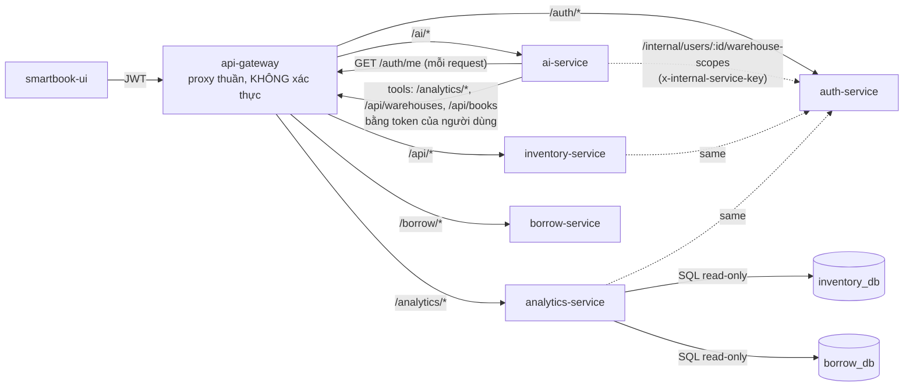

# SmartBook AI Copilot 3.2 — Phase 0: Audit (2026-10-16)

Phạm vi: nhánh `hungg` tại `ea9e761` (sau Copilot 3.1 `b94d74d` và việc rút gọn monitoring). Mọi nhận định dưới đây
lấy từ **mã nguồn và lần chạy thật** trong ngày; khi tài liệu cũ và mã khác nhau, tài liệu này theo mã.
Ký hiệu: **[ĐO]** = đo/chạy thật hôm nay · **[ĐỌC MÃ]** = suy ra từ mã, chưa chạy · **[CHƯA ĐO]**.

---

## 1. Kiến trúc và luồng dữ liệu của AI

- **Nguồn dữ liệu của AI** [ĐỌC MÃ]: chỉ các endpoint đọc qua gateway với token của người dùng
  (`assistant_tools._get`, `copilot_tools._cached_get`): 11 endpoint `/analytics/*`, `/api/warehouses`, `/api/books`.
  AI **không** đọc DB nghiệp vụ trực tiếp, không gọi borrow-service. Số liệu mượn đến từ analytics (đọc `borrow_db`).
- **Gateway không xác thực** (`apps/api-gateway/src/index.js` chỉ có `createProxyMiddleware`): mỗi service tự xác thực.
  Đây là thiết kế hiện có; mọi kết luận bảo mật dưới đây xét lớp kiểm tra ở service đích.

### 1.1 Luồng một lượt `/assistant` và `/assistant/stream` [ĐỌC MÃ]

1. `_start_assistant_turn` (main.py): kiểm tra message → rate limit theo IP → `get_user_context` (gọi `/auth/me`;
   auth-service đọc vai trò/quyền **mới nhất từ DB** và kiểm tra blacklist/`tokens-valid-after`) → `_assistant_can_access`
   (vai trò/quyền) → `_resolve_owned_conversation` (403 nếu hội thoại của người khác) → cache câu trả lời
   (`assistant:{conversation_id}:{câu hỏi}`), chỉ dùng lại nếu `warehouse_scope.can_view` còn đúng.
2. `copilot_plan.build_plan` — planner **tất định** (regex/quy tắc): capability, `answer_mode`
   (lookup/causal/comparison/decision/what_if/ranking), kỳ thời gian, kho (resolve bằng danh sách kho người dùng đọc được),
   ngân sách, tool + tham số (chỉ trong `PLANNABLE_TOOLS`, tham số dựng từ giá trị đã parse, không chép từ LLM).
3. `seed_fast_path`: chạy song song các tool của plan (hoặc snapshot của lượt trước khi giải thích biểu đồ).
4. `_attach_explanation_brief`: `copilot_explain.build_explanation` (XAI 2.0) + `copilot_visualization.build_visualizations`
   (3.0) dựng **tất định** từ cùng dữ liệu tool, ghi vào system prompt làm khung lập luận.
5. Vòng LLM (`ASSISTANT_MAX_TOOL_ROUNDS`): LLM có thể gọi thêm tool (read-only). Stream: token được gửi ngay khi sinh.
6. `_finalize_assistant_turn` (chung cho cả hai endpoint): numeric grounding + overclaims 2.0 + faithfulness 3.1 →
   tối đa **1** retry LLM → fallback/cảnh báo → pending action (chỉ CREATE_REORDER_DRAFT) → extras → cache → lưu DB.
   Stream: sự kiện `done` mang câu trả lời cuối; UI thay toàn bộ text đã stream.

### 1.2 Bằng chứng, giải thích và kiểm tra hiện có [ĐỌC MÃ]

| Thành phần | File | Nội dung |
|---|---|---|
| Evidence UI | `evidence.py` | `{label, tool_name, metric, value, unit}` theo tool — để hiển thị, không dùng để kiểm tra ngữ nghĩa |
| Claims XAI 2.0 | `copilot_explain.py` | claim `FACT/INFERENCE/ASSUMPTION/UNKNOWN`, mỗi claim có `evidence[{label,value,unit,source}]`, `certainty`, `basis`; INFERENCE theo quy tắc cố định (xếp hạng rủi ro, so sánh kỳ, thứ tự đề xuất nhập…) |
| Visualization 3.0 | `copilot_visualization.py` | spec biểu đồ tất định + `summary` (direction, change_pct, riskiest, tie…), `consistency_issues` |
| Numeric grounding | `rag.verify_numeric_grounding` + `number_grounding.py` | mỗi số trong câu trả lời phải **có mặt ở đâu đó** trong dữ liệu tool/giá trị tính sẵn (dung sai) |
| Overclaims 2.0 | `copilot_explain.overclaims` | từ vựng: chắc chắn / nguyên nhân / tối ưu / đáp ứng 100% |
| Faithfulness 3.1 | `copilot_faithfulness.py` | regex theo câu: xu hướng tổng, xếp hạng kho, phạm vi lượt mượn, nhân quả, "tối ưu", nhãn nội bộ, explanation↔biểu đồ |
| FACT/INFERENCE/… | `copilot_explain._claim` | FACT luôn CAO; INFERENCE có mức chắc chắn; ASSUMPTION/UNKNOWN không có |
| RBAC/scope | `_assistant_can_access`, `warehouse_scope.py`, dịch vụ đích | dữ liệu tool đã lọc ở analytics/inventory; dữ liệu đã lưu (lịch sử/snapshot/cache) kiểm tra lại scope kho khi đọc |

**Lỗ hổng phương pháp đã xác minh trong mã:** numeric grounding chỉ hỏi "số này có ở đâu trong dữ liệu không", **không**
hỏi "số này có đúng vai trò không". Ví dụ thật `xai-mt-03#0`: "hệ thống đề xuất nhập **5 đầu sách**" lọt kiểm tra vì
`funded_high_priority = 5` có trong dữ liệu, trong khi số đầu sách được duyệt là `funded_lines = 9`. Faithfulness 3.1 chỉ
mô hình hóa xu hướng tổng, thứ hạng kho, phạm vi lượt mượn — không có kiểm tra theo vai trò (đếm/tiền/kỳ/thực thể).

## 2. Baseline 3.1 — tái lập trên mã hiện tại

Phương pháp (đọc `eval/eval_faithfulness.py`, `eval/faithfulness_labels.json`, `collect_faithfulness_answers.py`):
REAL = 63 bản nháp đầu tiên của LLM (44 câu XAI 2.0 / 50 lượt + 12 câu biểu đồ 3.0 / 13 lượt), thu ngày 15/10, nhãn tay
của **một** người (cũng là người viết quy tắc); MUTATED = 154 câu sạch chèn đúng 1 lỗi theo mẫu (một số mẫu cố ý ngoài từ vựng);
DEV = 19 câu dùng khi viết quy tắc.

Chạy lại hôm nay (`python eval/eval_faithfulness.py`, offline, cùng dữ liệu) [ĐO]:

| Tập | Bộ kiểm tra | Precision | Recall | Lớp mâu thuẫn (A) | FP trên câu sạch |
|---|---|---|---|---|---|
| REAL (63) | 3.1 | 0,90 | **0,346 (9/26)** | **0/7** | 0/41 |
| MUTATED (154) | 3.1 | 1,00 | 0,818 | 11/16 | — |
| Held-out (217) | 3.1 | 0,993 | 0,75 | 11/23 | 0/41 |

Khác với doc 3.1 (P REAL 0,75 → 0,90; FP 1/41 → 0/41) là do bản sửa 2 false positive ở mục 10.3 của doc 3.1 — đúng như doc
đã ghi. Số **12/63 câu trả lời cuối còn lỗi ngữ nghĩa** là kiểm tra thủ công ngày 15/10 trên câu trả lời live; không tái lập
được offline (câu trả lời cuối phụ thuộc retry LLM). Live eval (`collect_faithfulness_answers.py`) cần stack + OpenRouter.

### 2.1 Bảy mâu thuẫn thật mà 3.1 bỏ sót — vẫn tái hiện trên mã hiện tại [ĐO: `detect()` không trả loại A]

| Ca | Bản nháp nói | Dữ liệu backend | Loại lỗi |
|---|---|---|---|
| `xai-mt-03#0`, `#1` | "đề xuất nhập **5 đầu sách**" (ngân sách 10 triệu) | `funded_lines = 9` (5 là `funded_high_priority`) | đếm sai vai trò |
| `xai-mt-03#0` | "đáp ứng **100% nhu cầu thiếu hụt**" | `shortfall_covered_pct = 100` nhưng chỉ cho `funded_shortfall_lines = 1` dòng; 90 đầu sách ưu tiên cao chưa duyệt | phủ toàn bộ khi dữ liệu thiếu |
| `xai-mt-01#1` | Norwegian Wood "giữ được **sức hút ổn định**" | `demand_trend_pct = -51,2` | xu hướng sai (thực thể) |
| `xai-mt-01#2` | "nhu cầu hiện tại (**cao và ổn định**)" | -51,2 % | xu hướng sai (thực thể) |
| `xai-de-04#0` | "thời gian chờ hàng **ngắn**" (30 ngày) | explanation coi ≥ 21 ngày là dài | đánh giá trái quy tắc |
| `viz-tr-02#0` | "**Ngày** cao điểm … **tháng 05/2026** với 1.096 lượt" | 1.096 là **tổng tháng** 05/2026 (chuỗi theo tháng) | nhầm ngày/tháng |
| `viz-cp-04#0` | "tháng này mới qua **13 ngày**" | `current_period.days = 15` | sai kỳ |

Các lỗi ngoài lớp A còn lọt: nhân quả diễn đạt ngoài từ vựng ("xuất phát từ việc…"), "quyết định đúng đắn nhất",
"đáng lo ngại nhất" (xếp hạng), tồn kho toàn hệ thống (5 bản) nói như tồn của kho được hỏi (`xai-de-04#0`, kho HCM có 2 bản).

**Fix đã có từ 3.1:** nhãn nội bộ (7/7), 2 false positive "100%". **Chưa có:** kiểm tra theo vai trò cho đếm/tiền/%/kỳ/thực thể.

## 3. Audit bảo mật các đường dữ liệu

Phương pháp: đọc middleware/controller; với nghi vấn rò rỉ, gọi API thật trên stack Docker bằng tài khoản demo
(script `probe_scope.mjs`, `probe_revoke.mjs` trong scratchpad, nội dung tóm tắt dưới đây). Phạm vi kho demo (auth_db):
`curator01` = HCM (READ), `manager01` = HCM + BR-HCM-01 + HN (FULL), `staff01..03` = HCM (OPERATOR), `warehouse01` = HN (OPERATOR).

### 3.1 Phân loại endpoint

Ký hiệu: **P** = bảo vệ đầy đủ · **F** = có kiểm quyền chức năng nhưng KHÔNG lọc kho · **L** = rủi ro rò qua tổng hợp/cache ·
**D** = đúng theo chính sách đã thiết kế (tổng toàn thư viện).

| Đường | Endpoint | Phân loại | Bằng chứng |
|---|---|---|---|
| GW→Inventory | `/api/warehouses`, `/:id`, zones/bins, low-stock | P | test 3.1 + integration 8/8 |
| GW→Inventory | `/api/purchase-orders`, `/api/goods-receipts`, supplier-deliveries | P | lọc `getReadableWarehouseIds`; probe: 0 dòng ngoài scope |
| GW→Inventory | **`/api/stock-movements`** | **F** | [ĐO] curator01 (chỉ HCM) nhận 330/500 dòng của BR-HCM-01/BR-HCM-02 |
| GW→Inventory | **`/api/purchase-requests` (list), `/:id`** | **F** | [ĐO] curator01 nhận 40/50 phiếu của HN/BR-HCM-*; `/:id` chỉ kiểm tra vai trò manager |
| GW→Inventory | **`POST /api/purchase-requests/:id/approve|reject|convert-to-po`** | **F (ghi)** | [ĐỌC MÃ] chỉ kiểm tra vai trò; middleware chỉ xét `warehouse_id` trong body → manager kho A duyệt được phiếu kho B |
| GW→Inventory | **`/api/picking/tasks`, `/picking-tasks`, `/:id`; `/api/packing/tasks`, `/:id`, history** | **F** | [ĐO] warehouse01 (chỉ HN) thấy picking task của WH-HCM-01; [ĐỌC MÃ] không có `warehouse_id` → mọi kho |
| GW→Inventory | **`/api/transfer-receiving`** | **F** | [ĐO] curator01 (HCM) thấy 1 phiếu nhận chuyển kho của HN |
| GW→Inventory | `/api/outbound/orders` | F | [ĐỌC MÃ] cùng mẫu; probe không có dòng ngoài scope nên chưa thấy rò thực tế |
| GW→Analytics | warehouse-stock-risk/items, aging, weeding | P (scope) | `attachWarehouseScope` |
| GW→Analytics | dashboard/kpis, reorder-suggestions, top-books, borrow-trends, book-turnover | D | tổng toàn thư viện, không có trường kho; quyền chức năng `readAnalytics`/`readBorrowAnalytics` |
| GW→Analytics | **mọi endpoint với token đã thu hồi** | **L/F** | [ĐO] sau `POST /auth/logout`: `/auth/me`, `/api/*`, `/borrow/*`, `/ai/*` → 401, nhưng `/analytics/dashboard/kpis`, `/reorder-suggestions`, `/warehouse-stock-risk` → **200**. `authenticateToken` của analytics không kiểm tra blacklist/`tokens-valid-after` |
| GW→AI | `/assistant`, `/assistant/stream` | P (có điều kiện) | `/auth/me` mỗi request → token thu hồi bị 401 [ĐO] |
| GW→AI | **khi `/auth/me` không phản hồi (lỗi mạng/timeout 5 s)** | **fail-open** | [ĐỌC MÃ] `agent_permissions._fallback_user_context` giải mã JWT **không kiểm chữ ký**, tin `roles`/`is_superuser`/`sub` tự khai → token giả mạo đọc được lịch sử hội thoại của người khác (superuser claim) và hủy action của người khác. Dữ liệu tool mới vẫn an toàn (dịch vụ đích kiểm chữ ký) |
| AI→Analytics/Inventory | 11 tool đọc | P/D theo endpoint | token người dùng; AI không mở rộng scope |
| AI cache tool | `copilot_tools._cached_get` (TTL 60 s) | **L** | khóa = (endpoint, Authorization, params) — không có phạm vi kho → sau khi thu hồi quyền kho, cùng token vẫn nhận kết quả cũ ≤ 60 s |
| AI cache câu trả lời | `assistant_response_cache` | L (nhẹ) | khóa theo hội thoại; kiểm tra lại scope kho khi đọc, **không** kiểm tra lại quyền chức năng |
| AI lịch sử | `GET /assistant/conversations/{id}` | P (ownership) / **L** | chủ sở hữu hoặc superuser; scope kho kiểm tra lại khi đọc; **không** kiểm tra lại quyền dùng trợ lý → người đã mất quyền vẫn đọc lại số liệu toàn thư viện đã lưu |
| AI Actions | `/actions/confirm` | P / **F** | ownership + `require_can_confirm_action` + claim nguyên tử (idempotent) + audit; **nhưng** `override_payload` merge **mọi khóa** vào payload (thay được `items`, số lượng, cờ `warehouse_resolution_status`) |
| AI Actions | tạo pending action trong `/assistant` | F | tạo **bất kể** kết quả kiểm tra câu trả lời (kể cả `fallback`) |
| Auth | đổi vai trò (`PATCH /iam/users/:id` với `role_ids`), đổi quyền của vai trò | **F** | [ĐỌC MÃ] chỉ đổi trạng thái mới gọi `revokeUserTokensIssuedBefore`; JWT cũ mang quyền cũ tới 2 giờ ở inventory/analytics/borrow (các dịch vụ này đọc quyền từ claim JWT) |
| Mọi dịch vụ | Redis không khả dụng | fail-open | [ĐỌC MÃ] wrapper Redis trả `null` khi lỗi → kiểm tra blacklist bị bỏ qua. Ghi nhận là rủi ro còn lại (đổi sẽ ảnh hưởng toàn hệ thống) |

Không coi là lỗ hổng: các endpoint inventory không có middleware riêng nhưng đã có `enforceRequestedWarehouseScope`
toàn cục cho mọi `warehouse_id` client gửi; endpoint analytics D (chính sách tổng toàn thư viện, đã ghi trong doc 3.1);
superuser đọc hội thoại của người khác (chính sách sẵn có, chỉ đọc).

### 3.2 Những gì tái sử dụng

- Kiểm tra: numeric grounding, overclaims 2.0, faithfulness 3.1 (giữ nguyên), claims/evidence XAI 2.0, `summary` của biểu đồ 3.0,
  một lần retry sẵn có, `fallback_answer` dựng từ explanation.
- Bảo mật: resolver scope dùng chung (`@smartbook/shared/warehouse-scope`), `warehouse-scope.utils` của inventory
  (`readableWarehouseFilter`, `requireWarehouse*Access`), cơ chế thu hồi `blacklist:token:*` / `user:tokens-valid-after:*`.

## 4. Phạm vi thay đổi cần làm

Phase 1 (verification): module kiểm tra có cấu trúc **mở rộng** pipeline hiện có — sổ dữ kiện dựng từ chính dữ liệu tool
(thêm vai trò, phạm vi, kỳ, thực thể, đơn vị), trích claim tất định từ câu trả lời, phán quyết từ dữ liệu backend; sửa tất định
khi an toàn; trạng thái PASSED/REPAIRED/WARNING/BLOCKED (thêm trường `verification`, giữ `faithfulness`); không tạo action khi
BLOCKED; stream báo "đang đối chiếu" trước `done`; UI dùng lại khung ghi chú 3.1.

Phase 2 (bảo mật, chỉ các mục đã xác nhận):
1. inventory: lọc theo scope cho stock-movements, purchase-requests (list/detail/duyệt), picking, packing, transfer-receiving, outbound.
2. analytics: kiểm tra token đã thu hồi (Redis, cùng khóa như các dịch vụ khác).
3. ai-service: bỏ fail-open khi `/auth/me` lỗi (trả 503); tool cache phân vùng theo người dùng + quyền + scope kho;
   cache câu trả lời phân vùng theo quyền; lịch sử che dữ liệu khi người đọc không còn quyền dùng trợ lý;
   `override_payload` chỉ nhận khóa được phép.
4. auth: thu hồi token khi đổi vai trò người dùng / đổi quyền của vai trò.

Ngoài phạm vi (ghi vào Future Work của các doc 3.2): Redis fail-closed toàn hệ thống, lọc scope cho mọi endpoint chi tiết còn lại
(stock-audit, staff-task, exception-report…), reorder/KPI theo kho (đổi mô hình), người gán nhãn thứ hai.

---

Kết quả sau khi làm: Phase 1 — [AI_COPILOT_3_2_DECISION_VERIFICATION.md](AI_COPILOT_3_2_DECISION_VERIFICATION.md) (mục 9: số đo
từng tập, kể cả tập live độc lập); Phase 2 — [AI_COPILOT_3_2_SECURITY.md](AI_COPILOT_3_2_SECURITY.md) (mục 1: lỗ hổng đã sửa,
mục 6: kết quả chạy thật).
