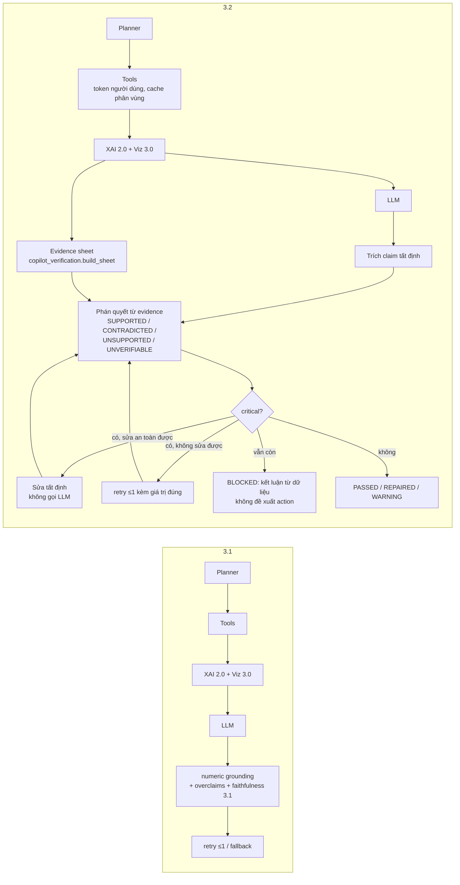
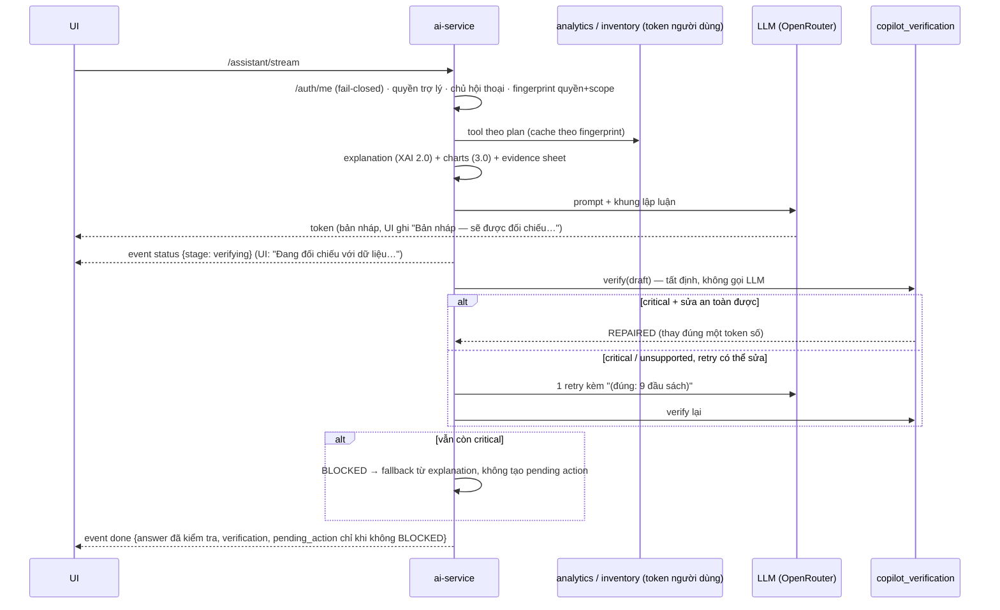

# SmartBook AI Copilot 3.2 — Phase 1: Structured Decision Verification (2026-10-16)

Tài liệu này mô tả phần đã **triển khai trong mã** và kết quả **đo thật**. Ký hiệu: **[ĐO]** đã chạy/đo hôm nay ·
**[CHƯA ĐO]** đã triển khai nhưng chưa có số liệu · **[TƯƠNG LAI]** chưa làm.
Không có phần nào trong tài liệu này khẳng định AI "không thể sai": bộ kiểm tra chỉ phát hiện được các loại lỗi nó mô hình
hóa, và chỉ khi câu trả lời diễn đạt theo cách mà bộ trích claim nhận ra.

Audit trước khi làm: [AI_COPILOT_3_2_AUDIT.md](AI_COPILOT_3_2_AUDIT.md). Bảo mật: [AI_COPILOT_3_2_SECURITY.md](AI_COPILOT_3_2_SECURITY.md).

---

## 1. Vấn đề

Numeric grounding (2.0) hỏi *"số này có xuất hiện đâu đó trong dữ liệu không?"*; validator 3.1 hỏi *"câu này có dùng từ
ngược xu hướng/thứ hạng/phạm vi không?"*. Không lớp nào hỏi *"số này có đúng **vai trò** mà câu văn gán cho nó không?"*.
Bảy mâu thuẫn thật mà 3.1 bỏ sót (audit mục 2.1) đều thuộc loại này: "5 đầu sách được duyệt" (5 là số đầu sách ưu tiên cao,
thực tế duyệt 9), "tháng này mới qua 13 ngày" (15), tổng tháng gọi là "ngày cao điểm", đầu sách giảm 51 % gọi là "ổn định",
30 ngày chờ gọi là "ngắn".

## 2. Kiến trúc trước / sau

- Module mới: `services/ai-service/copilot_verification.py`. **Không** có hệ thống evidence thứ hai: sheet được dựng từ
  **cùng** `collected_data` mà `copilot_explain` (XAI 2.0) và `copilot_visualization` (3.0) dùng, đọc thêm các claim
  `UNKNOWN` của explanation và `ctx` của faithfulness 3.1 (xu hướng tổng). Không gọi lại tool nghiệp vụ nào.
- Faithfulness 3.1 vẫn chạy; phát hiện của nó được gộp vào cùng báo cáo (`_FROM_31`), một câu chỉ thành một claim.
- Tích hợp: `main._finalize_assistant_turn` (dùng chung cho `/assistant` và `/assistant/stream`).

## 3. Sơ đồ một lượt AI (3.2)

## 4. Evidence sheet

`build_sheet(collected, explanation, visualizations)` → `Sheet` với `Fact(role, value, unit, label, source, scope,
warehouse, entity, period, as_of, derived)` và các bảng tra cứu theo vai trò:

| Nguồn tool | Vai trò được tách riêng | Phạm vi |
|---|---|---|
| `simulate_reorder_budget` | ngân sách ≠ chi phí duyệt ≠ còn lại; **đầu sách** duyệt ≠ **bản** duyệt ≠ đầu sách ưu tiên cao duyệt / chưa duyệt; chênh lệch giữa kịch bản (derived); nhu cầu đầy đủ | system |
| `get_reorder_suggestions` | tổng đầu sách cần xét ≠ ưu tiên cao; tổng bản; chi phí ước tính; đầu sách đứng đầu; từng đầu sách: tồn **khả dụng** ≠ tồn **thực**, ngưỡng, lượt mượn kỳ này/kỳ trước, % thay đổi, thời gian chờ + **nguồn** (DEFAULT/SUPPLIER_DECLARED), dự báo | system |
| `compare_borrow_periods` | kỳ hiện tại ≠ kỳ trước (tổng, trung bình/ngày, số ngày, ngày cao điểm); % thay đổi tổng và theo ngày | system (toàn thư viện) |
| `get_borrow_trends` | chuỗi theo **tháng** (tổng tháng) hoặc **ngày** (đỉnh ngày) | system |
| `get_warehouse_stock_risk`, `compare_warehouses` | từng kho: hết hàng ≠ dưới ngưỡng ≠ tồn khả dụng; thứ tự rủi ro, hòa hạng | warehouse |
| `get_warehouse_low_stock_items` | tổng dưới ngưỡng ≠ số dòng trả về (**truncated**), hết hàng | warehouse |
| `explain_warehouse_shortage` | đang thiếu có lượt mượn ≠ có nhu cầu **tăng** | warehouse (lượt mượn: system) |
| `get_overdue_summary` | **phiếu** quá hạn ≠ **cuốn** quá hạn | system |
| tool lỗi (`{"error"}`) | ghi là **thiếu dữ liệu**, không bao giờ là 0 | — |

Mỗi tool cũng sinh một bản ghi evidence công khai `{source, as_of, scope, warehouse?, time_range?, limitations?, entities?,
error?}` (trả trong `verification.evidence`; UI không hiển thị id).

## 5. Trích claim và quy tắc phán quyết

Trích claim **tất định** (regex trên văn bản đã bỏ dấu, tách câu → mệnh đề; số được đọc kèm đơn vị: đầu sách / bản / ₫ /
triệu / % / lượt / ngày / phiếu / cuốn; ngày tháng "05/2026", "07/10" không bị coi là số lượng). Vai trò của một số được quyết
định bởi **từ khóa gần nhất phía trước nó** (sau số liền trước) và cụm ngay sau đơn vị. Phán quyết luôn so với sheet; LLM
không tham gia.

| Nhóm | Claim | Ví dụ CONTRADICTED | Mức |
|---|---|---|---|
| numeric | COUNT (đầu sách/bản/phiếu/cuốn theo vai trò) | "duyệt 5 đầu sách" khi `funded_lines=9` | critical |
| numeric | MONEY (chi phí duyệt, còn lại, chênh lệch, tổng ước tính) | "9.876.000 ₫" khi duyệt 8.976.000 ₫; "dùng hết 20.000.000 ₫" khi duyệt 19.944.000 ₫ | critical |
| numeric | PERCENT (dấu và độ lớn, theo chủ thể: lượt mượn/trả/đặt chỗ/đầu sách) | "tăng 82,8%" khi giảm 82,8% | critical |
| decision | BUDGET ("vượt / nằm trong ngân sách") | "cả hai đều vượt ngân sách" | critical |
| decision | COVERAGE ("đáp ứng toàn bộ nhu cầu") khi còn đầu sách ưu tiên cao chưa duyệt | | critical |
| temporal | PERIOD (số ngày của kỳ; tháng ↔ giá trị; tổng tháng gọi là ngày; ngày cao điểm) | "tháng này mới qua 13 ngày" (15) | critical |
| comparative | TREND (đầu sách hoặc toàn thư viện được gọi là "ổn định/đều đặn/không giảm" khi \|%\| ≥ 20 hoặc xu hướng ≠ đi ngang) | "sức hút ổn định" khi −51,2 % | critical |
| comparative | RANKING (hơn/kém, nhất; chủ ngữ/bổ ngữ, "so với X") | "Kho Hà Nội đáng lo hơn Kho HCM" | critical |
| entity | ENTITY (số của kho/đầu sách này gán cho kho khác) | "Kho Hà Nội có 3 đầu sách hết hàng" (3 là của HCM) | critical |
| entity | SCOPE (toàn hệ thống ↔ một kho; lượt mượn toàn thư viện gán cho kho) | "Toàn hệ thống chỉ có 3 đầu sách hết hàng" (cộng các kho = 4) | critical / major |
| decision | RECOMMENDATION ("nên nhập X trước" khi X không đứng đầu) | | critical |
| decision | MISSING_DATA (tool lỗi → "không có…/đều ổn"; giá null → "0 đồng") | | critical |
| comparative | ASSESSMENT (thời gian chờ ≥ 21 ngày gọi là "ngắn") | | critical |
| decision | OPTIMALITY, CAUSALITY (yếu tố ngoài dữ liệu: nhân sự, giao chậm, lịch học…), CONSTRAINT, ASSUMPTION (giả định nói như đã kiểm chứng), FORECAST | "do thiếu nhân sự" | major (UNSUPPORTED) |

Chống cảnh báo sai:
- **UNVERIFIABLE không phải lỗi**: số không xác định được vai trò, hoặc không biết kịch bản nào được nhắc tới, thì để lại cho
  numeric grounding; không bao giờ suy ra "sai".
- Phủ định/rào đón (`không`, `chưa`, `có thể`, `chưa đủ để kết luận`, `cần kiểm tra`) bỏ qua claim; câu thừa nhận thiếu dữ
  liệu ("chưa lấy được dữ liệu…") không bị coi là "coi thiếu là 0".
- Làm tròn được chấp nhận theo **độ chính xác của số được viết** ("68,4 triệu" ↔ 68.375.250 ₫; "khoảng 13 nghìn" ↔ 13.000),
  nhưng "khoảng" không cứu một số viết đủ chữ số mà sai ("khoảng 68.735.250 ₫").
- Trong câu có so sánh ("thêm", "so với", "từ … lên …"), chênh lệch giữa các kịch bản cũng là giá trị hợp lệ.
- Một quy tắc lỗi (exception) chỉ bỏ qua claim của nó, không làm hỏng câu trả lời (`test_a_faulty_rule_…`).

## 6. Trạng thái, sửa an toàn, fallback

| Trạng thái | Điều kiện | Người dùng thấy |
|---|---|---|
| `PASSED` | không có claim CONTRADICTED/UNSUPPORTED | nếu có ≥ 1 claim SUPPORTED: dòng nhỏ "Đã đối chiếu với dữ liệu hệ thống"; nếu không có gì để kiểm: không hiện gì |
| `REPAIRED` | đã sửa tất định, hoặc retry đã xóa được mâu thuẫn critical | "Một số số liệu trong câu trả lời đã được điều chỉnh theo dữ liệu" + nhãn loại |
| `WARNING` | còn claim major/minor không có dữ liệu hỗ trợ (nhân quả, tối ưu…) | "Một số nhận định chưa có dữ liệu hỗ trợ" + nhãn |
| `BLOCKED` | còn mâu thuẫn critical sau sửa + 1 retry | "Không kiểm chứng được một khuyến nghị an toàn — câu trả lời đã được thay bằng kết luận tính trực tiếp từ dữ liệu"; **không có pending action**; `safe_to_act=false` |

Sửa tất định (`repair`) chỉ khi **đồng thời**: claim có giá trị đúng xác định (vai trò đã giải, kịch bản được nêu tường minh,
không phải câu so sánh), token sai xuất hiện **đúng một lần** trong cả câu trả lời, câu đó **không** mở đầu một danh sách mà
văn bản liệt kê tiếp ("5 đầu sách sau:" + 5 gạch đầu dòng — sửa thành 9 sẽ mâu thuẫn với danh sách), và kiểm tra lại văn
bản đã sửa **không** sinh vấn đề mới. Ngược lại → retry (một lần, kèm giá trị đúng) → còn thì BLOCKED.

Fallback (`fallback_answer`): kết luận của explanation (headline + tối đa 3 FACT + 1 UNKNOWN) — hoặc, khi không có
explanation, các giá trị đọc trực tiếp từ sheet. Không thêm nhận định nào ngoài dữ liệu (`test_fallback_adds_no_claim_of_its_own`).

Log: `copilot verification status=… checked=… contradicted=… unsupported=… categories=… repairs=… retried=…` — không
chứa số liệu hay văn bản trả lời.

## 7. API, UI, stream, AI Actions

- `AssistantResponse.verification` (tùy chọn, bổ sung, không đổi trường cũ): `{status, claims[{text, type, category,
  label, verdict, severity, detail, expected?, evidence?}], counts, checked, repairs, labels_stripped, retried,
  safe_to_act, evidence[], latency_ms}`. `faithfulness` (3.1) giữ nguyên; khi BLOCKED nó có `status: "fallback"` nên client
  cũ vẫn hiện ghi chú thay thế. Lưu vào `metadata.extras.verification` của tin nhắn.
- `/assistant/stream`: thêm sự kiện `status {stage: "verifying"}` trước `done`; client không biết sự kiện này bỏ qua nó
  (parser cũ chỉ xử lý `token`/`done`). Văn bản stream là **bản nháp** — UI hiện chữ mờ + "Bản nháp — sẽ được đối chiếu với dữ
  liệu trước khi hoàn tất", rồi "Đang đối chiếu với dữ liệu…"; `done` thay toàn bộ nội dung. Pending action chỉ đến trong
  `done`, nên **không có action nào trước khi kiểm tra xong**. Cùng một hàm `_finalize_assistant_turn` cho cả hai endpoint
  (`test_stream_announces_verification_and_matches_the_json_endpoint`).
- UI: `CopilotFaithfulness` (giữ tên, nhận thêm `verification`) dùng `src/lib/copilot-verification.ts`; không hiện mã
  nội bộ (category, claim/scope id) hay "100%"; câu trả lời cũ (trước 3.2) vẫn hiện ghi chú 3.1.
- AI Action Center: bộ kiểm tra **không bao giờ thực thi** gì; pending action chỉ được tạo khi không BLOCKED; lúc xác nhận,
  quyền/scope/trạng thái/quy tắc nghiệp vụ được kiểm lại (xem tài liệu bảo mật, mục AI Actions).

## 8. Kiểm thử

`test_copilot_verification.py` (bản đầu 37 test): số đầu sách sai (hồi quy `xai-mt-03`), đầu sách ↔ bản, tiền (9.876.000 ↔
8.976.000), ngân sách ↔ chi phí duyệt, còn lại của kịch bản khác, tuân thủ ngân sách, phép cộng/chênh lệch, % sai dấu và sai
độ lớn, % ngân sách không bị nhầm là % lượt mượn, số ngày của kỳ (hồi quy `viz-cp-04`), đảo kỳ tháng 9/10, tổng tháng gọi là
ngày (hồi quy `viz-tr-02`), ngày cao điểm sai, tháng ↔ giá trị, "ổn định" cho đầu sách −51 % (hồi quy `xai-mt-01`) và cho
toàn thư viện, đảo xếp hạng (hơn/kém/nhất/"so với"), nhầm kho A/B, toàn hệ thống ↔ một kho, lượt mượn toàn thư viện gán cho
kho, tồn toàn hệ thống nói như tồn của kho, thứ tự khuyến nghị, tối ưu không chứng minh, nhân quả ngoài dữ liệu (thiếu nhân
sự), lý do là quy tắc của hệ thống thì không bị bắt, đáp ứng toàn bộ nhu cầu, ràng buộc nhà cung cấp, thời gian chờ dài gọi là
ngắn (hồi quy `xai-de-04`), tool lỗi/timeout, danh sách bị cắt, chi phí null, câu đúng diễn đạt lại/làm tròn, phủ định, câu
không cần kiểm tra quyết định, sửa an toàn, không thay mù, quy tắc lỗi không làm hỏng câu trả lời, fallback, evidence; và 6
test endpoint: không gọi thêm LLM khi đạt, sửa không cần LLM, retry kèm giá trị đúng, BLOCKED không tạo action, stream có
`status` trước `done` và trùng `/assistant`, lưu cùng hội thoại.

Web: `tests/copilot-verification.test.mjs` (5) và một E2E Playwright mới trong `ai-copilot-visualization.spec.ts`.

Tổng cộng `test_copilot_verification.py` hiện có 47 test (thêm `LiveFailureRulesTests` và `LiveRun2FalseBlockTests` sau hai
lần chạy live — mục 9; các test đó dùng cách diễn đạt khác với câu live).

## 9. Đánh giá — đo thật, báo cáo tách riêng từng tập

Tái lập offline (không cần stack):
`python services/ai-service/eval/eval_decision_verification.py --live <answers.json> --live-labels <labels.json>`.
Thu thập live (cần stack + OpenRouter): `EVAL_PASSWORD=… python services/ai-service/eval/collect_faithfulness_answers.py --cases v32`.
Báo cáo: `eval/reports/decision_verification_eval_{1_first_run,2_after_live_fixes,3_live_run2,4_run2_after_fixes}.json`.

Định nghĩa (cấp mục): câu trả lời "bị gắn cờ" khi bộ kiểm tra báo ≥ 1 vấn đề. Precision = mục bị gắn cờ thực có lỗi / mục bị
gắn cờ; Recall = mục có lỗi bị gắn cờ / mục có lỗi; FPR = mục sạch bị gắn cờ / mục sạch; "critical" = mục có lỗi critical mà bộ
kiểm tra đưa ra phát hiện critical/blocking. Nhãn của mọi tập do **một người** gán (cũng là người viết quy tắc).

### 9.1 Mức độ độc lập của từng tập (đọc trước khi đọc số)

| Tập | Kích thước | Độc lập với quy tắc 3.2? |
|---|---|---|
| REAL31 | 63 bản nháp 3.1, nhãn 3.1 | **Không** — 7 mâu thuẫn 3.1 bỏ sót là hồi quy mà 3.2 được viết để bắt (số phát triển) |
| MUTATED31 | 154 đột biến của 3.1 | **Không hoàn toàn** — các mẫu đột biến (kể cả mẫu "ngoài từ vựng") đã nằm trong ngữ cảnh khi viết từ vựng 3.2 |
| HELDOUT32 | 70 câu viết tay, đóng băng trước khi có code (sha256 `897c6b24…f01b257`) | **Không** — viết trước code nhưng đã được cân nhắc khi thiết kế quy tắc; 43/43 chỉ cho biết quy tắc làm đúng điều tác giả định làm |
| **LIVE32 run 1** | 34 bản nháp live, 32 câu hỏi mới, nhãn mù (sha256 `a75ad07d…`) | **Có** — tập độc lập duy nhất. Ngoại lệ: console đã hiện trạng thái 3.1 của 2 lượt (mg-01, mg-02) trước khi gán nhãn |
| LIVE32 run 2 | 34 bản nháp live mới, cùng câu hỏi, sau khi sửa theo run 1 | Không với câu hỏi; mẫu LLM mới, nhãn mù (sha256 `efb3a27b…`) |

### 9.2 Phát hiện trên bản nháp

| Tập | Bộ kiểm tra | Precision | Recall | FPR (mục sạch) | Critical | Độ trễ p50 / p95 (ms/câu) |
|---|---|---|---|---|---|---|
| REAL31 | 3.1 | 1,00 | 0,455 (10/22) | 0/41 | 0/7 | 0,59 / 1,45 |
| REAL31 | 3.2 | 0,889 | 0,727 (16/22) | 2/41 ¹ | **7/7** | 2,0 / 6,6 |
| MUTATED31 | 3.1 | 1,00 | 0,818 (126/154) | — | 11/16 | 0,52 / 1,17 |
| MUTATED31 | 3.2 | 1,00 | 0,981 (151/154) | — | 16/16 | 2,0 / 5,0 |
| HELDOUT32 | 3.1 | 1,00 | 0,14 (6/43) | 0/27 | 3/35 | 0,08 / 0,16 |
| HELDOUT32 | 3.2 | 1,00 | 1,00 (43/43) | 0/27 | 35/35 | 0,40 / 0,82 |
| **LIVE32 run 1 (chính thức)** | 3.1 | 0,75 | 0,273 (3/11) | 1/23 | 0/8 | 0,51 / 1,18 |
| **LIVE32 run 1 (chính thức)** | **3.2** | **0,556** | **0,455 (5/11)** | **4/23** | **3/8** | 1,8 / 4,7 |
| LIVE32 run 1, sau sửa theo chính run 1 (không độc lập) | 3.2 | 0,90 | 0,818 (9/11) | 1/23 | 8/8 | 2,0 / 5,0 |
| LIVE32 run 2 | 3.1 | 0,50 | 0,273 (3/11) | 3/23 | 0/9 | 0,55 / 1,67 |
| LIVE32 run 2 (bản đã sửa theo run 1) | **3.2** | **0,556** | **0,455 (5/11)** | **4/23** | **4/9** | 2,5 / 5,4 |
| LIVE32 run 2, sau sửa theo run 2 (không độc lập) | 3.2 | 0,625 | 0,455 (5/11) | 3/23 ² | 4/9 | 2,6 / 5,4 |

¹ Hai mục REAL31 bị 3.2 gắn cờ mà nhãn 3.1 coi là sạch — `xai-wi-01#0` ("duyệt chi 9.987.000 ₫ cho 5 đầu sách", thực tế duyệt 9)
và `xai-mt-01#0` (hai đầu sách −61,5 % / −57,8 % "duy trì lượt mượn ổn định") — có cùng loại lỗi với mục được gán nhãn lỗi ở
nơi khác. **Không sửa nhãn gốc** (cùng một người gán); cần người gán thứ hai phân xử.
² Ba FP còn lại đều đến từ quy tắc từ vựng 3.1/2.0 mà 3.2 kế thừa ("hiệu quả nhất", "gây ra", "lượt mượn giảm" trong ngoặc
kép) — cột 3.1 cũng có.

Diễn giải trung thực:
- Trên tập độc lập (run 1), 3.2 bắt nhiều lỗi hơn 3.1 (5/11 so với 3/11; critical 3/8 so với 0/8) **nhưng gắn cờ sai nhiều hơn**
  (4/23 so với 1/23). Bốn FP đó là lỗi regex thật (thiếu ranh giới từ "đáp ứng **đ**ược" ↔ "đáp ứng **đủ**", chủ ngữ trước dấu
  ":", trạng từ "chỉ" trước số tiền còn lại, mang tên kho qua câu khác) — đã sửa.
- Sau khi sửa theo run 1, số trên chính run 1 lên 9/11, nhưng **run 2 (mẫu mới) vẫn chỉ 5/11, critical 4/9**: phần lớn cải thiện
  là khớp với cách diễn đạt của run 1, không tổng quát hóa. Đây là giới hạn cố hữu của trích claim bằng quy tắc.
- Lỗi thật còn lọt trên live: "dưới ngưỡng" đã gồm "hết hàng" nhưng diễn đạt khác, "trong đó" cùng câu, "0 lượt mượn" khi dữ liệu
  null, "cao nhất trong hệ thống" sai, "tồn kho thấp" khi trên ngưỡng mà không nêu số ngưỡng, danh sách toàn thư viện trình bày
  như của một kho, xu hướng −35 % gọi là "tương đối ổn định" cho lượt đặt chỗ.

### 9.3 Câu trả lời CUỐI người dùng nhận (live, kiểm tra thủ công từng câu)

| | Run 1 (bộ kiểm tra như triển khai lúc đó) | Run 2 (sau sửa theo run 1) |
|---|---|---|
| Bản nháp có lỗi ngữ nghĩa | 11/34 | 11/34 |
| **Câu trả lời cuối còn lỗi** | **7/34** (5 critical) | **8/34** (7 critical) |
| Trạng thái | PASSED 27 · BLOCKED 5 · WARNING 1 · REPAIRED 1 | PASSED 26 · REPAIRED 4 · BLOCKED 3 · WARNING 1 |
| BLOCKED dù bản nháp không có lỗi critical | **2** (bd-07, pr-mt#1) | **3** (bd-25, wh-01, dc-03) |
| Retry tạo lỗi mới mà bộ kiểm tra không bắt | 0 | 1 (dc-02: kỳ "16/10/2025 – 16/10/2026") |
| Tỷ lệ retry | 10/34 (29 %) | 9/34 (26 %) |
| Gọi LLM trung bình | 1,35 | 1,41 |
| Thời gian một lượt p50 / p95 | 5,9 s / 18,6 s | 5,5 s / 16,0 s |

Nhãn câu cuối: `eval/decision_verification_live_final_labels_run{1,2}.json`. Câu bị BLOCK luôn là kết luận dựng từ dữ liệu (không
có số sai), nên chặn nhầm làm mất phần diễn giải chứ không đưa số liệu sai cho người dùng — nhưng vẫn là chi phí khả dụng thật.
Lỗi gây chặn nhầm của run 2 đã sửa (`LiveRun2FalseBlockTests`) nhưng **chưa đo lại live**.

### 9.4 Độ trễ trước/sau — cùng 8 câu hỏi, cùng cách đo (`eval/measure_assistant_latency.py`)

| | Trước 3.2 (image `pre-copilot-3-2`) | Sau 3.2 |
|---|---|---|
| Thời gian một lượt p50 / p95 | 3,76 s / 7,65 s | 4,31 s / 7,94 s |
| Gọi LLM trung bình | 1,12 | 1,12 |
| Retry / fallback | 0/8 / 0/8 | 1/8 / 0/8 |

n = 8 và độ trễ LLM dao động mạnh giữa các lần: chênh lệch p50 không đủ để kết luận. Phần tất định của 3.2 tốn ~2–3 ms/câu
(p95 ≤ 10 ms, mục 9.2); chi phí đáng kể duy nhất là khi nó kích hoạt một lần retry LLM.

### 9.5 Chưa đo / tương lai

- Người gán thứ hai và Cohen's κ; tập live lớn hơn (34 lượt là nhỏ); live run 3 sau các sửa của run 2.
- Thử nghiệm người dùng A/B/C (đề xuất trong doc 3.1) — **chưa thực hiện, không có số liệu**.
- Trích claim bằng mô hình (LLM chỉ trích, backend vẫn phán quyết) có đánh giá riêng, để vượt giới hạn từ vựng.
- Chính sách chặn mềm hơn cho các loại phụ thuộc heuristic (ENTITY qua tên kho, TREND từ vựng): chặn → cảnh báo, nếu dữ liệu
  live tiếp theo vẫn cho thấy chặn nhầm.
- Quy tắc xu hướng của backend (so ngày trọn đầu/cuối) có thể cho "tăng +7,1 %" trong khi cả kỳ giảm mạnh (`v32-dc-03`); bộ kiểm tra
  trung thành với backend nên không bắt được — cần xem lại phương pháp xu hướng (thay đổi thuật toán: ngoài phạm vi 3.2).

## 10. Giới hạn còn lại

1. Kiểm tra theo quy tắc: diễn đạt mới vẫn lọt (run 2), và quy tắc mới có thể chặn nhầm câu đúng.
2. Một người gán nhãn, cũng là người viết quy tắc.
3. BLOCKED thay toàn bộ câu trả lời bằng kết luận từ dữ liệu: an toàn về số liệu nhưng mất phần giải thích khi chặn nhầm.
4. Retry có thể đổi một lỗi lấy một lỗi khác mà bộ kiểm tra không mô hình hóa.
5. Không có gì trong hệ thống chứng minh một câu trả lời "đúng hoàn toàn"; UI chỉ nói "Đã đối chiếu với dữ liệu hệ thống" khi có
   claim kiểm được và không có mâu thuẫn được phát hiện.
