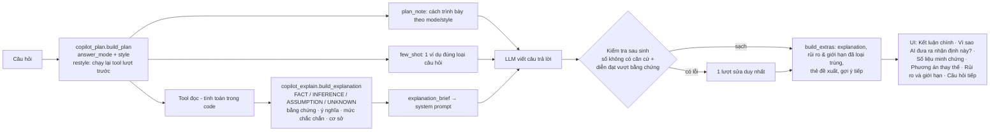

# SmartBook Management Copilot — Explainable AI 2.0 (2026-10-14)

Phạm vi: `/assistant` và `/assistant/stream` (trang **Trợ lý AI**, ADMIN/WAREHOUSE_MANAGER). Không thêm chức năng nghiệp vụ, không đổi API (chỉ thêm trường tùy chọn `explanation` và `plan.answer_mode`/`plan.style`), không đổi model/nhà cung cấp (`OPENROUTER_ASSISTANT_MODEL` = `qwen/qwen3.7-flash`), không đổi RBAC hay luồng xác nhận thao tác ghi.

## 1. Audit hiện trạng (trước nâng cấp, commit `d0d34a7`)

Nguồn: đọc mã (`copilot_plan.py`, `copilot_response.py`, `copilot_tools.py`, `assistant_loop.py`, `evidence.py`, `number_grounding.py`, `tool_context.py`, `main.py`, `ai-copilot-insights.tsx`, bộ test, `eval_copilot.py`) và câu trả lời thật của hai lượt chạy: `eval/reports/copilot_after-v2_20261013_083139.json` (171 lượt) và lượt baseline của bộ đánh giá mới `eval/reports/explain_xai-baseline_20261014_064719.json` (50 lượt).

| Hạn chế | Bằng chứng trong mã | Ví dụ câu trả lời thật (baseline) |
|---|---|---|
| **Khuôn trả lời cứng**: mọi câu "quyết định" phải theo Đề xuất → Lý do → Rủi ro → Bước tiếp theo; nguyên nhân/so sánh theo Kết luận → Căn cứ → Lưu ý. Không có chế độ "phân tích" riêng; không có cơ chế cho "giải thích kỹ hơn / nói ngắn gọn / dễ hiểu / vì sao không chọn phương án khác". | `COPILOT_SYSTEM_PROMPT` mục "Cách trả lời", `_ANALYSIS_GUIDE`; planner không nhận diện yêu cầu về cách diễn đạt — "Giải thích kỹ hơn" không có năng lực dữ liệu nên rơi về LLM tự chọn tool. | "Tôi nên nhập sách nào trước?" → liệt kê 8 đầu sách kèm số lượng/chi phí (1.708 ký tự), trung vị câu quyết định 1.835 ký tự. "Giải thích kỹ hơn" ngắn hơn câu trước (2.087 so với 2.131 ký tự). |
| **Lý do bịa ở dạng chữ** (không phải số nên bộ kiểm tra số không bắt được). | Không có lớp nào cho LLM biết lập luận nào được dữ liệu hỗ trợ, ở mức chắc chắn nào. | "Giải thích dễ hiểu hơn" (ngân sách 10 triệu): *"Tựa sách kinh điển luôn có nhu cầu cao"*, *"Sách tâm lý/làm giàu thường xuyên hết hàng"*, *"Sách thiếu nhi bán chạy"*. "Nên nhập sách nào trước?": *"đang bị mất doanh thu hoàn toàn"* (thư viện cho mượn, không có doanh thu). "Vì sao không chọn phương án khác?": *"Hệ thống ưu tiên các đầu sách có tỷ lệ nhu cầu/tồn kho cao hơn"* — sai, analytics xếp theo mức ưu tiên → điểm nhu cầu → số lượng. |
| **Kết luận quá mức dữ liệu**: "đáp ứng 100%/đủ nhu cầu" khi vẫn còn đầu sách ưu tiên cao chưa nhập hoặc 16 đầu sách nằm ngoài 100 dòng được liệt kê; "tối ưu". | `simulate_reorder_budget` trả `shortfall_covered_pct` chỉ tính trên dòng được liệt kê; không có kiểm tra cách diễn đạt sau khi sinh. | 5/50 lượt baseline bị bộ chấm gắn cờ "đáp ứng 100%/đủ", 1 lượt "tối ưu". |
| **Số liệu mâu thuẫn không được giải thích** | Ngân sách nhỏ có thể duyệt vài đầu sách nhưng bù 0% thiếu hụt dự kiến (thuật toán bỏ qua dòng không vừa ngân sách còn lại) — dữ liệu không nói vì sao. | Bản 2026-10-13: *"duyệt 4.890.000 ₫ … 4 đầu sách … chỉ đáp ứng 0% thiếu hụt dự kiến"* — người đọc không hiểu vì sao. "Kho HCM Chinh rủi ro hơn" trong khi tồn khả dụng 120 so với 8 bản — chỉ được lý giải bằng câu chung chung. |
| **Lặp nội dung**: văn bản chép lại số liệu của thẻ đề xuất và phần "Lưu ý về dữ liệu"; số liệu lặp trong cùng câu trả lời. | Prompt yêu cầu mục "Lưu ý" trong văn bản, đồng thời UI hiển thị `caveats` cùng nội dung; không có loại trùng. | Baseline: 31,9% số liệu trên thẻ đề xuất xuất hiện lại trong văn bản; 12% số trong câu trả lời là số lặp; ví dụ "KPI hiện tại và các phiếu quá hạn" nêu 371 phiếu và 238 ngày hai lần. |
| **LLM tự tính** | Prompt cấm tự cộng/trừ nhưng không có giá trị dẫn xuất sẵn cho mọi so sánh. | *"Tổng chi phí ước tính cho 8 đầu sách trên là 11.574.000 ₫"* (tự cộng); 9,1% câu trả lời có số không có trong dữ liệu. |
| **Không phân biệt dữ kiện / suy luận / giả định / chưa biết** | `recommendations[].confidence` chỉ có cho thẻ nhập hàng; `evidence.py` chỉ là danh sách số liệu phẳng. | UI có "Đề xuất có căn cứ", "Lưu ý về dữ liệu" và chip trích dẫn số liệu — không có chỗ cho "vì sao" của kết luận chính. |
| Hỏi mơ hồ không ngữ cảnh | "Giải thích kỹ hơn" (chưa có hội thoại) → baseline tự đoán và liệt kê 6 chủ đề (443 ký tự) thay vì hỏi lại. | |
| Điểm mạnh giữ nguyên | Planner xác định, tool tổng hợp tính toán trong code, grounding số, RBAC qua token người dùng, xác nhận thao tác ghi, stream/non-stream dùng chung prologue/finalize. | |

## 2. Kiến trúc Explainable AI 2.0

Nguyên tắc: **LLM chỉ diễn đạt**. Mọi kết luận có thể kiểm chứng (bên nào rủi ro hơn, vì sao ngân sách bù 0% thiếu hụt, vì sao sách B xếp sau sách A, phương án nào đổi lấy gì) được tính trong backend thành claim có loại, bằng chứng và mức chắc chắn theo quy tắc nêu rõ; LLM nhận claim đó làm khung lập luận, và câu trả lời được kiểm tra lại theo chính claim đó.

### 2.1 Adaptive Answer Generation (`copilot_plan.py`, `copilot_response.py`)
- `QueryPlan.answer_mode`: `lookup` (1–2 câu), `analysis` (nhận định → 2–4 căn cứ kèm ý nghĩa; mới: "tình hình/đánh giá/thế nào" hoặc câu chạm ≥2 nhóm dữ liệu), `comparison`, `causal`, `decision`, `what_if`, `ranking`. Hướng dẫn mỗi mode là mô tả linh hoạt ("Cách trình bày lượt này"), không còn tiêu đề mục bắt buộc.
- `QueryPlan.style`: `brief` ("nói ngắn gọn", "tóm tắt"), `deep` ("giải thích kỹ hơn", "chi tiết hơn"), `plain` ("dễ hiểu", "đơn giản hơn"), `why_not` ("vì sao không chọn…", "phương án khác", "thay vì"). Mẫu "rủi ro hơn" không bị nhầm thành "rõ hơn".
- Câu **chỉ đổi cách diễn đạt** (style, không có thực thể/năng lực mới) có ngữ cảnh → kế thừa toàn bộ lượt trước và **chạy lại đúng các lời gọi tool do planner dựng** (lưu trong `copilot_state.tool_calls`, lọc qua `PLANNABLE_TOOLS`, không bao giờ lặp lại lời gọi do model tự chọn) → giải thích lại trên cùng bằng chứng. Không có ngữ cảnh → hỏi lại, không gọi tool/LLM.
- `few_shot(plan)`: một ví dụ (dữ liệu giả, ghi rõ là giả) theo mode, ưu tiên ví dụ cùng nghiệp vụ: tra cứu quá hạn, phân tích quá hạn/phạt, so sánh kho, so sánh lượt mượn, nguyên nhân thiếu sách, quyết định nhập sách, mô phỏng ngân sách. Ví dụ nằm ngoài `plan_note` (vốn là ngữ cảnh grounding) nên số trong ví dụ mà bị chép lại vẫn bị phát hiện.
- Prompt "Cách trả lời" viết lại: câu đầu là kết luận quan trọng nhất; 2–4 số liệu, mỗi số một lần, kèm ý nghĩa; giải thích thuật ngữ ở lần đầu; dùng bản giải thích có cấu trúc; danh sách từ cấm khi dữ liệu không chứng minh; không chép phần UI đã hiển thị; không câu đệm.

### 2.2 Evidence-Grounded Explainability (`copilot_explain.py`, mới)
- `build_explanation(plan, collected)` → `{mode, style, headline, certainty, claims[], alternatives[], limits[], next_actions[], counts, flags, display}`. Mỗi claim: `kind` (FACT/INFERENCE/ASSUMPTION/UNKNOWN), `statement`, `evidence[]` {label, value, unit, source}, `meaning`, `certainty` (CAO/TRUNG BÌNH/THẤP — chỉ FACT/INFERENCE), `basis`.
- Bộ giải thích theo tool: so sánh/xếp hạng kho (tiêu chí quyết định → mức chắc chắn: hết hàng = CAO, dưới ngưỡng = TRUNG BÌNH, chỉ tổng tồn = THẤP; lý giải nghịch lý "tồn nhiều mà rủi ro hơn"), tồn thấp theo kho, nguyên nhân thiếu sách (mọi yếu tố là INFERENCE ≤ TRUNG BÌNH, cơ sở "tương quan", UNKNOWN: nhu cầu riêng theo kho, lịch sử nhập/điều chuyển), so sánh kỳ (trung bình/ngày khi hai kỳ dài khác nhau + ASSUMPTION phân bố đều), so sánh top sách, đề xuất nhập (đầu danh sách = INFERENCE với mức chắc chắn = `data_confidence`; phương án thay thế kèm lý do xếp sau đúng theo thứ tự của analytics: ưu tiên → điểm nhu cầu → số lượng), giải thích một đầu sách, nhu cầu × tồn kho, mô phỏng ngân sách (phương án thay thế với chênh lệch có dấu tính sẵn; "không có kịch bản tối ưu tuyệt đối"; giải thích bù 0% thiếu hụt; cảnh báo 100% chỉ trên dòng được liệt kê), việc ưu tiên, quá hạn; tool khác dùng extractor của `evidence.py` thành FACT. Lỗi 403 → UNKNOWN "không có quyền"; lỗi khác → UNKNOWN "chưa lấy được" — không có số.
- `simulate_reorder_budget` thêm `lines_with_shortfall` và `funded_shortfall_lines` (đếm, không đổi thuật toán).
- `explanation_brief()` đưa claim vào system prompt (gắn nhãn `[DỮ KIỆN]`, `[SUY LUẬN, mức chắc chắn …]`, `[GIẢ ĐỊNH]`, `[CHƯA BIẾT]`, `[PHƯƠNG ÁN KHÁC]`, `[BƯỚC TIẾP THEO]`), kèm tên các thẻ đề xuất UI sẽ hiển thị để văn bản không chép lại số liệu của thẻ.
- Kiểm tra sau sinh (`overclaims`): "chắc chắn/rõ ràng là" khi suy luận chỉ TRUNG BÌNH/THẤP hoặc câu nguyên nhân/mô phỏng; "chủ yếu do/nguyên nhân chính/là do/gây ra" ở câu nguyên nhân; "tối ưu/tốt nhất" ở câu quyết định/mô phỏng/xếp hạng; "đáp ứng toàn bộ/đủ/100%" khi còn nhu cầu chưa được nhập hoặc chưa được tính. Nhận biết phủ định trong cùng mệnh đề ("chưa thể khẳng định… là do", "không phải phương án tối ưu") và "mức chắc chắn". Lỗi số và lỗi diễn đạt dùng **chung một lượt sửa** (`retry_once_if_ungrounded`); câu trả lời sạch không tốn thêm lần gọi LLM. Phần còn sót lưu ở `explanation.language_flags`.
- Grounding số tính thêm các giá trị trong bản giải thích (chênh lệch, trung bình/ngày) — đều là phép tính trong code.

### 2.3 Explainable UI (`ai-copilot-insights.tsx`, `ai-assistant.tsx`, `services/ai.ts`)
- **Kết luận chính**: đoạn đầu của câu trả lời được làm nổi bật (viền trái + nhãn), không lặp lại ở hộp riêng.
- **Vì sao AI đưa ra nhận định này?** (accordion, đóng mặc định): số suy luận/dữ kiện, huy hiệu mức chắc chắn; mở ra là chuỗi claim (Suy luận/Dữ kiện) với ý nghĩa, **Số liệu minh chứng** (lưới nhãn–giá trị–nguồn), mức chắc chắn và cơ sở; **Phương án thay thế**; **Bước tiếp theo hợp lý** (chỉ câu quyết định/mô phỏng/xếp hạng).
- **Rủi ro và giới hạn** (đổi tên từ "Lưu ý về dữ liệu"): lưu ý của tool + giả định/điều chưa biết của bản giải thích (nhãn "Giả định"/"Chưa biết"), mỗi ý một lần (so khớp bigram), bỏ ý mà câu trả lời đã nói.
- Danh sách trích dẫn số liệu cũ chỉ hiện khi không có bảng "Vì sao" (tránh trùng). Thẻ đề xuất, ActionCard, streaming giữ nguyên. Gợi ý tiếp có thêm một câu đổi cách giải thích ("Giải thích kỹ hơn", "Vì sao không chọn phương án khác?") khi phù hợp.
- Kiểm tra trực tiếp trên trình duyệt (ai-service chạy mã mới, dữ liệu thật): câu "Kho HCM Chinh với Kho Ha Noi kho nào rủi ro hơn?" hiển thị Kết luận chính, bảng "Vì sao" (1 suy luận · 2 dữ kiện · Mức chắc chắn CAO, kèm lý giải tồn 120 so với 8 bản), "Rủi ro và giới hạn" với mục "Chưa biết", gợi ý "Giải thích kỹ hơn".

## 3. File đã sửa và lý do

| File | Thay đổi | Lý do |
|---|---|---|
| `services/ai-service/copilot_explain.py` (mới) | Lớp giải thích có cấu trúc, brief cho prompt, kiểm tra diễn đạt; chuyển `TOOL_LABELS`, `item_risks` từ `copilot_response` sang đây | Yêu cầu 3 |
| `services/ai-service/copilot_plan.py` | `answer_mode`, `style`, `detect_style`, restyle follow-up chạy lại tool lượt trước, hỏi lại khi không có ngữ cảnh, state lưu `tool_calls`/`answer_mode`; **sửa lỗi có sẵn**: tên sách bắt đầu bằng "Lập…" bị hiểu là yêu cầu ghi ("lập phiếu") nên mất toàn bộ tool đọc | Yêu cầu 2; lỗi tìm ra khi đánh giá (mục 5.3) |
| `services/ai-service/copilot_response.py` | Prompt "Cách trả lời" mới, `_MODE_GUIDE`/`_STYLE_GUIDE`, `few_shot`, `card_titles`, `build_extras` nhận `answer`/`explanation`, gộp và loại trùng rủi ro–giới hạn, gợi ý đổi cách giải thích | Yêu cầu 2, 4, 5 |
| `services/ai-service/copilot_tools.py` | `lines_with_shortfall`, `funded_shortfall_lines` trong mô phỏng | Giải thích được "bù 0%" bằng dữ liệu |
| `services/ai-service/main.py` | Trường `explanation` (tùy chọn); few-shot tách khỏi ngữ cảnh grounding; gắn brief sau khi seed tool (cả hai endpoint); câu cần dữ liệu mà chưa có kết quả tool nào → nhắc model không trả lời bằng suy đoán; yêu cầu trình bày (style) lặp lại cạnh câu hỏi trong prompt (tin nhắn lưu vẫn đúng như người dùng gõ); kiểm tra số + diễn đạt chung một lượt sửa; grounding tính giá trị của bản giải thích | Yêu cầu 3, 4; giữ stream = non-stream |
| `apps/web/src/services/ai.ts` | Kiểu `AiExplanation`, `AiExplanationClaim` | Yêu cầu 5 |
| `apps/web/src/components/ai-copilot-insights.tsx` | `CopilotExplanation`, nhấn mạnh kết luận chính, "Rủi ro và giới hạn" có nhãn Giả định/Chưa biết | Yêu cầu 5 |
| `apps/web/src/components/pages/ai-assistant.tsx` | Nối `explanation` (cả khi mở lại hội thoại), ẩn trích dẫn trùng | Yêu cầu 5 |
| `services/ai-service/test_copilot_explain.py` (mới), `test_copilot_plan.py`, `test_copilot_response.py`, `test_copilot_endpoints.py`, `test_eval_explain.py` (mới) | 47 test mới (789 → 836) | Yêu cầu 6 |
| `services/ai-service/eval/eval_explain.py`, `eval/explain_dataset.json` (mới), `eval/README.md` §5 | Bộ đánh giá chất lượng câu trả lời | Yêu cầu 6 |
| `docs/SERVICES/AI_SERVICE.md` | Mô tả luồng mới, trường `explanation` | Tài liệu |

## 4. Ví dụ trước/sau

Câu trả lời thật, cùng câu hỏi, cùng dữ liệu ngày 14/10/2026: **trước** = lượt `baseline2` (mã `d0d34a7`), **sau** = lượt `after3` (mã cuối). Trích nguyên văn, rút gọn bằng "…".

**1. Sách không tồn tại** — *Tại sao cuốn "Lập Trình Lượng Tử Cho Mèo" được đề xuất nhập?*
- Trước: *"…được đề xuất nhập vì tồn kho hiện chỉ còn 5 bản, thấp hơn ngưỡng an toàn là 10 bản, … 65 lượt mượn … nhập 28 bản"* — gán số liệu của Norwegian Wood cho một cuốn sách không có thật.
- Sau: *"…hiện không nằm trong danh sách đề xuất nhập."* Nhưng câu sau vẫn khẳng định *"Tồn kho còn đủ"* như dữ kiện, trong khi backend chỉ ghi đó là SUY LUẬN mức THẤP — xem mục 6.

**2. Mô phỏng ngân sách** — *Nếu giảm ngân sách nhập hàng còn 5 triệu thì sao?*
- Trước: liệt kê sách, kể cả *"'Tư Duy Phản Biện' (0 bản). Kết quả là đáp ứng được 100% thiếu hụt dự kiến."*, rồi mới nói 94 đầu sách ưu tiên cao bị bỏ lại.
- Sau: *"Với ngân sách 5.000.000 ₫, hệ thống duyệt chi 4.948.000 ₫ cho 5 đầu sách (63 bản), nhưng còn lại 94 đầu sách ưu tiên cao chưa được nhập."* … *"Mô phỏng này … không khẳng định đây là mức ngân sách hợp lý nhất."*

**3. Quyết định nhập sách** — *Tôi nên nhập sách nào trước?*
- Trước: mở đầu bằng danh sách nhiều sách, lý do *"phản ánh nhu cầu duy trì nguồn cung ổn định cho tựa sách từng có lượt mượn rất cao"*, lộ tên trường `lead_time_source`.
- Sau: *"Nên xem xét nhập **Norwegian Wood** trước."* → Vì sao (ưu tiên HIGH, tồn 5/ngưỡng 10) → Rủi ro chính (*"xu hướng mượn … đang giảm mạnh (-47,2%) … cần được cân nhắc kỹ lưỡng để tránh tình trạng tồn kho lâu ngày"*; thời gian chờ hàng theo cam kết NCC chưa kiểm chứng) → Phương án thay thế (Sắc Lời Đắc Thế, Babel) → bước tiếp theo cần xác nhận. Văn bản vẫn nhắc lại "28 bản, 5.040.000 ₫" đã có trên thẻ đề xuất.

**4. Vì sao không chọn phương án khác** (lượt 3 của hội thoại nhập sách)
- Trước: *"…dựa trên nguyên tắc tối ưu hóa dịch vụ và vốn lưu động"*, tự đặt ra nhóm "Tồn thấp – Chờ dài" và lý do *"không sinh ra doanh thu"* — không có trong dữ liệu; quy tắc xếp hạng thật của analytics là ưu tiên → điểm nhu cầu → số lượng.
- Sau: so sánh từng phương án bằng số liệu (*"Norwegian Wood có 65 lượt mượn, cao hơn Babel (20 lượt) và Sắc Lời Đắc Thế (13 lượt)"*, *"Kafka on the Shore … dự báo đủ dùng trong 1.767,5 ngày"*). Phần cuối vẫn còn *"lựa chọn tối ưu nhất do tỷ lệ chuyển đổi … cao"* — lượt sửa không loại được.

**5. "Nói ngắn gọn thôi"** (sau câu so sánh hai kho)
- Trước: *"Kho HCM Chinh rủi ro hơn Kho Ha Noi."* (bỏ hết căn cứ).
- Sau: *"Kho HCM Chinh rủi ro hơn Kho Ha Noi do có 3 đầu sách đã hết hàng, trong khi kho Hà Nội vẫn đảm bảo nguồn cung. Số lượng đầu sách dưới ngưỡng … cao hơn (7 so với 1)…"* — kết luận + căn cứ quan trọng nhất; lời gọi tool chạy lại y hệt lượt trước.

**6. "Giải thích kỹ hơn" khi chưa có ngữ cảnh**
- Trước (baseline lượt 1): tự đoán và liệt kê 6 chủ đề (443 ký tự).
- Sau: hỏi lại *"Bạn muốn tôi giải thích nội dung nào?…"* kèm 2 câu gợi ý, không gọi tool/LLM.

**7. Giao diện** — mục 2.3 (câu so sánh hai kho: Kết luận chính, bảng "Vì sao" 1 suy luận · 2 dữ kiện · Mức chắc chắn CAO, "Rủi ro và giới hạn" với nhãn "Chưa biết").

**Ví dụ chưa đạt (sau)**: *"Giải thích kỹ hơn"* sau câu "Tại sao Kho HCM Chinh thiếu sách?" trả về **nguyên văn** câu trả lời trước (có gọi LLM, 3,4 s) và còn chép nhãn "Ý nghĩa:" từ bản giải thích.

## 5. Kết quả đánh giá

### 5.1 Kiểm thử tự động
- `pnpm verify` (lint, typecheck, build web, workspace-config 62, Node 455 test của gateway/auth/inventory/borrow/analytics, ai-service): **pass**, chạy lại trên mã cuối.
- ai-service: **836 passed, 8 skipped** (trước: 789 passed, 8 skipped). 47 test mới: lớp giải thích (claim theo tool, mức chắc chắn theo tiêu chí quyết định, giải thích "bù 0%", "100% chỉ trên dòng liệt kê", phương án thay thế và lý do xếp sau, 403/lỗi → UNKNOWN không có số, brief, kiểm tra diễn đạt có phủ định/markdown), planner (mode, style, restyle chạy lại đúng tool và chỉ tool trong whitelist, hỏi lại khi thiếu ngữ cảnh, tên sách "Lập…"), response (hướng dẫn mode/style, few-shot đúng nghiệp vụ và ngoài ngữ cảnh grounding, gộp/loại trùng rủi ro–giới hạn), tích hợp endpoint (hai endpoint trả cùng `explanation`, brief có trong prompt, một lượt sửa khi diễn đạt quá mức và không tốn thêm lượt khi sạch, restyle chạy lại cùng lời gọi, 403 → chỉ UNKNOWN, câu cần dữ liệu mà chưa có tool), bộ chấm (`test_eval_explain.py`).

### 5.2 Đánh giá end-to-end (`eval_explain.py`, 50 lượt/lần chạy, dữ liệu và model thật)

Mỗi phiên bản chạy **hai lần** vì LLM không tất định — hai lần chạy baseline với cùng mã đã lệch nhau đáng kể (khả năng hành động 80% so với 67%, "không tìm thấy" 100% so với 50%, p50 độ trễ 5,6 s so với 10,2 s do tải nhà cung cấp). Chỉ coi là cải thiện khi **cả hai** lần chạy sau tốt hơn **cả hai** lần chạy trước. `after2` chưa có ba chỉnh sửa cuối (lọc few-shot, cấm chép nhãn của bản giải thích, lặp yêu cầu trình bày cạnh câu hỏi) và bản sửa nhận dạng markdown trong kiểm tra diễn đạt; `after3` là mã cuối. Báo cáo: `eval/reports/explain_xai-baseline_20261014_064719`, `…-baseline2_20261014_072742`, `…-after2_20261014_074724`, `…-after3_20261014_080654` (`.md`/`.json`).

| Chỉ số (n = số lượt được chấm mỗi lần chạy) | base 1 | base 2 | after 2 | after 3 | Gộp trước | Gộp sau |
|---|---|---|---|---|---|---|
| Liên quan: kết luận chính trong ~250 ký tự đầu (n=16) | 93,8% | 93,8% | 100% | 100% | 93,8% | **100%** |
| Bao phủ bằng chứng chuẩn (n≈40) | 91,5%\* | 96,1% | 95,7% | 95,7% | 94,4% | 95,7% |
| Số chuẩn được nêu đúng (n≈34) | 93,0% | 92,5% | 94,7% | 94,7% | 92,8% | 94,7% |
| Câu trả lời có số không có trong dữ liệu (n≈45) | 9,1% | 6,7% | 4,4% | **0%** | 7,9% | **2,2%** |
| Không diễn đạt quá mức (bộ chấm, n≈39) | 87,2% | 84,6% | 87,2% | 79,5% | 85,9% | 83,3% |
| Câu nguyên nhân có rào đón (n=7) | 100% | 85,7% | 100% | 100% | 92,9% | 100% |
| Khả năng hành động (n=15) | 80% | 66,7% | 100% | 73,3% | 73,3% | 86,7% |
| Tuân thủ yêu cầu trình bày (n=6) | 50% | 66,7% | 66,7% | 66,7% | 58,3% | 66,7% |
| Không có quyền: nói rõ, không bịa số (n=2) | 100% | 100% | 100% | 100% | 100% | 100% |
| Dữ liệu không có: nói rõ (n=2) | 100% | 50% | 100% | 100% | 75% | 100% |
| Câu mơ hồ: hỏi lại (n=3) | 66,7% | 100% | 100% | 100% | 83,3% | 100% |
| Số lặp lại trong câu trả lời | 12,0% | 12,7% | 10,4% | 9,3% | 12,3% | **9,9%** |
| Số liệu của thẻ đề xuất bị lặp trong văn bản | 31,9% | 35,6% | 30,9% | 29,0% | 33,8% | 29,9% |
| Lộ tên trường kỹ thuật | 2% | 6% | 0% | 0% | 4% | **0%** |
| Từ trên mỗi câu văn | 16,4 | 15,7 | 20,5 | 19,3 | 16,1 | 19,9 (dài hơn) |
| Câu đệm/lời mời ("Bạn có muốn…") | 6% | 8% | 10% | 10% | 7% | 10% (tệ hơn) |
| Trung vị độ dài tra cứu / phân tích / quyết định (ký tự) | 81 / 200 / 1835 | 81 / 135 / 1692 | 98 / 524 / 1315 | 132 / 529 / 1419 | 81 / 180 / 1835 | 98 / 529 / 1419 |
| Stream = non-stream: cùng tool (n=10) | 90% | 90% | 100% | 100% | 90% | **100%** |
| Stream = non-stream: cùng `explanation` | — | — | 100% | 100% | — | 100% |
| Có `explanation` / claim FACT+INFERENCE có bằng chứng | — | — | 100% / 94,6% | 100% / 94,6% | — | 100% / 94,6% |
| Còn cờ diễn đạt sau lượt sửa (production) | — | — | 2,1% | 8,5% | — | 5,3% |
| Lượt gọi LLM trung bình | 1,22 | 1,32 | 1,24 | 1,20 | 1,27 | 1,22 |
| Độ trễ p50 / p90 (s) | 5,6 / 13,7 | 10,2 / 25,3 | 5,8 / 12,6 | 6,2 / 13,3 | 6,3 / 21,5 | 5,9 / 12,6 |

\* base 1 được chấm lại bao phủ từ văn bản đã lưu sau khi sửa bộ chấm (markdown `**…**` làm hỏng so khớp tên).

**Đọc kết quả một cách trung thực**
- Cải thiện có thể khẳng định (cả hai lần chạy sau tốt hơn cả hai lần chạy trước): **số không có căn cứ** (9,1% / 6,7% → 4,4% / 0%), kết luận chính đặt ở đầu câu trả lời, ít số lặp, không lộ tên trường kỹ thuật, stream và non-stream cùng tool và cùng `explanation`, câu "quyết định" ngắn hơn (trung vị 1.835 → ~1.400 ký tự). Số lượt gọi LLM không tăng dù có thêm kiểm tra diễn đạt.
- **Không cải thiện**: tỷ lệ không diễn đạt quá mức theo bộ chấm (85,9% → 83,3%; after3 thấp hơn cả hai baseline). Một phần cờ là dương tính giả của bộ chấm (phủ định nằm xa hơn 45 ký tự; "độ tin cậy TRUNG BÌNH chủ yếu do thời gian chờ hàng…" mô tả quy tắc, không phải quan hệ nhân quả bịa), nhưng cũng có lỗi thật mà lượt sửa không xử lý được ("lựa chọn tối ưu nhất do…").
- **Kém hơn**: câu dài hơn (16 → 20 từ/câu), nhiều lời mời "Bạn có muốn tôi lập phiếu…" hơn; câu tra cứu dài hơn một chút (81 → 98–132 ký tự) và câu phân tích dài hơn nhiều (~180 → ~530 ký tự) — chủ ý thêm ý nghĩa của số liệu, nhưng trái mục tiêu ngắn gọn ở một số câu.
- Các chỉ số còn lại (khả năng hành động, tuân thủ trình bày, không tìm thấy, hỏi lại) có n rất nhỏ (2–15 lượt) và dao động giữa hai lần chạy cùng mã gần bằng mức chênh trước/sau — không dùng làm bằng chứng cải thiện.
- Số liệu của thẻ đề xuất lặp trong văn bản chỉ giảm nhẹ (33,8% → 29,9%) dù prompt và brief đã yêu cầu.

### 5.3 Đánh giá thủ công: lý do/nhận định không có trong dữ liệu
Bộ chấm tự động chỉ bắt số và một danh sách cụm từ; lý do bịa bằng chữ ("sách thiếu nhi bán chạy", "mất doanh thu") lọt qua. Người phát triển đọc 27 lượt quyết định/mô phỏng/nguyên nhân/nhiều lượt/thiếu dữ liệu của mỗi lần chạy và đếm lượt có ít nhất một nhận định không có trong dữ liệu hoặc mâu thuẫn với dữ liệu (không mù — người chấm biết phiên bản; văn bản từng lượt nằm trong các báo cáo `.md`):

| | base 2 | after 2 | after 3 |
|---|---|---|---|
| Lượt có nhận định không có căn cứ | 8/27 | 6/27 | 6/27 |

Khác biệt nhỏ, trong phạm vi dao động. Kiểu lỗi thay đổi: trước là bịa lý do nghiệp vụ (thể loại "kinh điển", "bán chạy", quy tắc xếp hạng không tồn tại, gán số của sách khác cho sách không có thật); sau là suy diễn quá mức từ dữ liệu có thật (nói suy luận mức THẤP như dữ kiện, gọi kho rủi ro nhất là "rủi ro thấp nhất", nói số liệu toàn hệ thống như của một kho).

**Lỗi tìm ra nhờ đánh giá** (đã sửa, có test): (1) lỗi có sẵn của planner — tên sách "Lập Trình…" bị hiểu là yêu cầu "lập phiếu" nên mất tool đọc; ở lượt `after` đầu tiên (`explain_xai-after_20261014_070652`, trước khi sửa) model trả lời không có dữ liệu và bịa *"Có sách 'Lập Trình Lượng Tử Cho Mèo' trong catalog"*; (2) few-shot về kho được chèn cho câu hỏi về lượt mượn và model mượn luôn lập luận của ví dụ; (3) kiểm tra diễn đạt bỏ sót "đáp ứng **100%**" vì dấu markdown. Lượt `after` đầu tiên được giữ trong `eval/reports/` để đối chiếu, không dùng trong bảng.

## 6. Hạn chế còn lại

- **Mô hình vẫn diễn đạt quá mức bằng chứng** ở khoảng 1/6 câu trả lời phân tích theo bộ chấm và 6/27 lượt theo đánh giá thủ công; một lượt sửa không loại hết (5,3% câu trả lời còn cờ). Kiểm tra diễn đạt là danh sách cụm từ tiếng Việt, có dương tính giả và âm tính giả; bộ chấm và kiểm tra production dùng danh sách tương tự nhau nên chỉ số "không diễn đạt quá mức" đo mức tuân thủ chính quy tắc đó, không đo độ trung thực tổng quát.
- **Lý do bịa bằng chữ** chưa có bộ kiểm tra tự động; chỉ có đánh giá thủ công trên mẫu nhỏ, không mù.
- **Restyle chưa ổn định**: "giải thích kỹ hơn" có lúc trả nguyên văn câu trước, "dễ hiểu hơn" chưa đạt ổn định. Hướng sửa chưa làm: so độ giống với câu trả lời trước và sửa một lần nếu gần như trùng.
- **Model đôi khi chép nhãn của bản giải thích** ("Ý nghĩa:", "(Cơ sở: …)", "(Mức chắc chắn: CAO)") — đọc máy móc; chỉ dẫn mới giảm nhưng chưa hết.
- **Độ dài**: câu phân tích dài hơn và câu văn dài hơn trước; số liệu của thẻ đề xuất vẫn bị nhắc lại ~30%.
- `answer_mode` là quy tắc tiếng Việt; khớp nhãn bộ dữ liệu 87% (ví dụ "Với ngân sách 10 triệu nên nhập gì" được xếp là quyết định, bộ dữ liệu ghi mô phỏng). Câu ngoài mẫu quay về cơ chế cũ.
- Mức chắc chắn (CAO/TRUNG BÌNH/THẤP) là quy tắc trên tiêu chí và cỡ mẫu, không phải xác suất đã hiệu chỉnh. "Nguyên nhân" vẫn chỉ là tương quan; nhu cầu mượn chưa có theo kho.
- Đánh giá: 50 lượt/lần, mỗi phiên bản 2 lần, một model, một ngày dữ liệu; nhiều chỉ số có n từ 2 đến 15. Bộ dữ liệu và nhãn do người phát triển viết; chưa có đánh giá của người dùng thật.
- Giao diện: bảng "Vì sao" đóng mặc định; ở bề rộng điện thoại toàn bộ khung trang nhân viên (sidebar không thu gọn) đã chật từ trước — không thuộc phạm vi thay đổi này.
