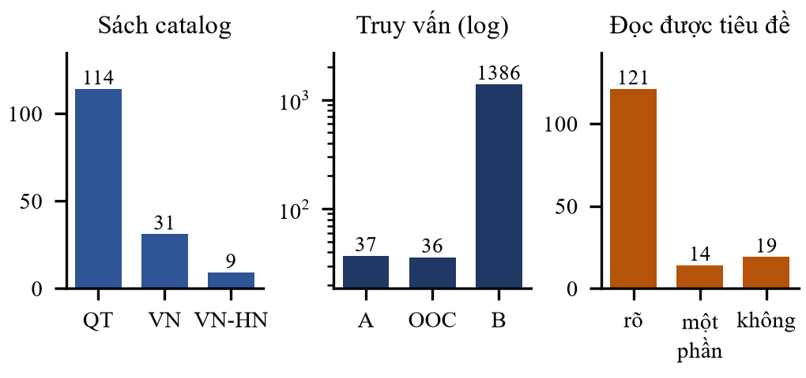
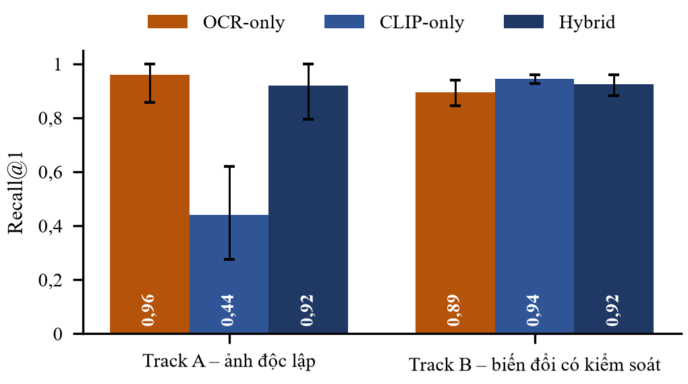
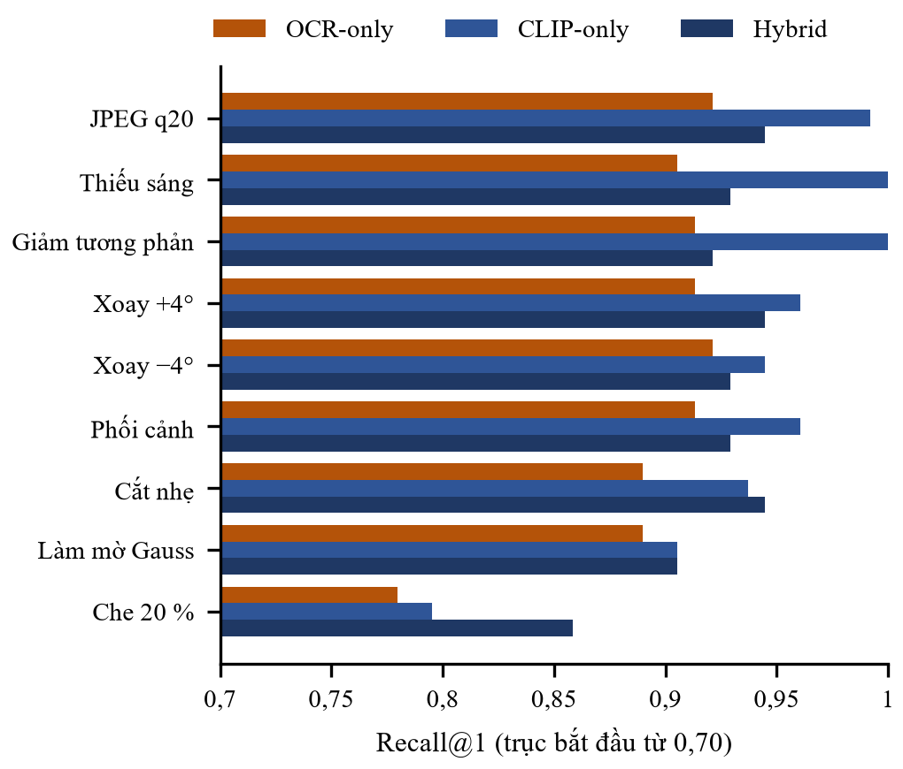
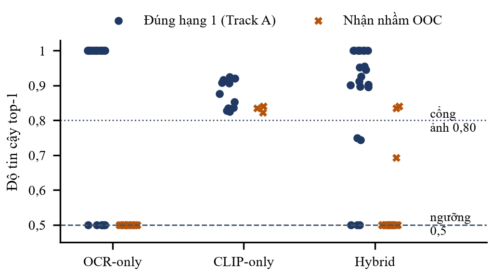
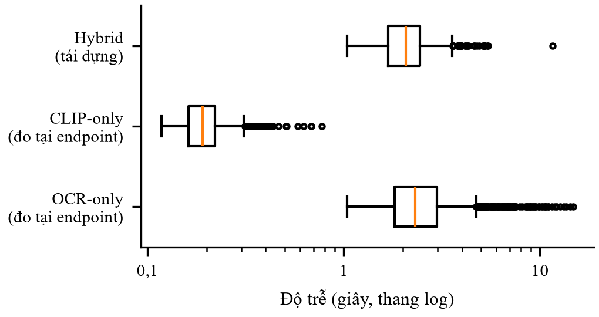
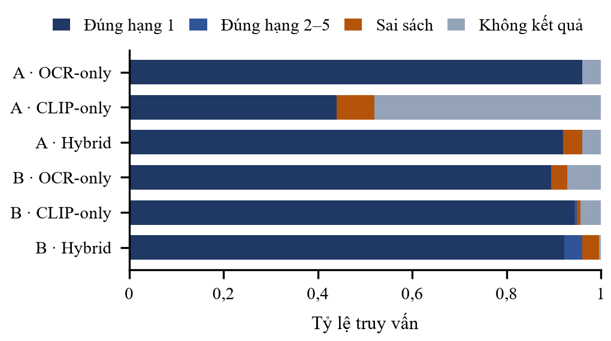

# Đánh giá thực nghiệm phương pháp tìm kiếm sách đa phương thức kết hợp đặc trưng thị giác CLIP và trích xuất văn bản bằng mô hình thị giác–ngôn ngữ trong hệ thống SmartBook

@authors Vòng Đăng Khoa, Trương Đăng Vĩnh Hưng
@affil Khoa Công nghệ Thông tin, Trường Đại học Công nghiệp Thành phố Hồ Chí Minh
@email 22673971.khoa@student.iuh.edu.vn, 22671921.hung@student.iuh.edu.vn

**Tóm tắt –** Tra cứu sách bằng ảnh bìa cần vừa nhận đúng sách trong danh mục vừa từ chối sách không có trong thư viện. Nghiên cứu đánh giá chức năng tìm sách bằng ảnh bìa đang vận hành trong SmartBook, kết hợp đặc trưng thị giác CLIP ViT-B/32 với tiêu đề và tác giả do mô hình thị giác–ngôn ngữ Qwen đọc từ bìa bằng trung bình có trọng số và các ngưỡng cố định. Bộ dữ liệu gồm 154 đầu sách (40 sách tiếng Việt) từ Wikimedia Commons có Ground Truth và kiểm toán giấy phép, với 37 ảnh truy vấn độc lập, 1.386 ảnh biến đổi có kiểm soát và 36 bìa ngoài danh mục; ba phương pháp OCR-only, CLIP-only và Hybrid chạy trên chính mã nguồn production với cùng phản hồi OCR. Trên ảnh độc lập, Recall@1 của OCR-only, Hybrid và CLIP-only là 0,960, 0,920 và 0,440; CLIP không nhận được bìa khác ấn bản và cổng cosine 0,80 loại phần lớn kết quả đúng của nó. Trên ảnh biến đổi, CLIP đạt 0,944 và Hybrid 0,923. Công thức hợp nhất không đơn điệu làm Hybrid mất 61 kết quả đúng, nhất là với bìa Hán-Nôm, và các phương pháp có OCR nhận nhầm toàn bộ 27 bìa ngoài danh mục vì điểm văn bản bằng đúng ngưỡng chấp nhận. Chi phí đo được là 4,6·10⁻⁵ USD và khoảng 2 giây mỗi lượt tìm.

**Thuật ngữ –** CLIP, Book Cover Retrieval, Vision-Language Model, OCR, Multimodal Fusion, Open-set Retrieval, SmartBook.

## I. Giới thiệu

### A. Bối cảnh và vấn đề nghiên cứu

Trong thư viện, ảnh bìa là cách nhanh nhất để người đọc hỏi "thư viện có cuốn này không" và để thủ thư tra một cuốn sách cầm trên tay mà không phải gõ tiêu đề có dấu tiếng Việt, chữ Hán-Nôm hay tên tác giả nước ngoài. Về bản chất, đây là bài toán truy xuất trong danh mục đóng: hệ thống nhận ảnh bìa và phải trả về đúng đầu sách trong catalog, hoặc trả lời "không có trong thư viện". Câu trả lời sai nhưng tự tin còn tệ hơn không trả lời, vì người dùng có thể đặt mượn nhầm sách.

Các hệ thống tìm kiếm thị giác di động trước đây dùng đặc trưng cục bộ và kiểm tra hình học [3]–[6]; hiện nay mô hình tương phản ảnh–văn bản như CLIP [1], dựa trên bộ mã hóa Vision Transformer [2], cho phép mã hóa ảnh thành một vector toàn cục mà không cần huấn luyện lại, còn mô hình thị giác–ngôn ngữ (VLM) như họ Qwen-VL [12]–[14] có thể đọc trực tiếp tiêu đề và tác giả in trên bìa. Hai tín hiệu bổ sung cho nhau về lý thuyết: ảnh bìa nhận diện đúng *ấn bản* nhưng nhạy với thiết kế bìa, còn chữ trên bìa nhận diện đúng *tác phẩm* nhưng phụ thuộc chất lượng đọc chữ.

SmartBook là hệ thống quản lý thư viện kiến trúc microservices do nhóm tác giả phát triển [28]. Chức năng "Tìm sách bằng ảnh bìa" kết hợp CLIP ViT-B/32 với mô hình `qwen/qwen3.7-flash` qua OpenRouter và một công thức hợp nhất có trọng số cố định. Chức năng đã chạy được nhưng chưa từng được đo trên dữ liệu có Ground Truth: chưa biết mỗi tín hiệu đóng góp bao nhiêu, công thức hợp nhất có tốt hơn từng tín hiệu riêng hay không, và hệ thống có từ chối được bìa không thuộc catalog hay không.

### B. Nghiên cứu liên quan và khoảng trống

Bìa sách từng là đối tượng chuẩn trong tìm kiếm thị giác di động: bộ Stanford MVS [4] gồm ảnh chụp bìa sách, CD, DVD bằng điện thoại và ảnh tham chiếu sạch, được giải bằng SIFT [6], cây từ vựng [5] và kiểm tra hình học [3]. Đặc trưng sâu toàn cục sau đó thay thế đặc trưng thủ công trong truy xuất thể hiện [19], còn CLIP [1] và các phiên bản mở rộng quy mô [15] cung cấp đặc trưng tổng quát không cần huấn luyện cho từng miền. Bìa sách cũng được nghiên cứu như bài toán phân loại thể loại [8], [9] và là nguồn văn bản của OCR-VQA với hơn 200 nghìn bìa [16], cho thấy tiêu đề và tác giả trên bìa là tín hiệu đọc được bằng máy.

Về đọc chữ, bên cạnh OCR truyền thống cần mô hình riêng cho từng chữ viết [7] là các mô hình hiểu tài liệu không cần OCR [10] và mô hình đa phương thức lớn; OCRBench [11] cho thấy các mô hình này đọc tốt văn bản Latin thông thường nhưng yếu hơn với chữ không phải Latin, viết tay và văn bản dày đặc. Về hợp nhất, các khảo sát phân biệt hợp nhất sớm, muộn và lai [17], [18]; hợp nhất muộn theo điểm phụ thuộc vào việc hai thang điểm có cùng ý nghĩa hay không, trong khi Reciprocal Rank Fusion (RRF) [20] hợp nhất theo thứ hạng để tránh vấn đề này. Bên trong nhánh văn bản, SmartBook dùng RRF và embedding Qwen3 [21]. Từ chối mẫu ngoài tập thuộc bài toán nhận dạng tập mở [22], [23]; độ bền trước nhiễu thường được đo bằng các biến đổi có kiểm soát với tham số ghi rõ [24].

Khoảng trống: chưa có đánh giá thực nghiệm cho tổ hợp *CLIP đóng băng + VLM đọc chữ + hợp nhất muộn có cổng ngưỡng* trên catalog thư viện, đặc biệt với sách tiếng Việt (có dấu, có bìa Hán-Nôm) và với yêu cầu từ chối bìa ngoài catalog.

### C. Câu hỏi nghiên cứu và đóng góp

Nghiên cứu đánh giá đúng mã nguồn đang vận hành, không đề xuất mô hình mới:

RQ1: CLIP truy xuất đúng sách từ ảnh bìa chính xác đến mức nào?

RQ2: Đọc chữ bằng VLM có cải thiện truy xuất so với chỉ dùng thị giác và chỉ dùng chữ không?

RQ3: Phương pháp đa phương thức bền vững đến đâu trước các điều kiện chất lượng ảnh khác nhau?

RQ4: Đánh đổi giữa độ chính xác, độ trễ suy luận và chi phí API như thế nào?

Sáu giả thuyết có hướng (H1–H6, mục III.G) được ghi trong protocol trước khi chạy thực nghiệm chính. Đóng góp gồm: (i) bộ dữ liệu 154 đầu sách có Ground Truth, kiểm toán giấy phép và mã băm từng ảnh, tái lập được từ nguồn mở; (ii) khung đánh giá gọi trực tiếp endpoint production, so sánh ghép cặp ba phương pháp trên cùng phản hồi OCR; (iii) kết quả định lượng có khoảng tin cậy và phân tích lỗi chỉ ra ba điểm yếu cấu trúc của cấu hình hiện tại.

## II. Phương pháp nghiên cứu

### A. Hệ thống, phiên bản mã nguồn và mô hình

Thực nghiệm dùng mã nguồn nhánh `hungg`, commit `33c41c7`; các tệp production liên quan không thay đổi trong mọi lượt chạy (kiểm tra bằng `git status`, ghi vào manifest từng lượt). Endpoint `POST /find-book-by-cover` chạy song song hai nhánh (Hình 1). Nhánh thị giác mã hóa ảnh bằng CLIP ViT-B/32 (`openai/clip-vit-base-patch32`; đổi cạnh ngắn về 224 px, cắt giữa 224×224; vector 512 chiều chuẩn hóa L2) và so cosine tuyến tính với ảnh bìa của từng ấn bản trong gallery; gallery được lưu trong bảng `ai_cover_embeddings` và đồng bộ theo mã băm danh sách ảnh. Nhánh đọc chữ gửi ảnh gốc tới `qwen/qwen3.7-flash` (nhiệt độ 0, tối đa 200 token, tắt reasoning, timeout 20 s) với prompt tiếng Việt yêu cầu JSON `{title, author}`; các cụm "không đọc được" bị lọc. Chuỗi "tiêu đề + tác giả" được xếp hạng trên catalog bằng tìm kiếm ngữ nghĩa (Qwen3-Embedding-8B, 768 chiều, ngưỡng cosine 0,3) và tìm kiếm toàn văn (mọi từ phải khớp), hợp nhất bằng RRF (k = 60) rồi chuẩn hóa về [0, 1]. Mọi nhánh đều suy giảm có kiểm soát: lỗi API, JSON sai hay lỗi CLIP chỉ làm mất tín hiệu tương ứng.

![[w=2.9]Hình 1. Pipeline tìm sách bằng ảnh bìa trong SmartBook: hai nhánh song song, cổng thị giác 0,80, hợp nhất theo sách và cổng độ tin cậy 0,5. Nguồn đối chiếu: routes_cover_search.py, cover_embeddings.py, assistant_tools.py.](figures/cover-search-architecture-column.png)

### B. Thuật toán hợp nhất

Với mỗi sách b, gọi v(b) là cosine lớn nhất giữa ảnh truy vấn và các ấn bản của b (chỉ xét khi v(b) ≥ 0,80) và o(b) là điểm văn bản đã chuẩn hóa. Độ tin cậy:

$$ conf(b) = 0,6·v(b) + 0,4·o(b) khi có cả hai tín hiệu; conf(b) = v(b) hoặc o(b) khi chỉ có một   (1) $$

Kết quả giữ tối đa 5 ứng viên có conf ≥ 0,5; không còn ứng viên nghĩa là "không tìm thấy". Hai đặc tính được ghi nhận khi đọc mã, trước khi thực nghiệm: (1) hợp nhất không đơn điệu — một sách có v = 0,85 và thêm bằng chứng chữ o = 0,5 nhận 0,71, thấp hơn khi chỉ có ảnh; (2) với RRF chuẩn hóa, một sách đứng hạng 1 ở chỉ một nhánh văn bản nhận đúng 0,5, bằng ngưỡng chấp nhận, còn hạng 1 ở cả hai nhánh nhận 1,0.

### C. Ba phương pháp so sánh và khung đánh giá

Cả ba phương pháp gọi chính hàm endpoint production, chỉ vô hiệu một nhánh trong tiến trình đánh giá: OCR-only (nhánh thị giác trả rỗng), CLIP-only (nhánh chữ trả rỗng) và Hybrid (nguyên trạng). Hợp nhất, các cổng và giới hạn top-5 không đổi, nên mọi khác biệt đến từ tín hiệu chứ không từ cách cài đặt lại. Catalog và gallery được cấp trong bộ nhớ thay cho Gateway và inventory-service; embedding gallery dùng đúng hàm `embed_image` của production. Nhánh toàn văn chạy trên một store nghiên cứu mô phỏng ngữ nghĩa `plainto_tsquery('simple', unaccent(q))` của Postgres (mọi từ phải có, bỏ dấu, không stemming) vì máy đánh giá không có Postgres và dữ liệu nghiên cứu không được ghi vào cơ sở dữ liệu nghiệp vụ. Phản hồi Qwen của mỗi ảnh được ghi một lần (kèm token, chi phí, độ trễ); OCR-only gọi API thật, Hybrid phát lại đúng phản hồi đó, nên phép so sánh là ghép cặp trên cùng văn bản OCR và chi phí không nhân đôi.

![[w=2.5]Hình 2. Quy trình nghiên cứu: từ audit mã nguồn, thu thập và gán nhãn dữ liệu đến pilot, thực nghiệm chính và phân tích thống kê.](figures/research-workflow-paper.png)

### D. Thu thập dữ liệu và Ground Truth

Ảnh lấy từ Wikimedia Commons qua API, tải tuần tự với User-Agent nhận diện nghiên cứu có địa chỉ liên hệ và tôn trọng Retry-After. Ứng viên tiếng Anh lấy từ truy vấn SPARQL trên Wikidata: 5.000 bản ghi (4.743 tác phẩm 1840–1930 có ảnh), 824 ảnh có tên tệp dạng bìa, 363 tác phẩm tiếng Anh đủ tác giả và năm; từ đó chọn ngẫu nhiên có seed 110 sách cho catalog và 30 sách làm bìa ngoài catalog. Ứng viên tiếng Việt (72 tệp) lấy từ danh mục "Book covers from Vietnam", 14 truy vấn tìm kiếm và 16 bản ghi seed có sẵn; ảnh độc lập cho Track A là các tệp khác của cùng tác phẩm trong danh mục Commons của nó (44 tệp tiếng Anh được rà soát). Ảnh được tải ở cỡ thumbnail chuẩn lớn nhất nhỏ hơn ảnh gốc (1.280/960/500/330 px), không phóng to.

Mỗi ảnh được kiểm tra MIME theo magic bytes, giải mã đầy đủ, băm SHA-256 và pHash. Giấy phép đọc từ trang mô tả tệp và phân loại: *đã xác minh phạm vi công cộng* chỉ khi trang nêu cơ sở tại Hoa Kỳ và cơ sở toàn cầu (tác giả mất trên 70 năm hoặc không đủ điều kiện bảo hộ); tuyên bố chỉ cho một quốc gia, kể cả "PD-Vietnam", được xếp *chỉ theo tuyên bố nguồn*; 16 bìa thương mại hiện đại do người dùng tự gắn giấy phép CC cũng được hạ xuống mức này. Một người gán nhãn (tác tử AI nghiên cứu, không có người gán nhãn thứ hai) đối chiếu danh tính sách với trang nguồn và chữ in trên bìa (chữ in thắng khi xung đột), đánh dấu mức đọc được tiêu đề, và loại 47/274 ảnh có ghi lý do: 15 trang tên sách, 13 bìa trải trước–gáy–sau, 5 ảnh ghép nhiều bìa, 3 bản quét trùng với ảnh gallery (pHash 2–8) và 11 lý do khác.

Bảng I – Thống Kê Bộ Dữ Liệu

| Thành phần | Số lượng | Ghi chú |
|---|---|---|
| Sách trong catalog | 154 | 114 quốc tế, 40 tiếng Việt (9 Hán-Nôm) |
| Track A – ảnh độc lập | 37 (29 sách) | 23 cùng bìa, 14 bìa khác |
| Track B – biến đổi | 1.386 | 9 phép × 154 ảnh |
| Ngoài catalog (OOC) | 36 | 28 quốc tế, 8 tiếng Việt |
| Dev / test | 27 / 127 sách | băm theo sách |
| Quyền: PD / mở / tuyên bố | 10 / 10 / 207 | 227 ảnh gốc |

Track A là ảnh khác tệp với ảnh gallery: cùng bìa của cùng ấn bản (bản quét hoặc ảnh chụp khác) hoặc bìa khác của cùng tác phẩm (ấn bản khác, áo bìa so với bìa vải). Nhóm OOC gồm 28 tác phẩm chưa từng vào catalog và 8 bìa tiếng Việt được rút khỏi catalog bằng hàm băm có seed; trong đó có các mẫu khó cùng tác giả hoặc cùng series với sách trong catalog (Zane Grey, L. Frank Baum, Hardy Boys, L. M. Montgomery). Không ấn bản nào có ISBN-13 (152 ấn bản ra đời trước khi có ISBN), nên đường tắt ISBN của production không được kiểm tra. Sách được chia dev/test theo ngưỡng băm từng sách (15 % dev); dev chỉ dùng cho pilot.

Bảng II – Tham Số Biến Đổi Có Kiểm Soát (Track B)

| Phép biến đổi | Tham số |
|---|---|
| Xoay ±4° | bicubic, mở rộng khung, nền xám nhạt |
| Phối cảnh | dịch 4 góc ngẫu nhiên ≤ 8 % kích thước |
| Làm mờ Gauss | bán kính = max(1, 0,4 % cạnh dài) px |
| Thiếu sáng / giảm tương phản | hệ số 0,45 / 0,5 |
| JPEG | chất lượng 20 |
| Che khuất | hình chữ nhật xám, 20 % diện tích, vị trí ngẫu nhiên |
| Cắt nhẹ | 3–8 % mỗi cạnh |

Mọi biến đổi dùng seed cố định theo mã ảnh và được lưu kèm tham số, seed và mã băm; đây là nhiễu tổng hợp trên chính ảnh gallery, không phải ảnh chụp thực.

### E. Thiết kế thực nghiệm và môi trường

Các thực nghiệm gồm: E0 kiểm định dữ liệu (trùng lặp, giải mã, mã băm, ISBN, Ground Truth, giấy phép, URL nguồn); E1 OCR-only; E2 CLIP-only; E3 Hybrid; E4 độ bền theo điều kiện ảnh; E5 từ chối bìa ngoài catalog; E6 độ trễ và chi phí. E0 cho 0 lỗi nghiêm trọng và 0 URL nguồn hỏng. Mọi tham số giữ đúng mặc định production; không tham số nào được tinh chỉnh. Pilot 5 truy vấn trên tập dev phát hiện một sai khác của khung đánh giá: store in-memory mặc định của repo khớp bất kỳ từ nào, nên các sách cùng tác giả hoặc cùng series nhận điểm văn bản 0,976–0,984 và đẩy sách đúng xuống hạng 2–5 trong Hybrid. Store được thay bằng bản mô phỏng ngữ nghĩa Postgres trước khi chạy tập test; kết quả pilot cũ được giữ nguyên làm bằng chứng. Môi trường: Windows 11, Intel Core i7-11800H, 16 GB RAM, CLIP chạy trên CPU như container production; Python 3.14.3, torch 2.15.0 (CPU), transformers 5.17.0. Chi phí API được giới hạn cứng 1 USD và đọc từ trường `usage.cost` do OpenRouter trả về.

### F. Độ đo và phân tích thống kê

Một truy vấn đúng khi mã sách Ground Truth nằm trong danh sách trả về; độ đo chính là Recall@1, Recall@5 và MRR. Truy vấn lỗi API hay không có kết quả vẫn tính là sai. Với E5, lớp dương là "từ chối": báo cáo F1 của từ chối, tỷ lệ nhận nhầm (FPR) trên bìa OOC và tỷ lệ từ chối nhầm trên Track A. Độ chính xác OCR đo trên các truy vấn có tiêu đề đọc được, theo khớp nguyên dạng, khớp sau chuẩn hóa (bỏ dấu, chữ thường, bỏ dấu câu, bỏ mạo từ đầu) và khớp mờ (SequenceMatcher ≥ 0,85); giá trị gốc có dấu luôn được giữ. Khoảng tin cậy (KTC) 95 % dùng bootstrap theo cụm sách (10.000 lần lặp) vì các truy vấn cùng một sách không độc lập [26]; kiểm định McNemar chính xác [25] được báo cáo như thống kê mô tả; kích thước hiệu ứng dùng Cohen's h.

## III. Kết quả và thảo luận

### A. Kết quả chính (RQ1, RQ2)

Bảng III – Kết Quả Trên Tập Test (KTC 95 % Bootstrap Theo Sách)

| Track | Phương pháp | n | Recall@1 (KTC 95 %) | R@5 | MRR |
|---|---|---|---|---|---|
| A | OCR-only | 25 | 0,960 (0,857–1,000) | 0,960 | 0,960 |
| A | CLIP-only | 25 | 0,440 (0,276–0,619) | 0,440 | 0,440 |
| A | Hybrid | 25 | 0,920 (0,793–1,000) | 0,920 | 0,920 |
| B | OCR-only | 1.143 | 0,894 (0,843–0,938) | 0,895 | 0,894 |
| B | CLIP-only | 1.143 | 0,944 (0,927–0,959) | 0,949 | 0,946 |
| B | Hybrid | 1.143 | 0,923 (0,882–0,958) | 0,961 | 0,935 |

RQ1. Độ chính xác của CLIP phụ thuộc gần như hoàn toàn vào việc ảnh truy vấn có cùng thiết kế bìa với ảnh trong catalog hay không. Trên ảnh biến đổi từ chính ảnh gallery, Recall@1 đạt 0,944; trên ảnh độc lập cùng ấn bản giảm còn 0,786 (11/14); với bìa khác của cùng tác phẩm là 0/11. Cổng cosine 0,80 là nguồn lỗi chính: nếu bỏ cổng (chỉ để chẩn đoán), thứ hạng cosine đặt đúng sách ở vị trí 1 với 68 % truy vấn Track A và 97,9 % truy vấn Track B; 6 trong 14 lỗi Track A và 40 trong 64 lỗi Track B là sách đúng đứng đầu nhưng có cosine dưới 0,80 nên bị loại.

Bảng IV – Recall@1 Trên Track A Theo Phân Tầng (Tập Test)

| Phân tầng | n | OCR-only | CLIP-only | Hybrid |
|---|---|---|---|---|
| Cùng bìa, ảnh độc lập | 14 | 1,000 | 0,786 | 0,929 |
| Bìa khác cùng tác phẩm | 11 | 0,909 | 0,000 | 0,909 |
| Bản quét | 18 | 0,944 | 0,444 | 0,889 |
| Ảnh chụp (kể cả chụp nghiêng) | 4 | 1,000 | 0,250 | 1,000 |
| Độ phân giải thấp | 3 | 1,000 | 0,667 | 1,000 |
| Tiếng Việt | 2 | 1,000 | 0,000 | 1,000 |

Bảng IV cho thấy khoảng cách giữa hai tín hiệu lớn nhất ở bìa khác ấn bản và ảnh chụp: chữ trên bìa không đổi giữa các ấn bản và ít nhạy với góc chụp, còn đặc trưng toàn cục của CLIP thay đổi theo thiết kế, ánh sáng và nền. Các phân tầng nhỏ (n ≤ 4) chỉ mang tính mô tả.

RQ2. So với CLIP-only, thêm OCR cải thiện rõ trên ảnh độc lập (Bảng V: Recall@1 +0,48, KTC không chứa 0) nhưng không cải thiện trên Track B. So với OCR-only, Hybrid không cho thấy cải thiện ở hạng 1 (Track A −0,04; Track B +0,029, cả hai KTC chứa 0); Hybrid chỉ tăng Recall@5 trên Track B (+0,066) vì tín hiệu ảnh giữ sách đúng trong danh sách khi Qwen không đọc được chữ (82 ca OCR-only không có văn bản, Hybrid chỉ còn 5 ca không có kết quả). Hybrid không phải "tốt nhất của cả hai": trên Track B nó làm sai 74 truy vấn CLIP-only đúng và 64 truy vấn OCR-only đúng.

Bảng V – So Sánh Ghép Cặp Hybrid Với Phương Pháp Đơn (Tập Test)

| Track | Hybrid so với | ΔRecall@1 (KTC 95 %) | ΔR@5 | b10/b01 |
|---|---|---|---|---|
| A | CLIP-only | +0,480 (0,286–0,655) | +0,480 | 0/12 |
| A | OCR-only | −0,040 (−0,143–0,000) | −0,040 | 1/0 |
| B | CLIP-only | −0,021 (−0,067–0,018) | +0,011 | 74/50 |
| B | OCR-only | +0,029 (−0,027–0,087) | +0,066 | 64/97 |

Nguyên nhân là tính không đơn điệu của công thức (1). Phân tích lại các phản hồi đã ghi tìm thấy 61 truy vấn Track B mà sách đúng có cả hai tín hiệu, điểm hợp nhất thấp hơn một ứng viên chỉ có một tín hiệu và sách đúng mất hạng 1; 49 ca là bìa Hán-Nôm. Ví dụ, với *Nam Kỳ lục tỉnh địa dư chí*, Qwen đọc đúng 南圻六省地輿誌, Qwen3-Embedding khớp chéo ngôn ngữ với tên quốc ngữ trong catalog (o = 0,5), CLIP cho v = 0,93–0,98; điểm hợp nhất 0,76–0,79 thấp hơn 0,92–0,93 của một bìa khắc gỗ Hán khác chỉ có điểm ảnh.

### B. Độ bền theo điều kiện ảnh (RQ3)

Bảng VI – Recall@1 Theo Phép Biến Đổi, Track B, Tập Test (n = 127 Mỗi Phép)

| Phép biến đổi | OCR-only | CLIP-only | Hybrid |
|---|---|---|---|
| JPEG q20 | 0,921 | 0,992 | 0,945 |
| Thiếu sáng | 0,906 | 1,000 | 0,929 |
| Giảm tương phản | 0,913 | 1,000 | 0,921 |
| Xoay +4° | 0,913 | 0,961 | 0,945 |
| Xoay −4° | 0,921 | 0,945 | 0,929 |
| Phối cảnh | 0,913 | 0,961 | 0,929 |
| Cắt nhẹ | 0,890 | 0,937 | 0,945 |
| Làm mờ Gauss | 0,890 | 0,906 | 0,906 |
| Che 20 % | 0,780 | 0,795 | 0,858 |

Che khuất là điều kiện khó nhất với cả ba phương pháp và là điều kiện duy nhất Hybrid vượt rõ cả hai phương pháp đơn; các biến đổi quang học (JPEG, độ sáng, tương phản) gần như không ảnh hưởng CLIP, còn làm mờ ảnh hưởng cả hai tín hiệu. Theo chữ viết, CLIP bền như nhau trên bìa Hán-Nôm (0,972), OCR-only giảm còn 0,694 và Hybrid sụp xuống 0,139; trên bìa chữ Latin, Hybrid là tốt nhất (0,976 so với 0,942 của CLIP và 0,908 của OCR-only), kể cả bìa tiếng Việt chữ Latin (0,979). Trên ảnh độc lập, 4 ảnh chụp thật đều được OCR-only và Hybrid nhận đúng, CLIP-only chỉ nhận được 1.

Bảng VII – Độ Chính Xác Đọc Chữ Của Qwen (Truy Vấn Có Tiêu Đề Đọc Được)

| Chỉ số | Track A (n = 24) | Track B (n = 990) |
|---|---|---|
| Tiêu đề khớp nguyên dạng | 0,500 | 0,362 |
| Tiêu đề khớp sau chuẩn hóa | 0,833 | 0,816 |
| Tiêu đề khớp mờ ≥ 0,85 | 0,958 | 0,860 |
| Tác giả khớp sau chuẩn hóa | 0,750 | 0,634 |
| Tác giả khớp mờ | 0,750 | 0,715 |

Khớp nguyên dạng thấp vì bìa in chữ hoa hoặc ngắt dòng ("The CLANSMAN", "THOMAS DIXON JR"); sau chuẩn hóa, tiêu đề đúng ở hơn 80 % truy vấn. Trên Track B, tiêu đề tiếng Việt khớp sau chuẩn hóa 80,2 % và khớp mờ 87,9 %, tương đương nhóm quốc tế (82,0 % và 85,4 %). Lỗi đọc quan sát được gồm chuẩn hóa chính tả cổ ("Đường Kích mệnh" thay cho *Đường kách mệnh*), sai dấu tiếng Việt ("TIÊN-NGUYỄN LOÁT-YỂU PHỒ"), dính chữ ("The MoonMaid"), bỏ sót logo cách điệu ("The Gnome King of Z") và thêm phụ đề. Tác giả khó hơn tiêu đề vì chữ viết tắt, danh xưng và nhiều tác giả ("Mrs. George Corbett", "J·H·Fabre").

### C. Từ chối bìa ngoài catalog

Bảng VIII – Từ Chối Bìa Ngoài Catalog (27 Bìa OOC, 25 Truy Vấn Track A, Tập Test)

| Phương pháp | Nhận nhầm OOC | Từ chối nhầm Track A | F1 từ chối |
|---|---|---|---|
| OCR-only | 1,000 (27/27) | 0,040 | – |
| CLIP-only | 0,111 (3/27) | 0,480 | 0,762 |
| Hybrid | 1,000 (27/27) | 0,040 | – |

OCR-only và Hybrid trả về một sách cho mọi bìa OOC có chữ đọc được. Nhánh ngữ nghĩa luôn trả về sách gần nhất; sách đứng hạng 1 ở một nhánh văn bản nhận đúng 0,5, bằng ngưỡng chấp nhận (`>=`). Hình 6 cho thấy cả 27 lần nhận nhầm của OCR-only có độ tin cậy 0,5, trùng với mức thấp nhất của câu trả lời đúng, nên không ngưỡng nào trên điểm này tách được hai nhóm. Các mẫu khó bị ánh xạ sang sách "gần" rất dễ được người dùng chấp nhận (*The Blue Castle* → *Anne of Green Gables*, *The Missing Chums* → *The House on the Cliff*, *The Last Trail* → *Riders of the Purple Sage*). Ngược lại, CLIP-only từ chối tốt hơn nhưng phải trả giá bằng tỷ lệ từ chối nhầm 48 % trên ảnh thật, vì cosine của bìa OOC (0,82–0,84) trùng dải cosine của ảnh đúng (0,83–0,92).

### D. Độ trễ và chi phí (RQ4)

Bảng IX – Độ Trễ Và Chi Phí (Track B, Tập Test)

| Thành phần | p50 | p95 |
|---|---|---|
| CLIP-only, endpoint | 191 ms | 300 ms |
| OCR-only, endpoint (gọi thật) | 2.303 ms | 6.054 ms |
| Hybrid, end-to-end tái dựng | 2.068 ms | 3.025 ms |
| Lời gọi Qwen (nhà cung cấp) | 2.033 ms | 2.990 ms |
| Mã hóa CLIP, đã nạp mô hình | 79 ms | 160 ms |
| Chi phí mỗi truy vấn | 4,6·10⁻⁵ USD | – |

Độ trễ của OCR-only gồm lời gọi Qwen và lời gọi embedding câu truy vấn; độ trễ Hybrid được tái dựng từ độ trễ API đã ghi vì hai nhánh chạy song song trong production. Lời gọi Qwen gấp khoảng 25 lần thời gian mã hóa CLIP; khởi động nguội CLIP (nạp mô hình) mất khoảng 15 s nên cần warm-up như production đang làm. Toàn bộ 1.459 lời gọi Qwen tốn 0,0675 USD theo số liệu nhà cung cấp (trung bình 1.431 token vào, 26 token ra), cộng khoảng 0,0001 USD cho embedding văn bản; 1.000 lượt tìm tốn khoảng 0,05 USD. Chi phí vì vậy không phải rào cản; độ trễ khoảng 2 s và khả năng từ chối mới là đánh đổi chính: CLIP-only nhanh hơn một bậc độ lớn nhưng thua 52 điểm phần trăm Recall@1 trên ảnh độc lập.

### E. Phân tích lỗi

Bảng X – Phân Loại Lỗi Track B (Tập Test, 1.143 Truy Vấn)

| Loại lỗi | OCR-only | CLIP-only | Hybrid |
|---|---|---|---|
| Không đọc được chữ | 82 | – | – |
| Cổng 0,80 loại sách đúng | – | 40 | – |
| Sai sách | 38 | 9 | 40 |
| Đúng nhưng không hạng 1 | 1 | 6 | 43 |
| Không kết quả khác | – | 9 | 5 |

Lỗi của OCR-only tập trung ở bìa không in tiêu đề (72/82 ca không có chữ) và bìa Hán-Nôm (22/38 ca sai sách). Lỗi của CLIP-only chủ yếu là cổng ngưỡng; các bìa vải trơn chữ nhỏ (*The Man Who Died Twice*, *Afloat and Ashore*) thường xuất hiện như kết quả sai vì chúng giống nhau về thị giác. Lỗi của Hybrid gần như đều do hạ hạng khi hợp nhất: 62/88 ca là bìa Hán-Nôm. Chỉ 1/1.459 lời gọi Qwen trả về JSON bị cắt; production đã suy giảm đúng thiết kế (OCR-only không có kết quả, Hybrid vẫn đúng nhờ CLIP); không có timeout, lỗi HTTP hay lỗi CLIP. Với bìa khác ấn bản, OCR-only và Hybrid tìm đúng 10/11 tác phẩm, nhưng mã ấn bản trả về khi đó là ấn bản mặc định của catalog chứ không phải ấn bản trong ảnh.

Bảng XI – Ví Dụ Truy Vấn (Sách Hạng 1 Và Độ Tin Cậy; – Là Không Có Kết Quả)

| Truy vấn | OCR-only | CLIP-only | Hybrid |
|---|---|---|---|
| *Dracula*, ảnh chụp bản 1897 | ✓ 1,00 | ✓ 0,91 | ✓ 0,95 |
| *The Sun Also Rises*, bìa ấn bản sau | ✓ 1,00 | – | ✓ 1,00 |
| *Through the Woods*, bản quét khác | ✓ 0,50 | ✗ 0,85 | ✗ 0,85 |
| *Đường kách mệnh*, chụp trong tủ kính | ✓ 0,50 | – | ✓ 0,50 |
| *Nam Kỳ lục tỉnh địa dư chí*, xoay +4° | ✓ 0,50 | ✓ 0,96 | ✗ 0,93 |
| *The Blue Castle* (ngoài catalog) | ✗ 0,50 | từ chối ✓ | ✗ 0,50 |

Bảng XI tóm tắt các cơ chế trên ở mức từng truy vấn: OCR cứu các trường hợp CLIP thất bại (bìa khác ấn bản, ảnh chụp trong tủ kính), CLIP đúng khi chữ khó đọc nhưng bị hợp nhất hạ hạng, và các câu trả lời đúng của OCR có cùng độ tin cậy 0,5 với câu trả lời sai cho bìa ngoài catalog. Các ví dụ được chọn để minh họa từng loại kết quả; số liệu đầy đủ của mọi truy vấn có trong tệp lỗi theo truy vấn của bộ dữ liệu.

### F. Thảo luận

Kết quả cho thấy ba điểm cần sửa trong cấu hình hiện tại, đều do thiết kế hợp nhất chứ không do mô hình. Thứ nhất, cổng cosine cố định 0,80 vừa loại kết quả đúng vừa nhận bìa lạ vì hai dải cosine chồng nhau; một ngưỡng toàn cục duy nhất không phù hợp cho CLIP ViT-B/32 với bìa sách. Thứ hai, điểm văn bản đúng bằng ngưỡng chấp nhận khiến hệ thống không bao giờ trả lời "không tìm thấy" khi đọc được chữ; mô-đun độ tin cậy truy xuất mà trợ lý AI của SmartBook đã dùng để từ chối trả lời được tính ngay trong hàm xếp hạng nhưng bị bỏ qua ở chức năng này. Thứ ba, trung bình có trọng số phạt bằng chứng đồng thuận; một quy tắc đơn điệu (ví dụ hợp nhất theo thứ hạng như RRF [20], hoặc cộng thêm điểm thay vì lấy trung bình) sẽ không gây hiện tượng này.

Ở góc độ ứng dụng, OCR là tín hiệu chính để tìm *tác phẩm*, CLIP là tín hiệu chính để xác định *ấn bản* và là phương án dự phòng khi bìa không có chữ Latin. Với thư viện tiếng Việt có tài liệu Hán-Nôm, cấu hình hiện tại cho kết quả kém hơn cả hai thành phần riêng lẻ trên nhóm này. Đây là các nhận định về cấu hình đang triển khai; nghiên cứu không tinh chỉnh và chưa chứng minh một cấu hình thay thế tốt hơn — việc đó cần tập validation riêng và thực nghiệm mới.

Từ các phát hiện trên có thể đề xuất các thay đổi cho SmartBook, cần được đánh giá lại trên một tập validation riêng trước khi triển khai: (a) chỉ chấp nhận ứng viên văn bản khi mô-đun độ tin cậy truy xuất không trả về "không có bằng chứng", hoặc khi sách khớp ở cả hai nhánh văn bản, thay vì điều kiện conf ≥ 0,5; (b) thay công thức (1) bằng quy tắc đơn điệu, ví dụ lấy điểm cao hơn của hai tín hiệu cộng một phần thưởng khi chúng đồng thuận, để bằng chứng thứ hai không bao giờ làm giảm thứ hạng; (c) hạ hoặc hiệu chỉnh cổng cosine theo phân phối điểm thực tế, đồng thời dùng điểm cosine như tín hiệu xác nhận ấn bản thay vì điều kiện bắt buộc; (d) với bìa có chữ không phải Latin, ưu tiên tín hiệu thị giác; và (e) ở giao diện, hiển thị kết quả độ tin cậy thấp như gợi ý "có thể là" thay vì khẳng định.

### G. Kiểm định giả thuyết và hạn chế

Trong sáu giả thuyết đã đăng ký: H1 (CLIP trên ảnh độc lập thấp hơn trên ảnh biến đổi: 0,786 so với 0,944), H2 (Hybrid ≥ CLIP-only trên Track A: +0,48), H3 (OCR-only > CLIP-only với bìa khác ấn bản: 0,909 so với 0,000) và H6 (độ trễ do API chi phối, gấp ≥ 5 lần CLIP: khoảng 25 lần) được ủng hộ; H5 được ủng hộ một phần (che khuất khó nhất, JPEG và độ sáng ít ảnh hưởng nhất, nhưng làm mờ khó hơn cắt nhẹ); H4 (Hybrid ≥ OCR-only trên Track A) không được ủng hộ.

Kết quả có các giới hạn. Track A nhỏ (25 truy vấn test) nên chỉ phân biệt được chênh lệch lớn; dữ liệu thiên về bìa sách 1850–1930 và chỉ có 2 truy vấn Track A tiếng Việt; Track B dùng chính ảnh gallery nên đánh giá cao hiệu năng thực tế; ảnh truy vấn độc lập là bản quét và ảnh chụp trên mạng chứ không phải ảnh người dùng chụp bằng điện thoại. Nhánh toàn văn là bản mô phỏng ngữ nghĩa Postgres, thứ tự giữa các tài liệu cùng khớp mọi từ có thể khác `ts_rank`; catalog chỉ có tiêu đề và tác giả trong khi production còn đánh chỉ mục mô tả. Ground Truth do một người gán nhãn; mô hình Qwen được phục vụ từ xa có thể thay đổi, dù các phản hồi đã ghi giúp phân tích tái lập được. Phần lớn ảnh (207/227) chỉ có tuyên bố phạm vi công cộng tại Hoa Kỳ trên trang nguồn nên không được phân phối lại; mã, siêu dữ liệu và mã băm đủ để tải lại.

## IV. Kết luận

Nghiên cứu đã xây dựng một bộ dữ liệu bìa sách có Ground Truth và kiểm toán giấy phép, và đánh giá ghép cặp chức năng tìm sách bằng ảnh bìa của SmartBook trên chính mã nguồn production. Đọc chữ bằng Qwen là tín hiệu mạnh nhất trên ảnh độc lập (Recall@1 0,960), CLIP mạnh khi ảnh truy vấn giữ nguyên thiết kế bìa (0,944) nhưng bị cổng 0,80 cắt nhiều kết quả đúng, còn Hybrid với công thức hiện tại không vượt OCR-only ở hạng 1 và sụp trên bìa Hán-Nôm. Điểm yếu nghiêm trọng nhất là khả năng từ chối: các phương pháp có OCR nhận nhầm toàn bộ bìa ngoài catalog. Chi phí API không đáng kể (4,6·10⁻⁵ USD mỗi lượt), độ trễ khoảng 2 s.

Hướng phát triển: dùng quyết định của mô-đun độ tin cậy truy xuất và một ngưỡng chấp nhận nghiêm ngặt hơn cho tín hiệu văn bản; thay trung bình có trọng số bằng quy tắc đơn điệu và hiệu chỉnh trên tập validation riêng; tránh cắt giữa ảnh bìa dọc hoặc dùng mô hình CLIP lớn hơn [15]; dùng chỉ mục ANN [27] khi catalog lớn; và thu thập ảnh chụp bằng điện thoại thật cùng nhiều bìa tiếng Việt hiện đại có giấy phép rõ ràng, với hai người gán nhãn độc lập.

## Tài liệu tham khảo

[1] A. Radford, J. W. Kim, C. Hallacy, et al., "Learning transferable visual models from natural language supervision," in Proc. 38th Int. Conf. Machine Learning (ICML), PMLR, vol. 139, 2021, pp. 8748–8763.

[2] A. Dosovitskiy, L. Beyer, A. Kolesnikov, et al., "An image is worth 16x16 words: Transformers for image recognition at scale," in Proc. Int. Conf. Learning Representations (ICLR), 2021.

[3] B. Girod, V. Chandrasekhar, D. M. Chen, N.-M. Cheung, R. Grzeszczuk, Y. Reznik, et al., "Mobile visual search," IEEE Signal Process. Mag., vol. 28, no. 4, pp. 61–76, 2011, doi: 10.1109/MSP.2011.940881.

[4] V. R. Chandrasekhar, D. M. Chen, S. S. Tsai, N.-M. Cheung, H. Chen, G. Takacs, et al., "The Stanford mobile visual search data set," in Proc. 2nd ACM Conf. Multimedia Systems, 2011, pp. 117–122, doi: 10.1145/1943552.1943568.

[5] D. Nistér and H. Stewénius, "Scalable recognition with a vocabulary tree," in Proc. IEEE CVPR, vol. 2, 2006, pp. 2161–2168, doi: 10.1109/CVPR.2006.264.

[6] D. G. Lowe, "Distinctive image features from scale-invariant keypoints," Int. J. Comput. Vis., vol. 60, no. 2, pp. 91–110, 2004, doi: 10.1023/B:VISI.0000029664.99615.94.

[7] R. Smith, "An overview of the Tesseract OCR engine," in Proc. 9th Int. Conf. Document Analysis and Recognition (ICDAR), 2007, pp. 629–633, doi: 10.1109/ICDAR.2007.4376991.

[8] B. K. Iwana, S. T. R. Rizvi, S. Ahmed, A. Dengel, and S. Uchida, "Judging a book by its cover," arXiv:1610.09204, 2016 (preprint).

[9] A. Lucieri, H. Sabir, S. A. Siddiqui, S. T. R. Rizvi, B. K. Iwana, S. Uchida, et al., "Benchmarking deep learning models for classification of book covers," SN Comput. Sci., vol. 1, no. 3, 2020, doi: 10.1007/s42979-020-00132-z.

[10] G. Kim, T. Hong, M. Yim, J. Nam, J. Park, J. Yim, et al., "OCR-free document understanding transformer," in Computer Vision – ECCV 2022, LNCS, 2022, pp. 498–517, doi: 10.1007/978-3-031-19815-1_29.

[11] Y. Liu, Z. Li, M. Huang, B. Yang, W. Yu, C. Li, et al., "OCRBench: On the hidden mystery of OCR in large multimodal models," Sci. China Inf. Sci., vol. 67, no. 12, 2024, doi: 10.1007/s11432-024-4235-6.

[12] J. Bai, S. Bai, S. Yang, S. Wang, et al., "Qwen-VL: A versatile vision-language model for understanding, localization, text reading, and beyond," arXiv:2308.12966, 2023 (preprint).

[13] P. Wang, S. Bai, S. Tan, S. Wang, et al., "Qwen2-VL: Enhancing vision-language model's perception of the world at any resolution," arXiv:2409.12191, 2024 (preprint).

[14] S. Bai, K. Chen, X. Liu, J. Wang, et al., "Qwen2.5-VL technical report," arXiv:2502.13923, 2025 (preprint).

[15] M. Cherti, R. Beaumont, R. Wightman, M. Wortsman, G. Ilharco, C. Gordon, et al., "Reproducible scaling laws for contrastive language-image learning," in Proc. IEEE/CVF CVPR, 2023, pp. 2818–2829, doi: 10.1109/CVPR52729.2023.00276.

[16] A. Mishra, S. Shekhar, A. K. Singh, and A. Chakraborty, "OCR-VQA: Visual question answering by reading text in images," in Proc. ICDAR, 2019, pp. 947–952, doi: 10.1109/ICDAR.2019.00156.

[17] T. Baltrušaitis, C. Ahuja, and L.-P. Morency, "Multimodal machine learning: A survey and taxonomy," IEEE Trans. Pattern Anal. Mach. Intell., vol. 41, no. 2, pp. 423–443, 2019, doi: 10.1109/TPAMI.2018.2798607.

[18] P. K. Atrey, M. A. Hossain, A. El Saddik, and M. S. Kankanhalli, "Multimodal fusion for multimedia analysis: A survey," Multimedia Syst., vol. 16, no. 6, pp. 345–379, 2010, doi: 10.1007/s00530-010-0182-0.

[19] A. Gordo, J. Almazán, J. Revaud, and D. Larlus, "Deep image retrieval: Learning global representations for image search," in Computer Vision – ECCV 2016, LNCS, 2016, pp. 241–257, doi: 10.1007/978-3-319-46466-4_15.

[20] G. V. Cormack, C. L. A. Clarke, and S. Buettcher, "Reciprocal rank fusion outperforms Condorcet and individual rank learning methods," in Proc. 32nd ACM SIGIR, 2009, pp. 758–759, doi: 10.1145/1571941.1572114.

[21] Y. Zhang, M. Li, D. Long, X. Zhang, et al., "Qwen3 Embedding: Advancing text embedding and reranking through foundation models," arXiv:2506.05176, 2025 (preprint).

[22] W. J. Scheirer, A. de Rezende Rocha, A. Sapkota, and T. E. Boult, "Toward open set recognition," IEEE Trans. Pattern Anal. Mach. Intell., vol. 35, no. 7, pp. 1757–1772, 2013, doi: 10.1109/TPAMI.2012.256.

[23] C. Geng, S.-J. Huang, and S. Chen, "Recent advances in open set recognition: A survey," IEEE Trans. Pattern Anal. Mach. Intell., vol. 43, no. 10, pp. 3614–3631, 2021, doi: 10.1109/TPAMI.2020.2981604.

[24] D. Hendrycks and T. Dietterich, "Benchmarking neural network robustness to common corruptions and perturbations," in Proc. ICLR, 2019.

[25] Q. McNemar, "Note on the sampling error of the difference between correlated proportions or percentages," Psychometrika, vol. 12, no. 2, pp. 153–157, 1947, doi: 10.1007/BF02295996.

[26] C. A. Field and A. H. Welsh, "Bootstrapping clustered data," J. R. Stat. Soc. Ser. B, vol. 69, no. 3, pp. 369–390, 2007, doi: 10.1111/j.1467-9868.2007.00593.x.

[27] J. Johnson, M. Douze, and H. Jégou, "Billion-scale similarity search with GPUs," IEEE Trans. Big Data, vol. 7, no. 3, pp. 535–547, 2021, doi: 10.1109/TBDATA.2019.2921572.

[28] SmartBook System, mã nguồn GitHub vinhhung04/smartbook-system, nhánh hungg, commit 33c41c7; khung đánh giá tại services/ai-service/eval/cover_search.
